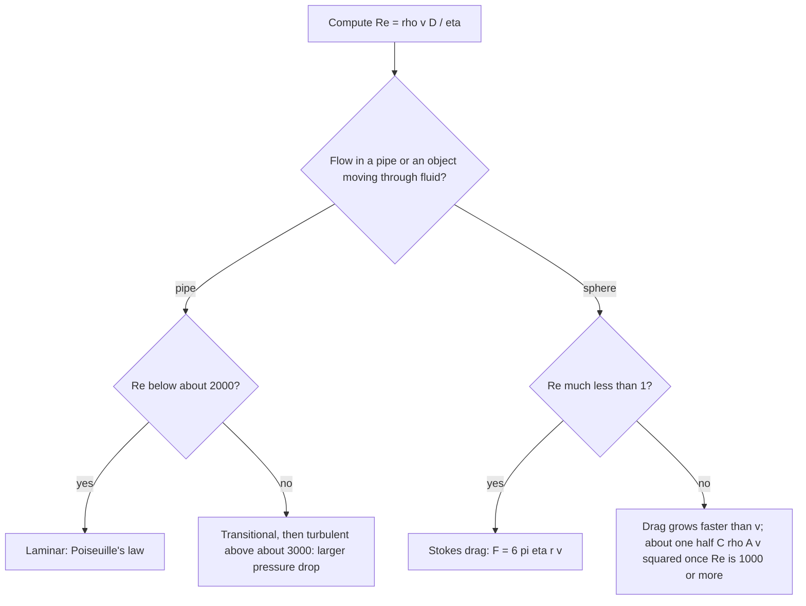

## Beyond the ideal fluid

The fluid-flow lesson assumed an ideal fluid, with no internal friction, and then mentioned viscosity and Poiseuille's law in a single paragraph. This lesson takes viscosity seriously. It defines the viscosity coefficient, derives Poiseuille's law and the parabolic velocity profile from Newton's second law, introduces the Reynolds number that decides whether a flow is smooth or turbulent, and derives the slow-motion drag on a sphere. That drag connects back to the friction lesson, which assumed a drag force $F = bv$ without saying where $b$ comes from.

## What viscosity measures

Put a thin layer of fluid between two large plates a distance $d$ apart and slide the top plate at speed $v$ while the bottom one stays still. The fluid touching each plate moves with it (the **no-slip condition**), and the layers in between slide over one another, each a little faster than the one below. Keeping the top plate moving takes a force proportional to its area $A$ and to the speed gradient:

$$\frac FA = \eta\frac vd, \qquad\text{or in general}\qquad \tau = \eta\frac{dv}{dy}.$$

The force per area $\tau$ is the **shear stress**, and the constant $\eta$ (Greek eta) is the viscosity, in pascal-seconds (Pa·s). Some typical values:

| Fluid | $\eta$ (Pa·s) |
|---|---|
| Air, 20°C | $1.8\times10^{-5}$ |
| Water, 20°C | $1.0\times10^{-3}$ |
| Water, 80°C | $0.35\times10^{-3}$ |
| Blood, 37°C | about $3$–$4\times10^{-3}$ |
| Olive oil, 20°C | about 0.08 |
| Glycerin, 20°C | about 1.4 |

Liquids get much runnier when heated, because their molecules escape their neighbors' attraction more easily. Gases do the opposite: their viscosity rises slowly with temperature, because faster molecules carry momentum between layers more effectively. Fluids that obey $\tau = \eta\,dv/dy$ with a constant $\eta$ are called **Newtonian fluids**; ketchup, paint and blood at low flow rates are not quite Newtonian, and the table's value for blood is only typical.

## Poiseuille flow in a pipe

Consider steady, smooth flow through a straight pipe of radius $R$ and length $L$, driven by a pressure difference $\Delta P$ between its ends. Take a cylinder of fluid of radius $r$ centered on the axis. The pressure difference pushes it forward with force $\Delta P\,\pi r^2$. The slower fluid outside it drags back on its curved surface, of area $2\pi rL$, with viscous force $\eta\left|\dfrac{dv}{dr}\right|2\pi rL$. The flow is steady, so the fluid isn't accelerating and the two forces balance:

$$\Delta P\,\pi r^2 = -\eta\frac{dv}{dr}2\pi rL \quad\Rightarrow\quad \frac{dv}{dr} = -\frac{\Delta P}{2\eta L}r.$$

Integrate with the no-slip condition $v(R) = 0$:

$$v(r) = \frac{\Delta P}{4\eta L}\left(R^2 - r^2\right).$$

The speed is greatest on the axis and falls to zero at the wall along a parabola. Adding up the flow through thin rings of area $2\pi r\,dr$,

$$Q = \int_0^R v(r)\,2\pi r\,dr = \frac{\pi R^4\,\Delta P}{8\eta L},$$

which is **Poiseuille's law**. The average speed $Q/(\pi R^2)$ works out to exactly half the speed on the axis.

The $R^4$ dominates everything. Writing Poiseuille's law as $\Delta P = Q\,\dfrac{8\eta L}{\pi R^4}$ shows a **flow resistance** $8\eta L/(\pi R^4)$: halve the radius and the resistance rises by a factor of 16. That is why small narrowings of blood vessels matter so much, and why a long, thin needle is hard to push fluid through.

### Example 1

Water ($\eta = 1.0\times10^{-3}$ Pa·s) is pushed through a 2.5 cm long hypodermic needle at 1.0 mL every 10 s. What pressure difference is needed if the needle's inner radius is 0.20 mm? If it is 0.10 mm? What force does each need on a plunger 1.0 cm in diameter? (Treat the flow as laminar Poiseuille flow along the whole needle, and ignore the small pressure drop in the syringe barrel.)

$Q = 1.0\times10^{-6}\text{ m}^3/10\text{ s} = 1.0\times10^{-7}$ m³/s.

For $R = 0.20$ mm: $\Delta P = \dfrac{8\eta LQ}{\pi R^4} = \dfrac{8(1.0\times10^{-3})(0.025)(1.0\times10^{-7})}{\pi(2.0\times10^{-4})^4} = 3.98\times10^3$ Pa, about 0.04 atm. The plunger area is $\pi(0.0050)^2 = 7.85\times10^{-5}$ m², so the force is $(3.98\times10^3)(7.85\times10^{-5}) = 0.31$ N.

For $R = 0.10$ mm: halving the radius multiplies $\Delta P$ by $2^4 = 16$, giving $6.4\times10^4$ Pa and a force of 5.0 N.

## Laminar or turbulent: the Reynolds number

Poiseuille's law describes **laminar flow**, in which layers slide smoothly past one another. Speed up the flow and it eventually becomes **turbulent**: chaotic, full of eddies, and much harder to push. Which one you get depends on a single dimensionless combination, the **Reynolds number**

$$\text{Re} = \frac{\rho vD}{\eta},$$

where $v$ is the average flow speed and $D$ is a typical size (the diameter, for a pipe or a sphere). Re compares inertial effects ($\rho v^2$, the momentum flux that tends to make disturbances grow) with viscous effects ($\eta v/D$, the internal friction that smooths them out).

For flow in a round pipe, Re below about 2000 gives laminar flow and Re above about 3000 is usually turbulent; in between the flow can switch back and forth. These thresholds are approximate: in very smooth, carefully undisturbed pipes laminar flow has been kept to much higher Re.

### Example 2

(a) Water flows at an average 1.0 m/s through a household pipe of diameter 1.5 cm. Is the flow laminar? (b) Check the 0.10 mm needle of Example 1.

(a) $\text{Re} = \dfrac{1000(1.0)(0.015)}{1.0\times10^{-3}} = 15\,000$: turbulent. For laminar flow in this pipe the speed would have to stay below about $2000\eta/(\rho D) = 0.13$ m/s. Poiseuille's law badly underestimates the pressure drop in ordinary plumbing.

(b) The average speed is $Q/(\pi R^2) = 1.0\times10^{-7}/(\pi(1.0\times10^{-4})^2) = 3.2$ m/s, and $D = 0.20$ mm, so $\text{Re} = \dfrac{1000(3.2)(2.0\times10^{-4})}{1.0\times10^{-3}} = 640$. Laminar, so using Poiseuille's law was justified.

## Drag on a slow sphere: Stokes' law

When a sphere of radius $r$ moves slowly through a fluid, with $\text{Re} \ll 1$, the drag force is

$$F = 6\pi\eta rv,$$

**Stokes' law** (George Stokes, 1851). The derivation solves the full equations of viscous flow around the sphere, which is beyond this course, but dimensional analysis already shows that slow, viscosity-dominated drag must be $\eta rv$ times a pure number; the hard part is the 6π. This is the linear drag $F = bv$ of the friction lesson, with $b = 6\pi\eta r$.

A sphere of density $\rho_s$ sinking through a fluid of density $\rho_f$ feels its weight, the buoyant force from the fluid-statics lesson, and the drag. At terminal velocity they balance: $\tfrac43\pi r^3(\rho_s - \rho_f)g = 6\pi\eta rv_t$, so

$$v_t = \frac{2r^2(\rho_s - \rho_f)g}{9\eta}.$$

The $r^2$ explains why fine particles stay suspended so long: muddy water clears in hours or days, not seconds. Robert Millikan used Stokes' law in his oil-drop experiment (published 1909–1913) to find the size of tiny charged droplets from their fall speed through air. Turned around, timing a ball falling through a liquid measures the liquid's viscosity: this is the **falling-ball viscometer**.

Stokes' law fails once Re reaches about 1. For fast, large objects (Re of roughly a thousand or more) drag is close to $\tfrac12C\rho Av^2$ with a drag coefficient $C$ near 0.5 for a sphere, the quadratic drag of the friction lesson.

### Example 3

(a) A silt grain of radius 10 μm and density 2650 kg/m³ settles in still water at 20°C. Find its terminal speed, check Stokes' law, and find how long it takes to sink 1.0 m. (b) Would Stokes' law work for a sand grain of radius 0.10 mm?

(a) $v_t = \dfrac{2(1.0\times10^{-5})^2(2650 - 1000)(9.8)}{9(1.0\times10^{-3})} = 3.6\times10^{-4}$ m/s, about 0.36 mm/s.

Check: $\text{Re} = \dfrac{1000(3.6\times10^{-4})(2.0\times10^{-5})}{1.0\times10^{-3}} = 0.0072 \ll 1$, so Stokes' law applies. Sinking 1.0 m takes $1.0/(3.6\times10^{-4}) = 2.8\times10^3$ s, about 46 minutes.

(b) Ten times the radius gives $10^2 = 100$ times the speed by the formula, 3.6 cm/s, and $\text{Re} = 1000(0.036)(2.0\times10^{-4})/(1.0\times10^{-3}) = 7.2$. That is above 1, so Stokes' law overestimates the speed; the real grain falls more slowly because drag grows faster than linearly at this Re.

## Common mistakes

- Using the radius where the diameter belongs in Re (or the reverse). For pipes and spheres, Re conventionally uses the diameter; Poiseuille's and Stokes' laws use the radius.
- Forgetting how strongly Poiseuille's law depends on radius: $R^4$, not $R^2$.
- Applying Poiseuille's law to turbulent flow, or Stokes' law when Re is not small. Always check Re.
- Leaving out buoyancy in the terminal-velocity balance: the formula has $\rho_s - \rho_f$, not $\rho_s$.
- Thinking the fluid at a pipe wall moves at the average speed. It is at rest (no slip).

## Key points

- Viscosity: $\tau = \eta\,dv/dy$; units Pa·s; liquids get less viscous when heated, gases more.
- Laminar pipe flow: $v(r) = \dfrac{\Delta P}{4\eta L}(R^2 - r^2)$, parabolic; Poiseuille $Q = \dfrac{\pi R^4\Delta P}{8\eta L}$; average speed is half the maximum.
- Reynolds number $\text{Re} = \rho vD/\eta$; pipes: laminar below about 2000, usually turbulent above about 3000.
- Stokes drag $F = 6\pi\eta rv$ for $\text{Re} \ll 1$; terminal speed $v_t = 2r^2(\rho_s - \rho_f)g/(9\eta)$.
- Fast, large objects: drag $\approx \tfrac12C\rho Av^2$.
