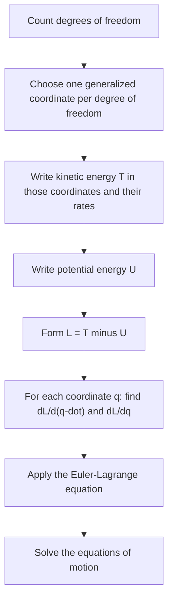

This module rebuilds mechanics from energy instead of force. In the core course you solved problems with $\sum\vec F = m\vec a$: draw a free-body diagram, pick axes, write one equation per object, and eliminate forces you never wanted, like the tension in an Atwood machine string (lesson 09) or the pull of a pendulum string (lesson 20). You also met the idea that a conservative force comes from a potential energy, $F = -dU/dx$ (lesson 12). Lagrangian mechanics turns that idea into a complete method. You write down two scalar energies, apply one rule, and the equations of motion come out, with the unwanted constraint forces never appearing. It is the starting point of every advanced mechanics course and of quantum mechanics and field theory, so this lesson is worth taking slowly.

## Coordinates that respect the constraints

A pendulum bob moves in a plane, so you might describe it with $x$ and $y$. But the rod forces $x^2 + y^2 = \ell^2$ at every instant, so the two numbers are not independent: once you know the angle $\theta$ from the vertical, you know where the bob is. A condition like this, which limits the possible positions, is a **constraint**. The number of independent quantities needed to specify the configuration is the number of **degrees of freedom**: one for the pendulum, one for an Atwood machine (if one block goes down by $x$, the other goes up by $x$), two for a puck sliding on a table, three for a free particle in space.

Any set of independent quantities that fixes the configuration is a set of **generalized coordinates**, usually written $q_1, q_2, \ldots$. They don't have to be lengths: the pendulum's coordinate is an angle, and for a planet you will use $r$ and an angle. Choosing them well is most of the work, and the rule is simple: one coordinate per degree of freedom, chosen so the constraints are satisfied automatically.

## The Lagrangian and the action

For a system whose forces come from a potential energy, define the **Lagrangian** as kinetic minus potential energy, written in the generalized coordinates and their time derivatives $\dot q = dq/dt$:

$$L(q, \dot q, t) = T - U.$$

(Advanced texts use $T$ for kinetic energy so that $K$ is free for other jobs; this module follows them.) Note the minus sign: $L$ is *not* the total energy.

Now imagine every path $q(t)$ the system *could* take from a given starting configuration at time $t_1$ to a given final one at $t_2$. Each path gets a number, its **action**,

$$S = \int_{t_1}^{t_2} L\,dt,$$

with units of energy × time (J·s). The **principle of stationary action**, also called Hamilton's principle, says that the path the system actually follows is the one for which $S$ is stationary: changing the path slightly, with the endpoints held fixed, leaves $S$ unchanged to first order. It is often called the principle of *least* action, and for short time intervals the true path does give a minimum, but in general it can be a saddle point, so "stationary" is the accurate word.

This is a different way of asking a mechanics question. Newton's laws are local: given the state now, they tell you the acceleration now. The action principle looks at the whole path at once, the way Fermat's principle picks out the path of a light ray as the one of stationary travel time.

## The Euler–Lagrange equation

Which path makes $S$ stationary? Take the true path $q(t)$ and nudge it to $q(t) + \varepsilon\eta(t)$, where $\eta$ is any smooth function with $\eta(t_1) = \eta(t_2) = 0$ (fixed endpoints) and $\varepsilon$ is small. To first order in $\varepsilon$,

$$\delta S = \varepsilon\int_{t_1}^{t_2}\left(\frac{\partial L}{\partial q}\,\eta + \frac{\partial L}{\partial \dot q}\,\dot\eta\right)dt.$$

Integrate the second term by parts. The boundary term $\left[\frac{\partial L}{\partial \dot q}\eta\right]_{t_1}^{t_2}$ vanishes because $\eta$ is zero at both ends, leaving

$$\delta S = \varepsilon\int_{t_1}^{t_2}\left(\frac{\partial L}{\partial q} - \frac{d}{dt}\frac{\partial L}{\partial \dot q}\right)\eta\,dt.$$

For $\delta S$ to be zero for *every* choice of $\eta$, the bracket must be zero at every instant. That gives the **Euler–Lagrange equation**, one for each generalized coordinate:

$$\frac{d}{dt}\left(\frac{\partial L}{\partial \dot q}\right) - \frac{\partial L}{\partial q} = 0.$$

The partial derivatives treat $q$ and $\dot q$ as independent variables: when you take $\partial L/\partial\dot q$, you hold $q$ fixed, and vice versa. Only *after* that do you take the full time derivative $d/dt$, which acts on everything that changes along the path.

**Check against Newton.** For one particle on a line, $L = \tfrac12m\dot x^2 - U(x)$. Then $\partial L/\partial\dot x = m\dot x$ and $\partial L/\partial x = -dU/dx$, so the Euler–Lagrange equation reads $m\ddot x + dU/dx = 0$, that is, $m\ddot x = -dU/dx = F$. Newton's second law comes out. Nothing new has been assumed for this case; the payoff comes when the coordinates are not plain Cartesian ones.

## The recipe

The hard step is usually writing $T$: express each object's velocity in terms of the generalized coordinates *before* squaring it. Constraint forces (tensions, normal forces) do no work when the constraints are fixed in time, so they never enter $T$ or $U$, and so they never appear in the equations.

### Example 1: the simple pendulum

A bob of mass $m$ hangs on a light rigid rod of length $\ell$. Find the equation of motion and the small-oscillation period.

*Coordinate.* One degree of freedom; use the angle $\theta$ from the vertical.

*Energies.* The bob moves on a circle of radius $\ell$, so its speed is $\ell\dot\theta$ and $T = \tfrac12m\ell^2\dot\theta^2$. Measuring height from the pivot, the bob is at $y = -\ell\cos\theta$, so $U = -mg\ell\cos\theta$.

*Lagrangian.* $L = \tfrac12m\ell^2\dot\theta^2 + mg\ell\cos\theta$.

*Derivatives.* $\dfrac{\partial L}{\partial\dot\theta} = m\ell^2\dot\theta$, so $\dfrac{d}{dt}\dfrac{\partial L}{\partial\dot\theta} = m\ell^2\ddot\theta$. And $\dfrac{\partial L}{\partial\theta} = -mg\ell\sin\theta$.

*Equation of motion.* $m\ell^2\ddot\theta + mg\ell\sin\theta = 0$, so

$$\ddot\theta = -\frac{g}{\ell}\sin\theta.$$

For small angles, $\sin\theta \approx \theta$ (in radians), giving simple harmonic motion with $\omega = \sqrt{g/\ell}$ and $T_{\text{period}} = 2\pi\sqrt{\ell/g}$, the result of lesson 20. Here it took four lines and no free-body diagram; the rod's tension never appeared.

### Example 2: an Atwood machine with a massive pulley

Blocks of mass $m_1 = 3.0$ kg and $m_2 = 2.0$ kg hang on either side of a string over a pulley that is a uniform disk of mass $M = 2.0$ kg and radius $R$. The string does not slip. Find the acceleration.

*Coordinate.* One degree of freedom: let $x$ be the distance $m_1$ has moved down. Then $m_2$ has moved up by $x$, both blocks have speed $\dot x$, and the pulley turns with $\omega = \dot x/R$.

*Energies.* $T = \tfrac12m_1\dot x^2 + \tfrac12m_2\dot x^2 + \tfrac12\left(\tfrac12MR^2\right)\left(\dfrac{\dot x}{R}\right)^2 = \tfrac12\left(m_1 + m_2 + \tfrac12M\right)\dot x^2$. The radius cancels. For the potential energy, $m_1$ drops and $m_2$ rises: $U = -m_1gx + m_2gx + \text{const}$.

*Euler–Lagrange.* $\dfrac{\partial L}{\partial\dot x} = \left(m_1 + m_2 + \tfrac12M\right)\dot x$ and $\dfrac{\partial L}{\partial x} = (m_1 - m_2)g$, so

$$a = \ddot x = \frac{(m_1 - m_2)g}{m_1 + m_2 + \tfrac12M} = \frac{(1.0)(9.8)}{6.0} = 1.63\text{ m/s}^2.$$

With a massless pulley the denominator would be 5.0 kg and $a = 1.96$ m/s²; the pulley's rotational inertia acts like an extra 1.0 kg of mass that has to be accelerated. The Newtonian solution (lesson 16) needs three equations and two different tensions; here neither tension appears. If you *want* a tension, go back to Newton for one block: the string pulls up on $m_1$ with $m_1(g - a) = 3.0(9.8 - 1.63) = 24.5$ N. (In this module $T$ means kinetic energy, so tensions get no symbol of their own here.)

### Example 3: a physical pendulum

A uniform rod of mass $m$ and length $\ell$ swings about a pivot at one end. Its moment of inertia about that end is $\tfrac13m\ell^2$, and its center of mass is $\ell/2$ below the pivot when it hangs straight down. With $\theta$ as the coordinate, $T = \tfrac12\left(\tfrac13m\ell^2\right)\dot\theta^2$ and $U = -mg\tfrac{\ell}{2}\cos\theta$. The Euler–Lagrange equation gives $\tfrac13m\ell^2\ddot\theta = -\tfrac12mg\ell\sin\theta$, so for small angles

$$\omega = \sqrt{\frac{3g}{2\ell}}.$$

For $\ell = 0.90$ m, $\omega = 4.04$ rad/s and the period is $2\pi/\omega = 1.55$ s, shorter than the 1.90 s of a simple pendulum of the same length, because the rod's mass is on average closer to the pivot.

## When to use it, and its limits

Lagrangian mechanics shines when constraints make Cartesian coordinates awkward: pendulums, beads on wires, rolling objects, coupled oscillators, and orbits in polar coordinates (lesson 92). It also handles several degrees of freedom at once: you get one Euler–Lagrange equation per coordinate, and they come out coupled correctly with no sign bookkeeping for forces.

It is less convenient in two situations, and this lesson's version is simplified for both.

- **You need a constraint force.** The method hides tensions and normal forces. You can recover them with Newton's law afterward, or with an extension called Lagrange multipliers.
- **Forces that don't come from a potential**, like kinetic friction or air drag. The basic form $L = T - U$ assumes conservative forces (and constraints that do no work). The full theory adds "generalized forces" on the right-hand side of the Euler–Lagrange equation for such cases; that is beyond this module.

For problems that fit, though, the method is not a trick that happens to agree with Newton. For conservative systems with workless constraints, it is an equivalent formulation of the same physics, and it carries over to quantum mechanics and field theory, where forces are not the natural language.

## Common mistakes

- Writing $L = T + U$. The Lagrangian is $T - U$; the total energy $T + U$ is a different quantity.
- Writing $T$ with the wrong speed, for example $\tfrac12m\dot\theta^2$ for a pendulum. Convert to a real speed first ($v = \ell\dot\theta$), then square.
- Taking $\partial L/\partial\theta$ while treating $\dot\theta$ as depending on $\theta$. In the partial derivatives, $q$ and $\dot q$ are independent; only $d/dt$ acts along the path.
- Forgetting the time derivative: the first term is $\frac{d}{dt}\left(\frac{\partial L}{\partial\dot q}\right)$, not $\frac{\partial L}{\partial\dot q}$.
- Using more coordinates than degrees of freedom without constraint equations (for example $x_1$ and $x_2$ for an Atwood machine as if they were independent).
- Expecting the tension to come out of the equations. Constraint forces that do no work never appear.
- Calling the true path the one of *least* action in every case. It is stationary; it need not be a minimum.

## Key points

- Generalized coordinates: one per degree of freedom, chosen so the constraints hold automatically.
- $L = T - U$; action $S = \int L\,dt$; the true path makes $S$ stationary (Hamilton's principle).
- Euler–Lagrange equation for each coordinate: $\frac{d}{dt}\left(\frac{\partial L}{\partial\dot q}\right) = \frac{\partial L}{\partial q}$.
- For $L = \tfrac12m\dot x^2 - U(x)$ it gives $m\ddot x = -dU/dx$: Newton's second law.
- Pendulum: $\ddot\theta = -(g/\ell)\sin\theta$; Atwood with disk pulley: $a = (m_1 - m_2)g/(m_1 + m_2 + \tfrac12M)$.
- Workless constraint forces never appear; friction and drag need an extension (generalized forces).
