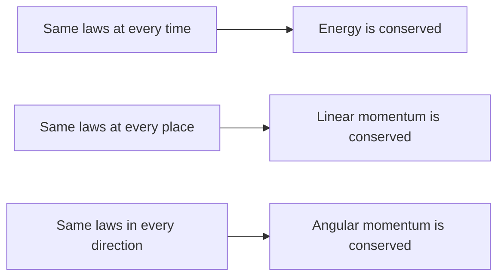

The core course treated conservation of energy (lesson 12), of momentum (lesson 13) and of angular momentum (lesson 17) as three separate discoveries, each with its own conditions: no nonconservative work, no external force, no external torque. The Lagrangian from the last lesson shows they are three cases of one idea. A quantity is conserved whenever the Lagrangian doesn't care about some change you could make to the system: shifting it in time, sliding it in space, or turning it. This lesson makes that precise, then introduces the Hamiltonian, a second reformulation of mechanics that describes motion as a flow in a space of positions *and* momenta.

## Generalized momentum

For each generalized coordinate $q$, define its **generalized momentum** (also called the canonical momentum)

$$p = \frac{\partial L}{\partial\dot q}.$$

For a particle on a line, $L = \tfrac12m\dot x^2 - U$ gives $p = m\dot x$, ordinary momentum. For the pendulum of the last lesson, $L = \tfrac12m\ell^2\dot\theta^2 + mg\ell\cos\theta$ gives $p_\theta = m\ell^2\dot\theta$, which is the bob's angular momentum about the pivot ($I\omega$ with $I = m\ell^2$). So the generalized momentum of a length is a momentum, and that of an angle is an angular momentum.

With this definition the Euler–Lagrange equation reads

$$\frac{dp}{dt} = \frac{\partial L}{\partial q},$$

which looks like "rate of change of momentum equals force". The right side is the **generalized force** for that coordinate (for an angle, it's a torque).

## Cyclic coordinates

Now suppose $L$ does not contain some coordinate $q$ at all (it may still contain $\dot q$). Then $\partial L/\partial q = 0$, and the equation above says

$$\frac{dp}{dt} = 0: \quad p \text{ is conserved.}$$

Such a coordinate is called a **cyclic coordinate** (or ignorable coordinate). Spotting cyclic coordinates is the fastest way to find conserved quantities.

The most important example is a particle moving in a plane under a **central force**, one that points toward or away from a fixed center and depends only on the distance $r$. In polar coordinates the velocity has a radial part $\dot r$ and a sideways part $r\dot\varphi$, so

$$L = \tfrac12m\left(\dot r^2 + r^2\dot\varphi^2\right) - U(r).$$

The angle $\varphi$ never appears: rotating the whole picture changes nothing. So $\varphi$ is cyclic and

$$p_\varphi = \frac{\partial L}{\partial\dot\varphi} = mr^2\dot\varphi = \text{constant}.$$

That is the particle's angular momentum about the center. Kepler's second law, equal areas in equal times, follows at once: the area swept per unit time is $\tfrac12r^2\dot\varphi = p_\varphi/(2m)$, a constant. Lesson 92 builds the whole theory of orbits on this.

### Example 1: a puck on a string

A 0.20 kg puck slides on a frictionless table, tied to a string that passes down through a hole at the center. It circles at radius 0.50 m at 2.0 rad/s. Someone below slowly pulls the string until the radius is 0.25 m. Find the new angular speed and the change in kinetic energy.

The string pulls straight toward the hole, so the force is central and the Lagrangian has no $\varphi$ in it (the pulling controls $r$, not $\varphi$). Therefore $mr^2\dot\varphi$ is conserved:

$$\dot\varphi_2 = \dot\varphi_1\left(\frac{r_1}{r_2}\right)^2 = 2.0(2.0)^2 = 8.0\text{ rad/s}.$$

Kinetic energy (all sideways motion once the pulling is slow): $T_1 = \tfrac12(0.20)(0.50)^2(2.0)^2 = 0.10$ J and $T_2 = \tfrac12(0.20)(0.25)^2(8.0)^2 = 0.40$ J. The kinetic energy goes up by 0.30 J. Angular momentum is conserved but energy is not: the 0.30 J is the work done by the person pulling the string. (Equivalently $T = p_\varphi^2/(2mr^2)$, so halving $r$ at fixed $p_\varphi$ quadruples $T$.)

## Noether's theorem

The pattern is general. In 1918 the mathematician Emmy Noether proved what is now called **Noether's theorem**: every continuous symmetry of the action corresponds to a conserved quantity. A *symmetry* here means a change you can make to the system, by any amount, that leaves the Lagrangian (more precisely the action) unchanged. The proof is beyond this lesson; the three cases that matter in mechanics are:

| If the Lagrangian is unchanged by… | then this is conserved | as in |
|---|---|---|
| a shift in time ($L$ has no explicit $t$) | energy | lesson 12 |
| a shift in position (along some direction) | linear momentum (along it) | lesson 13 |
| a rotation (about some axis) | angular momentum (about it) | lesson 17 |



This explains the conditions you learned. Momentum is conserved for an isolated system because empty space is the same everywhere; a nearby planet breaks that symmetry (the potential depends on position), and momentum stops being conserved. In general, when a symmetry is broken, the matching conservation law is lost: gravity singles out the downward direction, so a pendulum is not symmetric under rotation about its pivot, and its angular momentum about the pivot changes as it swings. Noether's theorem is also the reason physicists hunt for symmetries first in every new theory, from electromagnetism to particle physics.

## The Hamiltonian

The conserved quantity from time symmetry deserves a closer look. Define the **Hamiltonian**

$$H = \sum p\,\dot q - L,$$

summed over all the generalized coordinates. One can show that $dH/dt = -\partial L/\partial t$, so if $L$ has no explicit time dependence, $H$ is constant. What is $H$? For a particle on a line,

$$H = (m\dot x)\dot x - \left(\tfrac12m\dot x^2 - U\right) = \tfrac12m\dot x^2 + U = T + U.$$

It's the total energy. This holds generally whenever the constraints don't change with time and $U$ doesn't depend on velocities. When the constraints do move (a bead on a hoop that is spun by a motor at a fixed rate, for example), $H$ can still be conserved but no longer equals $T + U$: the motor does work, so $T + U$ changes while $H$ does not. That case is labeled here and not pursued.

To use $H$ as more than a bookkeeping device, write it as a function of the coordinates and the *momenta* (replace each $\dot q$ using $p = \partial L/\partial\dot q$). Then the motion follows from **Hamilton's equations**:

$$\dot q = \frac{\partial H}{\partial p}, \qquad \dot p = -\frac{\partial H}{\partial q}.$$

One second-order equation per coordinate has become two first-order ones. That is the form used in statistical mechanics, in numerical orbit integrators and in quantum mechanics.

### Example 2: the harmonic oscillator in phase space

A 0.50 kg mass on a spring with $k = 200$ N/m has total energy 4.0 J. In terms of $x$ and $p = m\dot x$,

$$H = \frac{p^2}{2m} + \tfrac12kx^2.$$

Hamilton's equations give $\dot x = \partial H/\partial p = p/m$ (the definition of momentum) and $\dot p = -\partial H/\partial x = -kx$ (Hooke's law). Together, $m\ddot x = -kx$, with $\omega = \sqrt{k/m} = \sqrt{400} = 20$ rad/s.

Since $H = E$ is constant, the point $(x, p)$ stays on the curve $\dfrac{p^2}{2mE} + \dfrac{x^2}{2E/k} = 1$, an ellipse. Its semi-axes are the amplitude $x_{\max} = \sqrt{2E/k} = \sqrt{8.0/200} = 0.20$ m (where $p = 0$) and the largest momentum $p_{\max} = \sqrt{2mE} = \sqrt{4.0} = 2.0$ kg·m/s (at $x = 0$). The state goes once around the ellipse each period, clockwise when $x$ is plotted across and $p$ up. The ellipse's area is $\pi x_{\max}p_{\max} = 1.26$ J·s, which equals $2\pi E/\omega$: a higher energy means a bigger ellipse.

## Phase space

The plane of $(q, p)$, or for several coordinates the space of all positions and momenta together, is called **phase space**. A single point in it is the complete state of the system: given it, Hamilton's equations fix the whole future. Drawing the paths for many starting states gives a **phase portrait**. When $H$ doesn't depend on time, paths in phase space never cross, because one state can't have two different futures.

The pendulum shows what phase portraits are good for. Its Hamiltonian is $H = \dfrac{p_\theta^2}{2m\ell^2} - mg\ell\cos\theta$. Small energies give closed loops around $\theta = 0$: the pendulum swings back and forth (libration). Large energies give wavy lines that never turn back: the pendulum goes over the top and keeps rotating. The boundary between the two, at exactly the energy needed to reach the top with zero speed, is the **separatrix**. It passes through the unstable equilibrium at $\theta = \pm\pi$ (balanced upside down).

```plot
{"x": [-4, 4], "y": [-3.2, 3.2], "xLabel": "θ (rad)", "yLabel": "dθ/dt (units of √(g/ℓ))", "functions": [{"f": "sqrt(2*(cos(x) - cos(1)))", "from": -1, "to": 1, "color": "#2c5d8a"}, {"f": "-sqrt(2*(cos(x) - cos(1)))", "from": -1, "to": 1, "color": "#2c5d8a"}, {"f": "sqrt(2*(cos(x) - cos(2.2)))", "from": -2.2, "to": 2.2, "color": "#2c5d8a"}, {"f": "-sqrt(2*(cos(x) - cos(2.2)))", "from": -2.2, "to": 2.2, "color": "#2c5d8a"}, {"f": "2*cos(x/2)", "from": -3.1416, "to": 3.1416, "dashed": true, "color": "#c0392b"}, {"f": "-2*cos(x/2)", "from": -3.1416, "to": 3.1416, "dashed": true, "color": "#c0392b"}, {"f": "sqrt(2*(cos(x) + 1.6))", "color": "#1e8449"}, {"f": "-sqrt(2*(cos(x) + 1.6))", "color": "#1e8449"}], "points": [[0, 0], {"at": [3.1416, 0], "open": true}, {"at": [-3.1416, 0], "open": true}], "labels": [{"at": [0.5, 0.3], "text": "stable"}, {"at": [3.3, 0.6], "text": "unstable"}, {"at": [-3.0, 1.6], "text": "rotation"}], "caption": "Pendulum phase portrait: closed loops are swings, the dashed separatrix passes through the upside-down equilibrium at θ = ±π, and the outer wavy curves are full rotations"}
```

### Example 3: reaching the separatrix

A pendulum is a small mass on a light *rigid* rod of length 1.0 m. What speed at the bottom puts it exactly on the separatrix?

On the separatrix the pendulum arrives at the top ($\theta = \pi$) with zero speed. Energy from bottom to top: $\tfrac12mv^2 - mg\ell = 0 + mg\ell$, so

$$v = \sqrt{4g\ell} = \sqrt{4(9.8)(1.0)} = 6.26\text{ m/s}.$$

Any faster and the motion is a rotation; any slower and it's a swing. (If the bob were on a *string*, it would need more, $\sqrt{5g\ell} = 7.0$ m/s, because a string goes slack unless the tension stays positive at the top. The Lagrangian assumed a rod, and the answer depends on that constraint.)

Phase space has one more remarkable property, stated here without proof: under Hamilton's equations, a patch of starting states moves and changes shape, but its area (volume, with more coordinates) stays the same. This is Liouville's theorem, and it is one of the foundations of statistical mechanics.

## Common mistakes

- Assuming generalized momentum always means $m v$. For an angle it is an angular momentum, and in general it is whatever $\partial L/\partial\dot q$ gives.
- Calling a coordinate cyclic when only $\dot q$ is missing. It is cyclic when $q$ itself is absent from $L$; $\dot q$ may appear.
- Concluding that energy is conserved because angular momentum is (the string-and-hole puck gains kinetic energy).
- Writing $H = T - U$ or assuming $H$ is always $T + U$; it is $T + U$ only for fixed constraints and velocity-independent potentials.
- Using Hamilton's equations with $H$ still written in terms of $\dot q$ instead of $p$.
- Getting the sign wrong: $\dot p = -\partial H/\partial q$, $\dot q = +\partial H/\partial p$.

## Key points

- Generalized momentum $p = \partial L/\partial\dot q$; Euler–Lagrange becomes $\dot p = \partial L/\partial q$.
- If $q$ is absent from $L$ (cyclic), $p$ is conserved. Central force: $mr^2\dot\varphi$ is conserved, which gives Kepler's second law.
- Noether: continuous symmetry ↔ conserved quantity (time → energy, space → momentum, rotation → angular momentum).
- $H = \sum p\dot q - L$, conserved when $L$ has no explicit $t$; equals $T + U$ for fixed constraints.
- Hamilton's equations: $\dot q = \partial H/\partial p$, $\dot p = -\partial H/\partial q$.
- Phase space: each point is a full state; oscillator paths are ellipses; the pendulum's separatrix divides swings from rotations.
