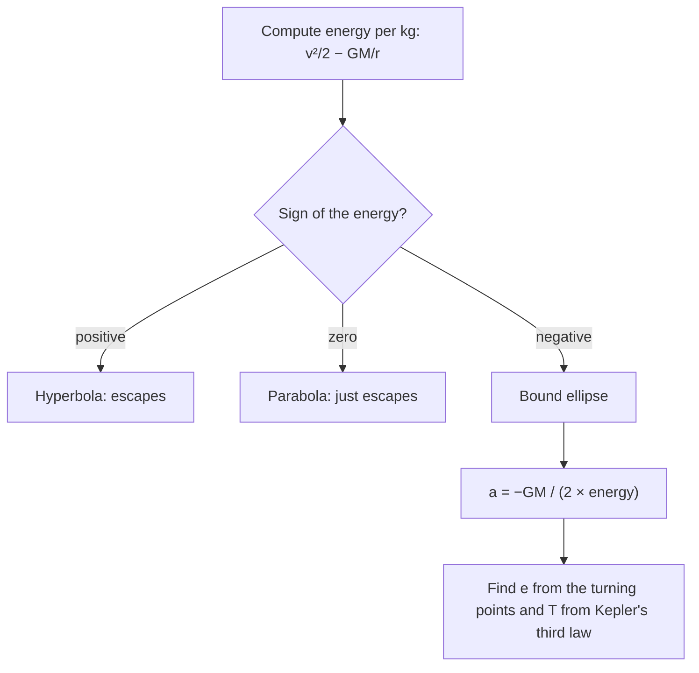

Lesson 19 stated Kepler's three laws and proved the third one only for circular orbits. It also claimed that inverse-square forces produce ellipses, without showing why. This lesson closes that gap with the tools of this module. Finding the motion of two bodies attracting each other by gravity is called the **Kepler problem**. You will reduce it to one body, use the two conserved quantities from lesson 91 (energy and angular momentum) to turn it into a one-dimensional problem, and then solve for the exact shape of the orbit. The results (ellipses, the energy–size relation, the vis-viva equation) are the working tools of orbital mechanics, which the last lesson of the module puts to use.

## From two bodies to one

A planet and a star both move: each pulls the other. Let them have masses $m_1$ and $m_2$, and let $\vec r = \vec r_1 - \vec r_2$ be the vector from one to the other. Rewriting the kinetic energy in terms of the center-of-mass velocity $\vec V$ and the relative velocity $\dot{\vec r}$ gives

$$L = \tfrac12(m_1 + m_2)V^2 + \tfrac12\mu\,\dot{\vec r}^{\,2} - U(r), \qquad \mu = \frac{m_1m_2}{m_1 + m_2}.$$

The center-of-mass position doesn't appear in $L$, so it is cyclic and the center of mass moves at constant velocity (lesson 91). What is left is the motion of a single fictitious particle of mass $\mu$, the **reduced mass**, in the potential $U(r)$. When one body is much heavier, $\mu$ is almost the lighter mass: for Earth and the Sun, $\mu$ is smaller than Earth's mass by only 3 parts in a million. From here on we treat the heavy body as fixed and call the orbiting mass $m$; for exact work, replace $m$ with $\mu$ and $GM$ with $G(m_1 + m_2)$.

## A one-dimensional problem in disguise

Gravity is a central force, so (lesson 91) the angular momentum $\ell = mr^2\dot\varphi$ is conserved. (In this lesson $\ell$ is angular momentum, not a length.) Its direction is fixed too, so the motion stays in one plane. The energy is

$$E = \tfrac12m\dot r^2 + \tfrac12mr^2\dot\varphi^2 - \frac{GMm}{r} = \tfrac12m\dot r^2 + \underbrace{\frac{\ell^2}{2mr^2} - \frac{GMm}{r}}_{U_{\text{eff}}(r)}.$$

The sideways kinetic energy has been rewritten with $\dot\varphi = \ell/(mr^2)$. What remains looks exactly like a particle moving on a line with kinetic energy $\tfrac12m\dot r^2$ in a potential called the **effective potential**

$$U_{\text{eff}}(r) = \frac{\ell^2}{2mr^2} - \frac{GMm}{r}.$$

The first term, the centrifugal barrier, grows fast as $r \to 0$ and keeps an orbiting body with any angular momentum from falling into the center. The second is gravity. Reading the graph works like the energy diagrams of lesson 12: the body can only be where $E \ge U_{\text{eff}}$, and it turns around in $r$ where $E = U_{\text{eff}}$.

```plot
{"x": [0, 6], "y": [-1.3, 1.2], "xLabel": "r (circular-orbit radius = 1)", "yLabel": "U_eff (scaled)", "functions": [{"f": "1/x^2 - 2/x", "from": 0.3, "to": 6, "color": "#2c5d8a"}], "segments": [{"from": [0.612, -0.6], "to": [2.72, -0.6], "color": "#c0392b"}, {"from": [0.467, 0.3], "to": [6, 0.3], "color": "#1e8449"}], "points": [[1, -1], [0.612, -0.6], [2.72, -0.6], [0.467, 0.3]], "labels": [{"at": [1.5, -1.12], "text": "circle"}, {"at": [1.7, -0.45], "text": "ellipse (E < 0)"}, {"at": [3.6, 0.45], "text": "hyperbola (E > 0)"}], "caption": "Effective potential: an orbit with E < 0 is trapped between two turning points (an ellipse), the minimum is a circular orbit, and E ≥ 0 escapes"}
```

- **$E$ at the minimum of $U_{\text{eff}}$:** $r$ can't change, so the orbit is a circle.
- **$U_{\text{min}} < E < 0$:** $r$ oscillates between two turning points, the closest and farthest distances. The orbit is bound.
- **$E \ge 0$:** only an inner turning point; the body comes in once and leaves for good (an unbound orbit).

## The shape of the orbit

The energy picture gives the range of $r$ but not the shape. For that, use the radial Euler–Lagrange equation from $L = \tfrac12m(\dot r^2 + r^2\dot\varphi^2) + GMm/r$:

$$m\ddot r - mr\dot\varphi^2 = -\frac{GMm}{r^2}.$$

The trick (due to Binet) is to describe the orbit by $u = 1/r$ as a function of the angle $\varphi$ instead of time. Using $\dot\varphi = \ell u^2/m$ and the chain rule, $\dot r = -\dfrac{\ell}{m}\dfrac{du}{d\varphi}$ and $\ddot r = -\dfrac{\ell^2u^2}{m^2}\dfrac{d^2u}{d\varphi^2}$. Substituting and dividing by $-\ell^2u^2/m$ gives the **orbit equation**

$$\frac{d^2u}{d\varphi^2} + u = \frac{GMm^2}{\ell^2}.$$

This is the harmonic-oscillator equation with a constant on the right, and its general solution is a constant plus a cosine. Choosing $\varphi = 0$ at the closest point,

$$r(\varphi) = \frac{p}{1 + e\cos\varphi}, \qquad p = \frac{\ell^2}{GMm^2}.$$

This is the polar equation of a **conic section** with the attracting body at a focus. The number $e \ge 0$ is the **eccentricity**, and it sorts the orbits:

| Eccentricity | Orbit | Energy |
|---|---|---|
| $e = 0$ | circle | $E = U_{\text{min}}$ |
| $0 < e < 1$ | ellipse | $E < 0$ |
| $e = 1$ | parabola | $E = 0$ |
| $e > 1$ | one branch of a hyperbola | $E > 0$ |

Kepler's first law is now a theorem. The orbit closes on itself because the cosine has period $2\pi$, the same as the angle. That is special to the inverse-square law (and to the spring force $F \propto r$, a result called Bertrand's theorem). Under any other power law, bound orbits generally don't close, and the ellipse slowly turns. Real planetary orbits do precess slightly, because of the other planets and, for Mercury, a further 43 arcseconds per century that Newtonian gravity can't account for and general relativity does.

## Ellipse geometry and energy


For an ellipse, half the long axis is the **semimajor axis** $a$. The closest point to the focus is the **periapsis** and the farthest is the **apoapsis** (perigee and apogee for Earth orbits, perihelion and aphelion for orbits of the Sun). Setting $\varphi = 0$ and $\varphi = \pi$ in the orbit equation:

$$r_p = a(1 - e), \qquad r_a = a(1 + e), \qquad\text{so}\quad a = \frac{r_p + r_a}{2},\quad e = \frac{r_a - r_p}{r_a + r_p}.$$

The energy depends only on $a$. At the turning points $\dot r = 0$, so $E = U_{\text{eff}}(r)$ there; both $r_p$ and $r_a$ are roots of $Er^2 + GMmr - \ell^2/(2m) = 0$, and their sum is $-GMm/E$. Since the sum is $2a$,

$$E = -\frac{GMm}{2a}.$$

For a circle this is the $-GMm/(2r)$ of lesson 19. Putting $E = \tfrac12mv^2 - GMm/r$ gives the speed anywhere on the orbit, the **vis-viva equation**:

$$v^2 = GM\left(\frac{2}{r} - \frac{1}{a}\right).$$

**Kepler's second and third laws.** The area swept per unit time is $\tfrac12r^2\dot\varphi = \ell/(2m)$, constant (the second law). Over one period the whole ellipse is swept, area $\pi ab$ with $b = a\sqrt{1 - e^2}$, so $T = 2\pi abm/\ell$. Using $\ell^2/m^2 = GMp$ and $p = a(1 - e^2)$ for an ellipse,

$$T^2 = \frac{4\pi^2}{GM}a^3,$$

the third law, now proved for ellipses: the period depends only on the semimajor axis, not on the eccentricity.

### Example 1: Halley's comet

Halley's comet comes within about 0.586 AU of the Sun and goes out to about 35.1 AU (1 AU is Earth's mean distance from the Sun). Find $a$, $e$, the period, and the ratio of its fastest to slowest speed.

$a = \tfrac12(0.586 + 35.1) = 17.8$ AU and $e = \dfrac{35.1 - 0.586}{35.1 + 0.586} = 0.967$.

Kepler's third law as a ratio to Earth's orbit ($a = 1$ AU, $T = 1$ yr): $T = 17.8^{3/2} = 75.4$ yr. The observed period varies between about 74 and 79 years because the planets tug on the comet, so this is a good average.

At periapsis and apoapsis the velocity is perpendicular to $\vec r$, so $\ell = mr_pv_p = mr_av_a$ and $v_p/v_a = r_a/r_p = 35.1/0.586 = 59.9$. The comet moves about 60 times faster near the Sun than at its far point.

### Example 2: an elliptical Earth orbit

A satellite's orbit comes within 7000 km of Earth's center and goes out to 10 000 km. Using $GM_E = 3.98\times10^{14}$ m³/s² (from the course's $G$ and $M_E$), find $e$, the speeds at perigee and apogee, and the period.

$a = 8500$ km $= 8.50\times10^6$ m; $e = \dfrac{3000}{17\,000} = 0.176$.

Vis-viva at perigee: $v_p^2 = 3.98\times10^{14}\left(\dfrac{2}{7.00\times10^6} - \dfrac{1}{8.50\times10^6}\right) = 6.69\times10^7$ m²/s², so $v_p = 8.18$ km/s. At apogee, $v_a = 5.73$ km/s. Check: $r_pv_p = r_av_a$ gives $7000(8.18) = 57\,300 \approx 10\,000(5.73)$.

Period: $T = 2\pi\sqrt{a^3/GM} = 2\pi\sqrt{(8.50\times10^6)^3/3.98\times10^{14}} = 7.80\times10^3$ s $= 130$ min.

### Example 3: what orbit is this?

A spacecraft 7000 km from Earth's center moves at 8.0 km/s, perpendicular to the line to Earth's center. Describe its orbit.

The energy per kilogram (the **specific orbital energy**) is

$$\varepsilon = \frac{v^2}{2} - \frac{GM}{r} = \frac{(8.0\times10^3)^2}{2} - \frac{3.98\times10^{14}}{7.00\times10^6} = 3.20\times10^7 - 5.69\times10^7 = -2.49\times10^7\text{ J/kg}.$$

It's negative, so the orbit is an ellipse. Its semimajor axis is $a = -GM/(2\varepsilon) = 8.01\times10^6$ m. Because the velocity is perpendicular to $\vec r$, this point is a turning point; it's faster than the circular speed $\sqrt{GM/r} = 7.54$ km/s, so it must be perigee. Then $r_a = 2a - r_p = 9.01\times10^6$ m, about 2600 km above the surface, and $T = 119$ min.



## Common mistakes

- Using altitude instead of distance from the center for $r$, $r_p$ or $r_a$.
- Thinking the central body is at the center of the ellipse. It is at a focus; the center is empty.
- Using $v = \sqrt{GM/r}$ on an elliptical orbit. That's only for circles; use vis-viva.
- Taking the period to depend on eccentricity. At a fixed $a$, every ellipse has the same period.
- Thinking a bound orbit has positive energy because kinetic energy is positive. The total is negative for every closed orbit.
- Mixing units in Kepler's third law: the ratio form needs the same units for both orbits; the full form needs SI.

## Key points

- Two bodies reduce to one of reduced mass $\mu = m_1m_2/(m_1 + m_2)$.
- $U_{\text{eff}} = \dfrac{\ell^2}{2mr^2} - \dfrac{GMm}{r}$: turning points where $E = U_{\text{eff}}$.
- Orbit: $r = \dfrac{p}{1 + e\cos\varphi}$, a conic with the central body at a focus; $e < 1$ bound, $e \ge 1$ unbound.
- $r_p = a(1 - e)$, $r_a = a(1 + e)$; $E = -GMm/(2a)$; vis-viva $v^2 = GM(2/r - 1/a)$.
- $T^2 = 4\pi^2a^3/GM$ for ellipses; $r_pv_p = r_av_a$.
