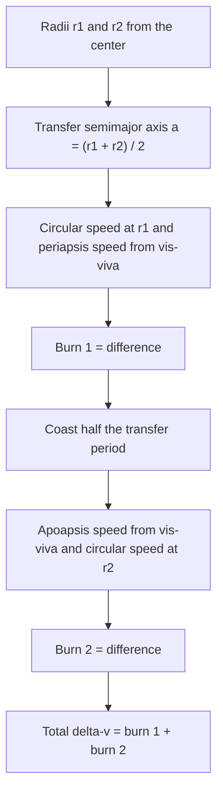

The last lesson described orbits that are already fixed; this one changes them. Every space mission is a chain of orbits joined by rocket burns: from a parking orbit to a higher one, from Earth's orbit around the Sun to Mars's, from a planet's gravity out to interplanetary space. Two results you already have do almost all the work: the vis-viva equation $v^2 = GM(2/r - 1/a)$ from lesson 92, which gives the speed needed at any point of any orbit, and the rocket equation $\Delta v = u\ln(m_i/m_f)$ from lesson 13, which says what each change of speed costs in fuel. Put together, they make up the core of mission planning. This lesson uses the simplest model that captures the physics; the simplifications are labeled as they come up.

## Delta-v: the currency of spaceflight

The rocket equation says that a spacecraft's fuel buys it a fixed total change of velocity, its **delta-v** ($\Delta v$), no matter how that change is used: once the mass ratio and exhaust speed are set, so is the budget. Mission designers therefore add up the $\Delta v$ of every maneuver, and the total decides how much of the launch mass must be fuel. Because the mass ratio grows exponentially with $\Delta v$ (the mass ratio is $e^{\Delta v/u}$), every km/s saved matters.

We treat each burn as an **impulsive burn**: the engine fires for a time much shorter than the orbital period, so the velocity changes almost instantly while the position stays put. Real burns take minutes (or, with ion engines, months), and long ones cost somewhat more; the impulsive model is the standard first approximation.

An impulsive burn at one point of an orbit can't move that point, because the spacecraft is still there afterward. It changes the rest of the orbit. A forward (prograde) burn adds kinetic energy, which raises $a$ (from $E = -GMm/2a$) and lifts the *opposite* side of the orbit. A burn at periapsis raises the apoapsis; a burn at apoapsis raises the periapsis. This is why orbital maneuvers are planned at periapsis and apoapsis.

## The Hohmann transfer

To move between two circular orbits of radii $r_1 < r_2$ in the same plane, the classic method is the **Hohmann transfer**, published by Walter Hohmann in 1925: use a **transfer orbit** that is half of an ellipse just touching both circles.

The transfer ellipse has periapsis $r_1$ and apoapsis $r_2$, so its semimajor axis is $a_t = (r_1 + r_2)/2$.

1. **Burn 1** (on the inner circle): speed up from the circular speed $\sqrt{GM/r_1}$ to the transfer orbit's periapsis speed. By vis-viva,
$$\Delta v_1 = \sqrt{\frac{GM}{r_1}}\left(\sqrt{\frac{2r_2}{r_1 + r_2}} - 1\right).$$
2. **Coast** half an orbit to apoapsis. By Kepler's third law this takes
$$t = \pi\sqrt{\frac{a_t^3}{GM}}.$$
3. **Burn 2** (at apoapsis, on the outer circle): the spacecraft arrives *slower* than the circular speed there and must speed up again to circularize:
$$\Delta v_2 = \sqrt{\frac{GM}{r_2}}\left(1 - \sqrt{\frac{2r_1}{r_1 + r_2}}\right).$$

Both burns are forward. The odd result is that the spacecraft ends up moving *slower* than it started (higher circular orbits are slower), even though both burns sped it up: on the way out, the climb against gravity turns more kinetic energy into potential energy than the burns add. For two coplanar circular orbits the Hohmann transfer uses the least $\Delta v$ of any two-burn transfer. When the radius ratio exceeds about 11.9, a three-burn "bi-elliptic" transfer can do slightly better, at the price of a much longer trip.

### Example 1: low Earth orbit to geostationary orbit

Move a satellite from a circular parking orbit of radius $6.70\times10^6$ m (about 330 km up) to geostationary radius $4.22\times10^7$ m. Use $GM_E = 3.98\times10^{14}$ m³/s².

*Transfer orbit:* $a_t = \tfrac12(6.70\times10^6 + 4.22\times10^7) = 2.445\times10^7$ m.

*Burn 1:* circular speed $\sqrt{GM/r_1} = 7.71$ km/s. Periapsis speed of the transfer orbit: $v^2 = GM\left(\dfrac{2}{r_1} - \dfrac{1}{a_t}\right)$ gives $v = 10.13$ km/s. So $\Delta v_1 = 2.42$ km/s.

*Coast:* $t = \pi\sqrt{(2.445\times10^7)^3/3.98\times10^{14}} = 1.90\times10^4$ s $= 5.3$ h.

*Burn 2:* apoapsis speed $v = \sqrt{GM\left(\dfrac{2}{r_2} - \dfrac{1}{a_t}\right)} = 1.61$ km/s; circular speed at GEO $= 3.07$ km/s. So $\Delta v_2 = 1.46$ km/s.

*Total:* 3.88 km/s. With an exhaust speed of 3.0 km/s, the rocket equation gives a mass ratio $e^{3.88/3.0} = 3.6$: almost three-quarters of the satellite-plus-stage mass in the parking orbit must be propellant. (Real launches from sites away from the equator also have to tilt the orbit into the equatorial plane, which costs extra $\Delta v$; this example ignores that.)

### Example 2: Earth to Mars

Model Earth's and Mars's orbits as circles in one plane, of radii 1.00 AU and 1.52 AU (in reality Mars's orbit has $e \approx 0.09$ and a slight tilt, so real numbers vary from one opportunity to the next).

*Trip time.* In units of AU and years (where $T^2 = a^3$ for orbits of the Sun), $a_t = 1.26$ AU, so the transfer takes half of $1.26^{3/2}$ years: $t = 0.707$ yr $\approx 258$ days.

*Burns.* With $GM_{\text{Sun}} = (6.67\times10^{-11})(1.99\times10^{30})$ and 1 AU $= 1.50\times10^{11}$ m, Earth's orbital speed is 29.7 km/s and the transfer orbit's periapsis speed is 32.7 km/s. The spacecraft must leave Earth's neighborhood moving 2.93 km/s faster than Earth. At Mars it arrives at 21.5 km/s, while Mars moves at 24.1 km/s, so relative to Mars it approaches at 2.63 km/s. An orbiter has to shed that speed (with a braking burn close to Mars) to be captured; otherwise it flies past.

*Timing.* Mars has to arrive at the meeting point at the same moment. Mars takes $1.52^{3/2} = 1.87$ yr per orbit, so during the 0.707 yr trip it moves $360°(0.707/1.87) = 136°$. The spacecraft travels 180°, so at launch Mars must be about $180° - 136° = 44°$ ahead of Earth. That geometry repeats once every **synodic period**, the time for Earth to gain a full lap on Mars: $1/S = 1/(1\text{ yr}) - 1/(1.87\text{ yr})$, so $S = 2.14$ yr. This is why Mars missions launch in a **launch window** about every 26 months.

## Leaving a planet: hyperbolic excess and the Oberth effect

The 2.93 km/s in Example 2 is the speed the spacecraft needs *after* escaping Earth's gravity. That leftover speed far from the planet is the **hyperbolic excess speed** $v_\infty$. By energy conservation, a burn at distance $r$ that leaves the spacecraft at speed $v$ gives

$$\tfrac12v^2 - \frac{GM}{r} = \tfrac12v_\infty^2 \quad\Rightarrow\quad v = \sqrt{v_\infty^2 + v_{\text{esc}}^2}, \qquad v_{\text{esc}} = \sqrt{\frac{2GM}{r}}.$$

### Example 3: departing for Mars from low Earth orbit

From the parking orbit of Example 1 ($r = 6.70\times10^6$ m, circular speed 7.71 km/s), what single burn gives $v_\infty = 2.93$ km/s?

$v_{\text{esc}} = \sqrt{2(3.98\times10^{14})/6.70\times10^6} = 10.90$ km/s, so the needed speed is $v = \sqrt{2.93^2 + 10.90^2} = 11.29$ km/s. The burn is $\Delta v = 11.29 - 7.71 = 3.58$ km/s.

Compare doing it in two steps: first just escape ($10.90 - 7.71 = 3.19$ km/s, arriving far away with zero speed), then add 2.93 km/s out there: 6.12 km/s in all. Burning deep in the gravity well saves about 2.5 km/s. This is the **Oberth effect**: a small $\Delta v$ changes the kinetic energy by about $mv\,\Delta v$, so the same burn adds more energy when the spacecraft is already moving fast, as it is at periapsis close to a planet.

(Treating the escape from Earth and the trip around the Sun as separate two-body problems, as done here, is called the patched-conic approximation. It is good enough for planning; precise trajectories are computed numerically.)

## Gravity assists

A spacecraft can also gain speed from a planet for free. In the planet's own frame, a flyby is like an elastic collision (lesson 14): the spacecraft leaves with the same speed it came in with, only turned. But the planet is moving around the Sun at speed $U$. Turning the spacecraft's velocity in the planet's frame and then adding back $\vec U$ can leave it with a very different speed in the Sun's frame. In the idealized limit of a head-on approach that turns the spacecraft right around, it gains up to $2U$, like a tennis ball bouncing off the front of a moving truck. Jupiter moves at about 13 km/s, which is why the Voyager probes passed Jupiter on their way to the outer planets. The planet loses the same momentum the spacecraft gains, but its huge mass makes its change of speed immeasurably small.

## Common mistakes

- Using altitudes instead of radii from the planet's center in vis-viva or $a_t$.
- Assuming the second Hohmann burn is a braking burn when going outward. Both burns are forward; you arrive too slow for the higher circle.
- Taking the transfer time as a full period of the transfer ellipse instead of half.
- Adding $v_\infty$ to the escape speed instead of combining them as $\sqrt{v_\infty^2 + v_{\text{esc}}^2}$.
- Forgetting that the target planet moves during the transfer, so launch timing matters.
- Thinking a gravity assist gives energy in every frame. In the planet's frame the speed is unchanged.

## Key points

- Delta-v is the budget; the rocket equation turns it into a mass ratio $e^{\Delta v/u}$.
- A burn at one point changes the opposite side of the orbit; plan burns at periapsis and apoapsis.
- Hohmann transfer: half an ellipse with $a_t = (r_1 + r_2)/2$; two forward burns from vis-viva; trip time $\pi\sqrt{a_t^3/GM}$.
- Earth to Mars (circular model): about 258 days, launch with Mars about 44° ahead, windows every 26 months.
- Departure burn: $v = \sqrt{v_\infty^2 + v_{\text{esc}}^2}$; burning low and fast is cheaper (Oberth effect).
- Gravity assist: same speed in the planet's frame, a different one in the Sun's frame.
