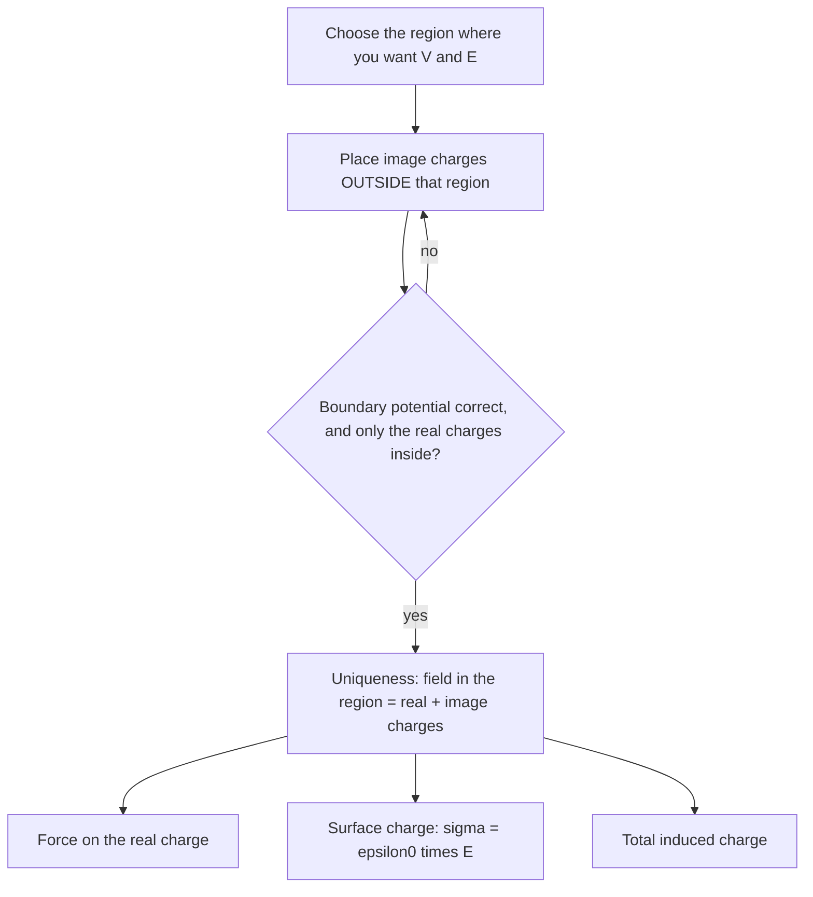

## When symmetry runs out

The Gauss's law lesson found fields quickly, but only for spheres, long cylinders and flat sheets. Real problems are rarely that tidy. Put a charge near a metal plate and the plate's electrons rearrange themselves into a pattern you don't know in advance, and that unknown pattern shapes the field. This lesson combines two results you already have, Gauss's law and $\vec E = -\nabla V$ from the potential lesson, into one equation for the potential. A remarkable property of that equation, the uniqueness theorem, then justifies a trick that turns a hard conductor problem into an easy point-charge problem: the method of images.

## Poisson's and Laplace's equations

Gauss's law in differential form says $\nabla\cdot\vec E = \rho/\varepsilon_0$. Substituting $\vec E = -\nabla V$ gives **Poisson's equation**:

$$\nabla^2V = \frac{\partial^2V}{\partial x^2} + \frac{\partial^2V}{\partial y^2} + \frac{\partial^2V}{\partial z^2} = -\frac{\rho}{\varepsilon_0}.$$

In a region with no charge it becomes **Laplace's equation**, $\nabla^2V = 0$. Electrostatics, everywhere outside the charges themselves, is the study of solutions to this one equation.

Two quick checks show it agrees with what you know.

- *Between parallel plates*, $V$ depends only on $x$, so $d^2V/dx^2 = 0$ and $V = A + Bx$: the potential falls linearly, and the field $-dV/dx = -B$ is uniform.
- *Outside a point charge*, $V$ depends only on $r$. In spherical coordinates Laplace's equation reads $\dfrac{1}{r^2}\dfrac{d}{dr}\left(r^2\dfrac{dV}{dr}\right) = 0$, so $r^2\,dV/dr$ is a constant and $V = A + B/r$. With $V \to 0$ far away, $V = B/r$: the familiar $kq/r$.

## What Laplace's equation forbids

Solutions of Laplace's equation have an averaging property: in a charge-free region, the potential at any point equals the average of $V$ over any sphere centered on that point (as long as the sphere contains no charge). In one dimension this is easy to see: a straight line's value at the midpoint of any interval is the average of its two end values.

An average can't be bigger than every value it averages, so *$V$ has no local maximum or minimum in empty space*. Its extreme values are on the boundaries: on conductors or at charges.

That has a famous consequence, **Earnshaw's theorem**: a charged particle cannot sit in stable equilibrium under electrostatic forces from fixed charges alone. A positive charge would need a point where $V$ has a minimum, so that it is pushed back from every direction; Laplace's equation rules such points out. At best you get a saddle, stable in some directions and unstable in others. This is why particle physicists who trap single ions add a magnetic field (a Penning trap) or use a rapidly oscillating field (a Paul trap): a static electric field alone cannot do it.

## The uniqueness theorem

The most useful fact about Laplace's equation is the **uniqueness theorem**: in a region, if the charge density inside is known and the potential is specified on every boundary (each conductor's potential, and $V = 0$ far away), there is exactly one solution.

*Why:* suppose $V_1$ and $V_2$ were both solutions. Their difference $W = V_1 - V_2$ satisfies Laplace's equation (the charge densities cancel) and is zero on every boundary. With no interior maximum or minimum, $W$ can be no larger and no smaller than its boundary values, so $W = 0$ everywhere.

The practical meaning: *if you can guess a potential that satisfies the equation and matches the boundary conditions, it is the answer*, however you found it. For example, a closed metal box with nothing inside: $V$ equal to the box's potential everywhere inside satisfies Laplace's equation and the boundary condition, so it is the solution, and the field inside is zero no matter what charges sit outside. That is the Faraday cage from the electric field lesson, now proved.

## Image charge for a flat conductor

A point charge $+q$ sits a distance $d$ above a large, flat, grounded conductor ($V = 0$). What is the field above the plate?

The guess: delete the conductor and put a charge $-q$ at the mirror-image point, a distance $d$ *below* the plane. On the plane, every point is equally far from $+q$ and $-q$, so their potentials cancel: $V = 0$, exactly the boundary condition. In the region above the plane the only real charge is $+q$, and the guess has only $+q$ there too (the **image charge** sits outside the region). By the uniqueness theorem, the field above the plate is exactly the field of the two charges. This is the **method of images**.


The image is a calculating device, not a real charge. Below the surface, inside the metal, the true field is zero; the image's field there means nothing. What it gives correctly is everything above the plate:

- *Force on the charge*: attraction toward the plate, $F = \dfrac{kq^2}{(2d)^2}$.
- *Induced surface charge*: just above the plate the field is perpendicular to it, and adding the two charges' contributions at distance $r$ from the foot of the perpendicular gives $E = \dfrac{2kqd}{(r^2 + d^2)^{3/2}}$, pointing into the plate. A conductor's surface charge is $\sigma = \varepsilon_0E_\perp$ (the Gauss's law lesson), so
$$\sigma(r) = -\frac{qd}{2\pi(r^2 + d^2)^{3/2}}.$$
Integrating over the whole plane gives exactly $-q$: every field line from $q$ that reaches the plate ends on induced charge.
- *Work to pull the charge away*: the force is $kq^2/(4x^2)$ at height $x$, so the work to move it from $d$ to infinity is $\displaystyle\int_d^\infty\frac{kq^2}{4x^2}\,dx = \frac{kq^2}{4d}$. That is *half* the energy $kq^2/(2d)$ of a real pair of charges $2d$ apart. As you pull the charge away its image recedes too, and the field fills only the space above the plate, so only half of the pair's field energy is really there.

### Example 1

A $+2.0$ nC charge is held 3.0 cm above a large grounded metal plate. Find (a) the force on it, (b) the surface charge density directly beneath it and 3.0 cm to the side of that point, and (c) the work needed to remove it to a great distance.

(a) The image is $-2.0$ nC, 6.0 cm from the real charge:
$$F = \frac{(8.99\times10^9)(2.0\times10^{-9})^2}{(0.060)^2} = 1.0\times10^{-5}\text{ N},$$
toward the plate.

(b) Directly below, $r = 0$: $\sigma = -\dfrac{q}{2\pi d^2} = -\dfrac{2.0\times10^{-9}}{2\pi(0.030)^2} = -3.5\times10^{-7}$ C/m². At $r = d$, the denominator grows by $(2d^2)^{3/2}/d^3 = 2^{3/2}$, so $\sigma = -3.5\times10^{-7}/2.83 = -1.3\times10^{-7}$ C/m². The induced charge crowds under the real charge.

(c) $W = \dfrac{kq^2}{4d} = \dfrac{(8.99\times10^9)(2.0\times10^{-9})^2}{4(0.030)} = 3.0\times10^{-7}$ J.

## Image charge for a grounded sphere

A sphere is less obvious, but an image still works. Let a grounded conducting sphere of radius $R$ have its center a distance $a$ from a point charge $q$. Place an image charge

$$q' = -\frac{R}{a}q \quad\text{at distance}\quad b = \frac{R^2}{a}$$

from the center, on the line toward $q$.

```shape
{"circles": [{"center": [0, 0], "r": 1}], "points": [{"at": [0, 0]}, {"at": [2.5, 0], "label": "q"}, {"at": [0.4, 0]}], "segments": [{"from": [0, 0], "to": [-0.6, 0.8], "label": "R"}, {"from": [0, -1.35], "to": [2.5, -1.35], "label": "a"}, {"from": [0, 0], "to": [2.5, 0], "dashed": true}], "labels": [{"at": [-0.12, -0.25], "text": "O"}, {"at": [0.45, 0.25], "text": "q′"}, {"at": [0.25, -0.55], "text": "b = R²/a"}], "caption": "Grounded sphere: the image q′ = −qR/a sits at b = R²/a from the center O, on the line to q"}
```

Check two points on the sphere. At the point nearest $q$, the distance to $q$ is $a - R$ and the distance to $q'$ is $R - b = R(a - R)/a$. The potentials are $kq/(a - R)$ and $kq'a/[R(a - R)] = -kq/(a - R)$: they cancel. At the far point the distances are $a + R$ and $R(a + R)/a$, and they cancel again. A little geometry shows the ratio of the two distances is $R/a$ at every point of the sphere, so $V = 0$ on the whole surface. By uniqueness, the field outside the sphere is that of $q$ and $q'$.

Three consequences:

- The induced charge on the sphere totals $q' = -qR/a$, less than $q$ in size: some of $q$'s field lines miss the sphere and go to infinity.
- The sphere attracts the charge with force $F = \dfrac{kq|q'|}{(a - b)^2}$.
- If the sphere is *isolated and neutral* instead of grounded, add a second image $+qR/a$ at the center. That keeps the total charge zero and the surface still an equipotential. The pair $q'$ and $-q'$ is a small dipole, and the net force is still an attraction. This is the full story behind a charged balloon pulling on a neutral metal object.

### Example 2

A grounded metal sphere of radius 5.0 cm has its center 15 cm from a $+4.0$ nC point charge. Find the image charge, its position, and the force on the point charge.

*Image:* $q' = -\dfrac{5.0}{15}(4.0\text{ nC}) = -1.33$ nC, at $b = \dfrac{(5.0)^2}{15} = 1.67$ cm from the center.

*Separation:* $a - b = 15 - 1.67 = 13.3$ cm.

*Force:* $F = \dfrac{(8.99\times10^9)(4.0\times10^{-9})(1.33\times10^{-9})}{(0.133)^2} = 2.7\times10^{-6}$ N, attractive.

For comparison, a flat grounded plate 10 cm from the charge (the same gap) would pull with $kq^2/(0.20)^2 = 3.6\times10^{-6}$ N. The sphere pulls less because it intercepts fewer of the charge's field lines.

## The image force on an electron

### Example 3

An electron just outside a metal surface is attracted by its own image. Estimate the electron's potential energy 0.50 nm from the surface, in eV.

The work to remove the electron from distance $x$ is $ke^2/(4x)$, so its potential energy is $U(x) = -\dfrac{ke^2}{4x}$:
$$U = -\frac{(8.99\times10^9)(1.602\times10^{-19})^2}{4(0.50\times10^{-9})} = -1.15\times10^{-19}\text{ J} = -0.72\text{ eV}.$$

This image attraction is one of the reasons electrons need a few eV (the work function, met in the photon lesson) to escape a metal. The model is a simplification: within a few tenths of a nanometer of the surface the metal no longer behaves like a smooth perfect conductor, and the formula $-ke^2/(4x)$, which grows without bound as $x \to 0$, fails there.

## The method in practice



The method works for a handful of shapes: planes, spheres, two planes at right angles (three images), a line charge near a conducting cylinder. For anything else, Laplace's equation is solved by separation of variables or numerically on a computer, using the same uniqueness theorem to know the answer found is the only one.

## Common mistakes

- Using the image's field inside the conductor. The image only describes the region outside; inside the metal $E = 0$.
- Taking the work to remove a charge from a plane as $kq^2/(2d)$, the energy of a real pair. It is $kq^2/(4d)$.
- Putting a sphere's image at distance $R$ from the center or giving it charge $-q$. It is $-qR/a$ at $R^2/a$.
- Thinking Earnshaw's theorem forbids all charged equilibria. It forbids *stable* ones in static fields from fixed charges; magnetic or oscillating fields can trap charges.
- Calling the image charge real. The real induced charge is spread over the conductor's surface; the image is the point charge that would make the same field.

## Key points

- Poisson: $\nabla^2V = -\rho/\varepsilon_0$; Laplace (no charge): $\nabla^2V = 0$.
- In empty space $V$ has no local maximum or minimum, so no static electric field can hold a charge in stable equilibrium (Earnshaw).
- Uniqueness: known charges plus known boundary potentials give exactly one solution, so any solution that fits is the solution.
- Plane: image $-q$ at the mirror point; $F = kq^2/(2d)^2$; $\sigma = -qd/[2\pi(r^2 + d^2)^{3/2}]$; work to remove $kq^2/(4d)$.
- Grounded sphere: image $-qR/a$ at $R^2/a$ from the center.
