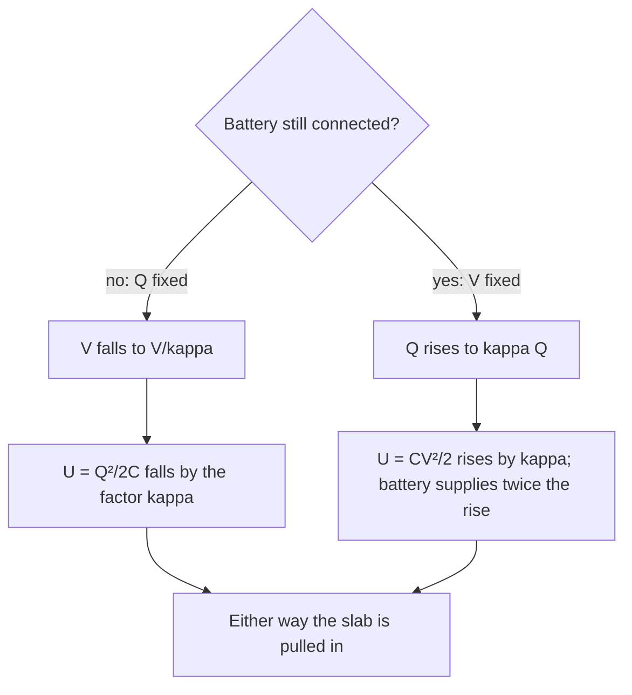

## Inside the insulator

The capacitance lesson stated a rule: fill a capacitor with a dielectric and its capacitance rises by the factor $\kappa$. It explained the rule in a sentence (the molecules polarize and partly cancel the field), and the dipoles lesson showed how a single molecule responds to a field. This lesson connects the two levels. It describes the polarization of a whole block of material, finds the charge that polarization leaves on the surfaces, and rewrites Gauss's law so that it works inside matter. Then it uses those tools on problems the simple rule can't handle: a capacitor only partly filled, a slab slid in with or without the battery attached, and the limit set by electrical breakdown.

## Polarization and bound charge

In a field, each small volume of a dielectric acquires a net dipole moment, whether by lining up polar molecules or by stretching nonpolar ones. The **polarization vector** $\vec P$ is the dipole moment per unit volume:

$$\vec P = n\,\vec p_{\text{avg}},$$

where $n$ is the number of molecules per cubic meter and $\vec p_{\text{avg}}$ is the average moment of one molecule along the field. Its unit is (C·m)/m³ = C/m², the same as a surface charge density, and that is no coincidence.

Picture a slab polarized uniformly, with every molecule's $+$ end shifted slightly along $\vec P$. Deep inside, each molecule's $+$ end sits next to its neighbor's $-$ end, and the charges cancel. At the two faces they don't: one face is left with a thin layer of uncanceled $+$ ends, the other with uncanceled $-$ ends. This is **bound charge**, charge that belongs to the molecules and cannot flow away, unlike the **free charge** on the plates, which arrived through the wires. On a face whose outward normal is $\hat n$, the bound surface density is

$$\sigma_b = \vec P\cdot\hat n.$$

For a slab between capacitor plates, $\vec P$ points along $\vec E$, from the positive plate toward the negative plate. The face next to the positive plate gets $\sigma_b = -P$, the face next to the negative plate $+P$. The bound charges always face the opposite free charges, so their field opposes the plates' field. (If $\vec P$ varies from place to place, bound charge also appears inside the material, with density $\rho_b = -\nabla\cdot\vec P$.)

## Linear dielectrics

In most materials at ordinary field strengths, the polarization is proportional to the field:

$$\vec P = \varepsilon_0\chi_e\vec E,$$

where the dimensionless **electric susceptibility** $\chi_e$ measures how easily the material polarizes. Now find the field in a filled capacitor whose plates carry free charge density $\sigma_f$. The field inside comes from the free charge minus the bound charge:

$$E = \frac{\sigma_f - \sigma_b}{\varepsilon_0} = \frac{\sigma_f - \varepsilon_0\chi_eE}{\varepsilon_0} \quad\Rightarrow\quad E = \frac{\sigma_f}{(1 + \chi_e)\varepsilon_0}.$$

The field is reduced by the factor $1 + \chi_e$, so this must be the dielectric constant: $\kappa = 1 + \chi_e$. Two useful by-products:

- The bound charge is $\sigma_b = \sigma_f(1 - 1/\kappa)$. For water ($\kappa \approx 80$) it cancels about 99% of the free charge's field.
- Vacuum has $\chi_e = 0$ and $\kappa = 1$, as it must.

## Gauss's law in matter

Bound charge is awkward: you usually don't know it until you've solved the problem. The fix is to define the **electric displacement**

$$\vec D = \varepsilon_0\vec E + \vec P.$$

Gauss's law for $\vec E$ counts free and bound charge. Subtracting the bound part (which is what $\vec P$ accounts for) leaves a version that needs only the free charge:

$$\oint\vec D\cdot d\vec A = Q_{\text{free, enc}}.$$

In a linear dielectric, $\vec D = \varepsilon_0(1 + \chi_e)\vec E = \kappa\varepsilon_0\vec E$. The product $\kappa\varepsilon_0$ is called the **permittivity** of the material and written $\varepsilon$. So inside a uniform linear dielectric, every vacuum formula holds with $\varepsilon_0$ replaced by $\varepsilon = \kappa\varepsilon_0$. A point charge $q$ buried in a large block of dielectric has

$$E = \frac{q}{4\pi\kappa\varepsilon_0r^2},$$

and the force between two charges in the block is $\kappa$ times weaker than in vacuum.

This explains, at least roughly, why water dissolves salt. In vacuum, separating a $\text{Na}^+$ and a $\text{Cl}^-$ ion from 0.28 nm apart to far away takes $ke^2/r = 5.1$ eV. Divide by water's $\kappa \approx 80$ and it is about 0.064 eV, only a few times the typical thermal energy at room temperature ($k_BT \approx 0.026$ eV), so random collisions can pull the ions apart. (This is a simplification: a few water molecules between two ions don't behave like a smooth block with $\kappa = 80$, and real dissolving also involves how water molecules bind to each ion. The factor-of-80 weakening is still the main reason.)

## Partly filled capacitors

Suppose a slab of thickness $t$ and dielectric constant $\kappa$ fills part of a parallel-plate gap $d$, with air in the rest.

```shape
{"polygons": [{"points": [[0, 4], [6, 4], [6, 4.25], [0, 4.25]]}, {"points": [[0, -0.25], [6, -0.25], [6, 0], [0, 0]]}, {"points": [[0, 0], [6, 0], [6, 2], [0, 2]], "fill": true}], "segments": [{"from": [6.5, 0], "to": [6.5, 2], "label": "t"}, {"from": [7.4, 0], "to": [7.4, 4], "label": "d"}], "labels": [{"at": [3, 4.7], "text": "+Q (top plate, area A)"}, {"at": [3, -0.75], "text": "−Q (bottom plate)"}, {"at": [3, 3], "text": "air"}, {"at": [3, 1], "text": "dielectric slab, κ"}], "caption": "A capacitor with a dielectric slab filling part of the gap"}
```

Gauss's law for $\vec D$ with a pillbox around the top plate gives $D = \sigma_f = Q/A$ everywhere in the gap, in the air and the slab alike, because only free charge counts. Then $E = D/\varepsilon_0$ in the air and $E = D/(\kappa\varepsilon_0)$ in the slab. Adding up the voltage across each part,

$$V = \frac{Q}{\varepsilon_0A}\left(d - t + \frac t\kappa\right) \quad\Rightarrow\quad C = \frac{\varepsilon_0A}{d - t + t/\kappa}.$$

This is the same as two capacitors in series, one of air (gap $d - t$) and one of dielectric (gap $t$). If instead the dielectric fills the gap *side by side* (covering area $A_2$ of the plates, with air over the rest $A_1$), both parts have the same voltage and it is two capacitors in parallel: $C = \varepsilon_0(A_1 + \kappa A_2)/d$.

### Example 1

Plates of area 0.020 m² are 4.0 mm apart. A glass slab ($\kappa = 5.0$) 2.0 mm thick lies against the lower plate, and the capacitor is connected to 100 V. Find the capacitance with and without the slab, and the field in the air and in the glass.

*Without the slab:* $C_0 = \dfrac{(8.85\times10^{-12})(0.020)}{0.0040} = 44.3$ pF.

*With it:* $d - t + t/\kappa = 2.0 + 0.40 = 2.4$ mm, so $C = \dfrac{1.77\times10^{-13}}{0.0024} = 73.8$ pF.

*Fields:* $Q = CV = 7.38$ nC, so $E_{\text{air}} = \dfrac{Q}{\varepsilon_0A} = \dfrac{7.38\times10^{-9}}{1.77\times10^{-13}} = 4.17\times10^4$ V/m and $E_{\text{glass}} = E_{\text{air}}/5.0 = 8.33\times10^3$ V/m.

*Check:* $(4.17\times10^4)(0.0020) + (8.33\times10^3)(0.0020) = 83.3 + 16.7 = 100$ V. ✓

```plot
{"x": [0, 4], "y": [0, 50], "xLabel": "distance from top plate (mm)", "yLabel": "E (kV/m)", "functions": [{"f": "41.7", "from": 0, "to": 2}, {"f": "8.33", "from": 2, "to": 4}], "segments": [{"from": [2, 0], "to": [2, 50], "dashed": true}], "labels": [{"at": [1, 45], "text": "air: 41.7"}, {"at": [3, 13], "text": "glass: 8.33"}], "caption": "Field across the gap in Example 1: the dielectric cuts E by κ = 5"}
```

Notice where the voltage went: the air layer, half the gap, carries 83% of it. A thin air layer left between a dielectric and a plate takes most of the field, which is why high-voltage capacitors are built without air gaps: the air would break down first.

## Sliding a dielectric in: battery attached or not?

What happens when a slab is pushed fully into a charged capacitor depends on whether the battery is still connected.



*Isolated capacitor (Q fixed).* $C$ becomes $\kappa C$, so $V = Q/C$ drops to $V/\kappa$ and $U = Q^2/(2C)$ drops to $U/\kappa$. The lost energy went into work done on the slab: the field pulls it in.

*Connected to a battery (V fixed).* $Q$ grows to $\kappa Q$, and $U = \tfrac12CV^2$ grows to $\kappa U$. The battery pushed the extra charge $(\kappa - 1)Q$ through voltage $V$, supplying $(\kappa - 1)QV = 2(\kappa - 1)U$, twice the increase in stored energy. The other half again went into work on the slab: it is still pulled in.

What does the pulling? The **fringing field** at the edge of the plates, which bulges outward and is not perpendicular to them, polarizes the part of the slab sticking out and tugs it toward the strong field, like the paper drawn to a comb in the dipoles lesson. Energy bookkeeping gives the force without knowing the fringing field's shape: at fixed $V$, $F = \tfrac12V^2\,dC/dx$. For plates of width $w$ with the slab inserted a length $x$, $C$ grows by $(\kappa - 1)\varepsilon_0w\,dx/d$ for each extra $dx$, so

$$F = \frac{(\kappa - 1)\varepsilon_0wV^2}{2d},$$

the same at every insertion depth while the slab is partway in.

### Example 2

A 20 pF air capacitor is charged to 50 V. A slab with $\kappa = 3.0$ is then slid in to fill it. Find the final voltage, charge and stored energy (a) if the battery was disconnected first and (b) if it stays connected.

*Before:* $Q = (20\text{ pF})(50\text{ V}) = 1.0$ nC and $U = \tfrac12(20\times10^{-12})(50)^2 = 25$ nJ.

(a) *Disconnected:* $Q = 1.0$ nC, $C = 60$ pF, $V = 1.0\text{ nC}/60\text{ pF} = 16.7$ V, $U = 25/3.0 = 8.3$ nJ. The field did $25 - 8.3 = 16.7$ nJ of work pulling the slab in.

(b) *Connected:* $V = 50$ V, $Q = (60\text{ pF})(50\text{ V}) = 3.0$ nC, $U = 75$ nJ. The battery moved an extra 2.0 nC through 50 V, supplying 100 nJ: 50 nJ more is stored in the capacitor and 50 nJ is the work done on the slab.

## Breakdown and dielectric strength

Every insulator has a **dielectric strength**: the largest field it can withstand before it breaks down and conducts, with a spark or a burned path. For dry air at sea level it is about $3\times10^6$ V/m; good solid insulators reach ten or more times that. The dielectric strength $E_{\max}$ limits a capacitor in two ways. The maximum voltage across a gap $d$ is $V_{\max} = E_{\max}d$, and the maximum energy density is

$$u_{\max} = \tfrac12\kappa\varepsilon_0E_{\max}^2,$$

since in a dielectric the energy density is $\tfrac12\kappa\varepsilon_0E^2$. A good capacitor material needs both a large $\kappa$ and a large $E_{\max}$.

### Example 3

A capacitor uses a plastic film with $\kappa = 3.0$ and dielectric strength $2.0\times10^7$ V/m (illustrative values like those listed for common plastics in textbook tables; thin films made for capacitors can withstand considerably higher fields), 10 μm thick. Find the highest safe voltage and the maximum energy density, and compare with air.

*Voltage:* $V_{\max} = (2.0\times10^7)(10\times10^{-6}) = 200$ V.

*Energy density:* $u_{\max} = \tfrac12(3.0)(8.85\times10^{-12})(2.0\times10^7)^2 = 5.3\times10^3$ J/m³.

*Air:* $\tfrac12(8.85\times10^{-12})(3.0\times10^6)^2 = 40$ J/m³, about 130 times less. The film wins by its factor of 3 in $\kappa$ and its factor of about 6.7 in $E_{\max}$, which counts twice because it is squared.

## Common mistakes

- Using Gauss's law for $\vec E$ with only the free charge inside a dielectric. Either include the bound charge, or use $\vec D$, which needs only free charge.
- Thinking $D$ changes across a dielectric slab parallel to the plates. $D = \sigma_f$ is the same in air and slab; $E$ is what jumps.
- Treating a partly filled capacitor as fully filled, or adding the two parts in parallel when they are stacked (stacked layers are in series).
- Assuming energy is conserved inside the capacitor when a battery is attached. The battery supplies energy, twice the stored increase.
- Concluding that the slab is pushed out in the isolated case because the stored energy falls. Falling stored energy means the field did work pulling the slab in.

## Key points

- Polarization $\vec P$ = dipole moment per volume; bound surface charge $\sigma_b = \vec P\cdot\hat n$.
- Linear dielectric: $\vec P = \varepsilon_0\chi_e\vec E$, $\kappa = 1 + \chi_e$, $\sigma_b = \sigma_f(1 - 1/\kappa)$.
- $\vec D = \varepsilon_0\vec E + \vec P$; $\oint\vec D\cdot d\vec A = Q_{\text{free}}$; in a linear dielectric $\vec D = \kappa\varepsilon_0\vec E$.
- Slab of thickness $t$ in gap $d$: $C = \varepsilon_0A/(d - t + t/\kappa)$ (series); side by side: parallel.
- Inserting a slab: isolated, $U \to U/\kappa$; connected, $U \to \kappa U$ with the battery supplying twice the gain. The slab is pulled in either way.
- Dielectric strength sets $V_{\max} = E_{\max}d$ and $u_{\max} = \tfrac12\kappa\varepsilon_0E_{\max}^2$.
