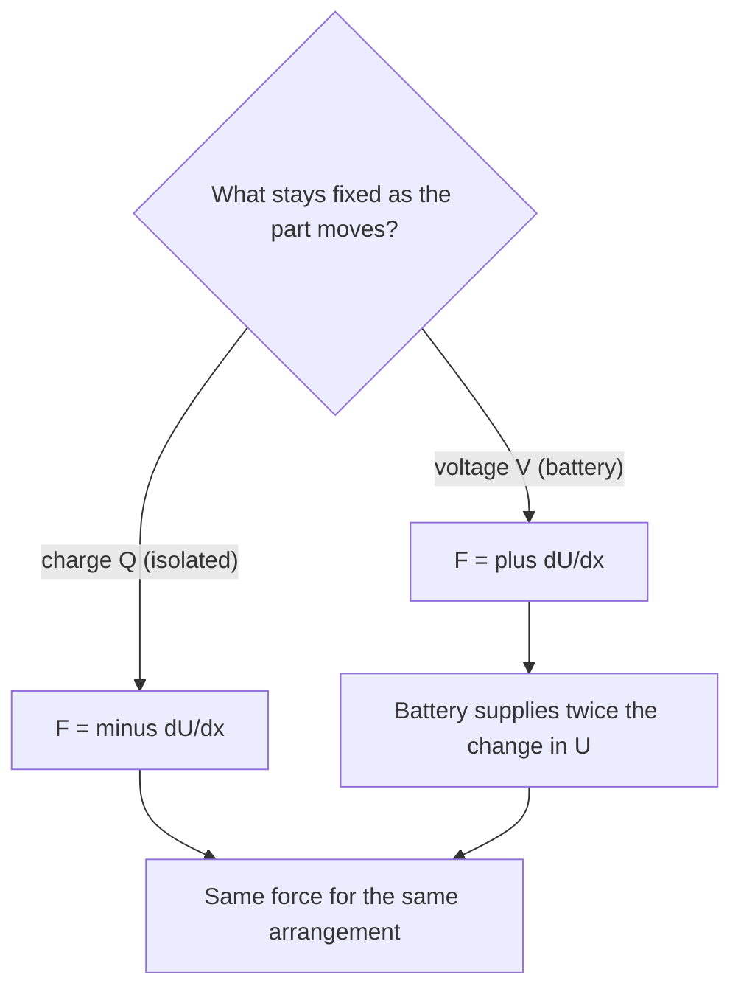

## Where the energy is, and what it pushes on

The potential lesson gave the energy of a pair of charges, $kq_1q_2/r$, and the capacitance lesson found the energy of a charged capacitor and the field energy density $\tfrac12\varepsilon_0E^2$. This lesson pulls those results together. It finds the energy needed to assemble any arrangement of charge, uses it to estimate the electric energy packed into an atomic nucleus, and then turns energy into force: the pressure on a charged conductor's surface, the pull between capacitor plates, and the method of **virtual work**, which finds forces from how the energy changes.

## The energy of assembling charges

Bring charges in from far away one at a time. The first costs nothing. The second costs $kq_1q_2/r_{12}$, the work against the first. The third costs $kq_1q_3/r_{13} + kq_2q_3/r_{23}$, and so on. The total, the electric potential energy of the arrangement, is a sum over every pair, each counted once:

$$U = \sum_{\text{pairs}}\frac{kq_iq_j}{r_{ij}} = \frac12\sum_iq_iV_i,$$

where $V_i$ is the potential at charge $i$ due to all the *others*. The $\tfrac12$ in the second form corrects for counting each pair twice (once from each end).

### Example 1

Four equal charges of $+1.0$ μC sit at the corners of a square with 10 cm sides. How much work did it take to assemble them?

There are six pairs: four along the sides ($r = 0.10$ m) and two along the diagonals ($r = 0.10\sqrt2 = 0.141$ m). With $kq^2 = (8.99\times10^9)(1.0\times10^{-6})^2 = 8.99\times10^{-3}$ J·m,

$$U = 8.99\times10^{-3}\left(\frac{4}{0.10} + \frac{2}{0.141}\right) = 8.99\times10^{-3}(40 + 14.1) = 0.49\text{ J}.$$

*Check with the other form:* each charge sits at potential $V = kq\left(\dfrac{2}{0.10} + \dfrac{1}{0.141}\right) = 2.43\times10^5$ V from the other three, and $\tfrac12(4)(1.0\times10^{-6})(2.43\times10^5) = 0.49$ J. ✓ The energy is positive: like charges had to be pushed together, and let go they would fly apart.

## From charges to fields

For a continuous distribution the sum becomes an integral, $U = \tfrac12\int\rho V\,d\tau$ over the charge (with $d\tau$ a volume element). Using Gauss's law to replace $\rho$ by $\varepsilon_0\nabla\cdot\vec E$ and integrating by parts turns this into an integral over all space:

$$U = \frac{\varepsilon_0}{2}\int E^2\,d\tau.$$

The two forms always agree, but they suggest different pictures: energy stored in the charges, or energy stored in the field. The capacitance lesson's energy density $u = \tfrac12\varepsilon_0E^2$ is this second form. Electromagnetic waves, which carry energy through empty space with no charge anywhere near, show that the field picture is the one to take literally.

## Self-energy: what it costs to build one charged object

The energy needed to assemble a single object's own charge is its **self-energy**. Two cases:

*Thin spherical shell* (charge $Q$, radius $R$): the field is $kQ/r^2$ outside and zero inside, and the field integral gives $U = \dfrac{kQ^2}{2R}$, the same as $Q^2/(2C)$ with the sphere's capacitance $C = 4\pi\varepsilon_0R$.

*Uniformly charged ball*: build it layer by layer. When the ball has reached radius $r$ it holds $q(r) = Q r^3/R^3$ and its surface sits at potential $kq(r)/r$. Adding the next layer, of charge $dq = 3Qr^2\,dr/R^3$, costs $dU = \dfrac{kq(r)}{r}\,dq$:

$$U = \int_0^R\frac{k}{r}\cdot\frac{Qr^3}{R^3}\cdot\frac{3Qr^2}{R^3}\,dr = \frac{3kQ^2}{R^6}\int_0^Rr^4\,dr = \frac35\frac{kQ^2}{R}.$$

The ball costs more than the shell ($\tfrac35 > \tfrac12$) because it has field inside it too. (Check: $\tfrac{\varepsilon_0}{2}\int E^2\,d\tau$ gives $\tfrac{kQ^2}{2R}$ from the outside and $\tfrac{kQ^2}{10R}$ from the inside; the total is $\tfrac35kQ^2/R$.)

Both results grow without limit as $R \to 0$: in classical physics a true point charge has infinite self-energy. This puzzle has never been fully resolved within classical physics. One response, historically, was to ask how big an electron would have to be for its electric energy to equal its rest energy $m_ec^2$. Dropping the factor of order 1, $ke^2/r_e = m_ec^2$ gives the **classical electron radius**

$$r_e = \frac{ke^2}{m_ec^2} \approx 2.8\times10^{-15}\text{ m}.$$

It is a useful length scale (it sets the size of the electron's scattering cross-section for low-energy light), but it is *not* the electron's size: experiments find no structure in the electron at all, down to scales far smaller than $r_e$, and quantum field theory handles the infinity in a different way.

### Example 2

Model a uranium-238 nucleus as a uniformly charged ball with $Z = 92$ protons and radius $R = (1.2\text{ fm})A^{1/3}$, an empirical rule for nuclear radii. Estimate its electric self-energy in MeV.

*Radius:* $R = 1.2(238)^{1/3} = 1.2(6.20) = 7.44$ fm.

*Energy:* a handy combination is $ke^2 = 1.44$ MeV·fm. Then
$$U = \frac35\frac{k(Ze)^2}{R} = \frac35\cdot\frac{(1.44\text{ MeV·fm})(92)^2}{7.44\text{ fm}} = 980\text{ MeV}.$$

That is roughly half the nucleus's total binding energy (about 1800 MeV), all working to push it apart. The electric repulsion grows as $Z^2$ while the short-range nuclear attraction grows only about as $A$, which is why the heaviest nuclei are unstable and why splitting uranium releases energy. (Nuclear models use $Z(Z - 1)$ in place of $Z^2$, since a proton does not repel itself; that changes the result by about 1%.)

## The pressure on a charged surface

A conductor with surface charge density $\sigma$ has field $\sigma/\varepsilon_0$ just outside and zero inside. The charge feels a force per area, an outward **electrostatic pressure**. How big is it?

Not $\sigma\cdot\sigma/\varepsilon_0$. The charge layer has a small thickness, and the field rises across it from $0$ to $\sigma/\varepsilon_0$; the charge inside the layer feels the field where it actually is.

```plot
{"x": [-1.5, 2.5], "y": [0, 1.3], "xLabel": "position", "yLabel": "E / (σ/ε0)", "functions": [{"f": "0", "from": -1.5, "to": 0}, {"f": "x", "from": 0, "to": 1}, {"f": "1", "from": 1, "to": 2.5}, {"f": "0.5", "from": 0, "to": 1, "dashed": true}], "segments": [{"from": [1, 0], "to": [1, 1.3], "dashed": true}], "labels": [{"at": [-0.75, 0.15], "text": "metal: E = 0"}, {"at": [1.75, 1.12], "text": "outside: σ/ε0"}, {"at": [0.72, 0.38], "text": "average"}], "caption": "Through the thin layer of surface charge the field rises from 0 to σ/ε0; the charge feels the average, σ/(2ε0)"}
```

For a layer of thickness $\delta$, Gauss's law gives $dE = \rho\,dx/\varepsilon_0$, so the force per area is $\int\rho E\,dx = \varepsilon_0\int_0^{\sigma/\varepsilon_0}E\,dE = \dfrac{\sigma^2}{2\varepsilon_0}$, whatever the charge's profile within the layer. So

$$P = \frac{\sigma^2}{2\varepsilon_0} = \tfrac12\varepsilon_0E^2,$$

with $E$ the field just outside. It always pulls *outward*, for either sign of charge, and it equals the energy density at the surface. A charged soap bubble expands slightly for this reason.

## The force between capacitor plates

Each plate of a parallel-plate capacitor feels this pressure toward the other plate, so the plates attract with

$$F = \frac{\sigma^2A}{2\varepsilon_0} = \frac{Q^2}{2\varepsilon_0A} = \tfrac12QE.$$

The $\tfrac12$ again: a plate does not push on itself, so each plate feels only the *other* plate's field, $\sigma/(2\varepsilon_0)$, which is half the field $E$ between the plates.

### Example 3

A capacitor has plates of area 0.040 m² (20 cm squares) 1.0 mm apart and is connected to 1000 V. Find the force between the plates.

$E = V/d = 1.0\times10^6$ V/m. Pressure $P = \tfrac12(8.85\times10^{-12})(1.0\times10^6)^2 = 4.4$ Pa. Force $F = PA = 0.18$ N, about the weight of 18 g. Small, but easily measured; nineteenth-century "attracted disk" electrometers measured voltages by weighing exactly this force.

## Forces from energy: virtual work

When a geometry is too complicated to integrate pressures, find how the energy changes when part of the system moves a small distance $dx$.

*Isolated system (charge fixed):* the work done by the electric force comes out of the stored energy, $F\,dx = -dU$, so
$$F = -\left(\frac{dU}{dx}\right)_Q.$$

*Connected to a battery (voltage fixed):* now the battery also does work, $V\,dQ$. With $V$ fixed, $dU = \tfrac12V^2\,dC$ while the battery supplies $V\,dQ = V^2\,dC = 2\,dU$. Half the battery's energy is stored and half does the mechanical work, so $F\,dx = +dU$:
$$F = +\left(\frac{dU}{dx}\right)_V.$$



*Check on the plates.* With gap $x$, $C = \varepsilon_0A/x$. At fixed $Q$: $U = \dfrac{Q^2x}{2\varepsilon_0A}$, so $F = -\dfrac{Q^2}{2\varepsilon_0A}$; the minus sign means the force acts toward smaller $x$, an attraction of the size found above. At fixed $V$: $U = \dfrac{\varepsilon_0AV^2}{2x}$, so $F = +\dfrac{dU}{dx} = -\dfrac{\varepsilon_0AV^2}{2x^2}$, again an attraction, and with $Q = \varepsilon_0AV/x$ it is the same number. Using $-dU/dx$ with $V$ fixed would give a *repulsion*: the classic virtual-work error.

The same rule, $F = \tfrac12V^2\,dC/dx$ at fixed voltage, is how the dielectrics lesson found the pull on a slab, and how engineers design the comb-shaped electrostatic actuators in many MEMS devices (micro-machined sensors and mirrors).

## Common mistakes

- Counting each pair twice in $U = \sum kq_iq_j/r_{ij}$, or dropping the $\tfrac12$ in $\tfrac12\sum q_iV_i$.
- Taking the force on a charged surface or plate as $\sigma E$ or $QE$. The charge feels the average field, so it is $\tfrac12\sigma E$ per area and $\tfrac12QE$ in total.
- Using $F = -dU/dx$ at fixed voltage. With a battery attached, $F = +dU/dx$.
- Treating the classical electron radius as the electron's actual size.
- Using the shell's self-energy $kQ^2/(2R)$ for a uniformly charged ball, which is $\tfrac35kQ^2/R$.

## Key points

- Assembly energy: $U = \sum_{\text{pairs}}kq_iq_j/r_{ij} = \tfrac12\sum q_iV_i$; continuous, $U = \tfrac{\varepsilon_0}{2}\int E^2\,d\tau$.
- Self-energy: shell $kQ^2/(2R)$; uniform ball $\tfrac35kQ^2/R$; classical electron radius $ke^2/(m_ec^2) \approx 2.8$ fm (not a real size).
- Pressure on a conductor's surface: $\sigma^2/(2\varepsilon_0) = \tfrac12\varepsilon_0E^2$, outward.
- Capacitor plates attract with $F = Q^2/(2\varepsilon_0A) = \tfrac12QE$.
- Virtual work: $F = -(dU/dx)_Q$; $F = +(dU/dx)_V$.
