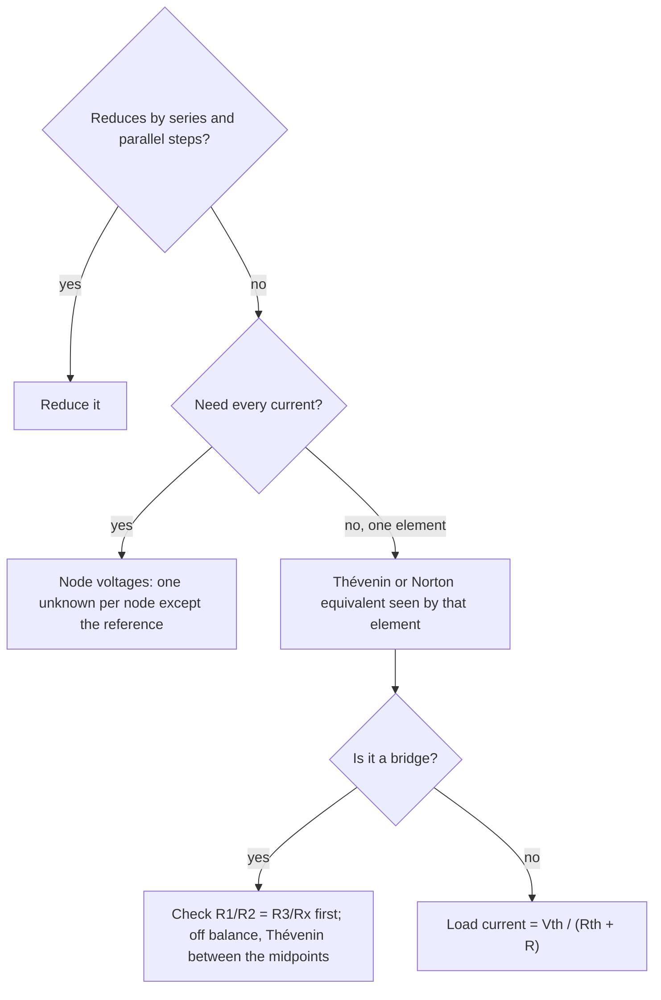

## Fewer unknowns, better questions

The DC circuits lesson solved every network with Kirchhoff's rules: one unknown current per branch, a junction equation for each junction, loop equations for the rest. That always works, but it treats every circuit as a pile of simultaneous equations, and most of the time you only want one number: the current in one resistor, or what a sensor reads. This lesson shows how circuit analysts cut the work down. The **node-voltage method** uses potentials as the unknowns, which usually means fewer of them. **Thévenin's theorem** and **Norton's theorem** replace everything except the part you care about with two components. Then the same ideas explain the Wheatstone bridge, a precision measuring circuit, and an infinite ladder of resistors, whose resistance turns out to involve the golden ratio.

Everything here applies to a **linear circuit**: one built from ideal batteries (fixed emfs) and ohmic resistors. In such a circuit every current and voltage is a linear combination of the emfs, because Kirchhoff's rules with $V = IR$ are linear equations.

## The node-voltage method

Pick one junction as the **reference node** and call its potential zero (circuit diagrams often mark it as "ground"). Every other junction, or node, gets an unknown potential. Ohm's law then gives each branch current directly from the potentials at its ends: a resistor $R$ from node $a$ to node $b$ carries current $(V_a - V_b)/R$ from $a$ to $b$. A branch with a battery is just as easy: if the branch runs from node $b$ through a battery whose $+$ terminal faces $a$, then through $R$ to $a$, its current toward $a$ is $(V_b + \mathcal{E} - V_a)/R$.

Now write the junction rule at each non-reference node, with every current expressed this way. The loop rule never has to be written: it is built in, because a potential has a single value at each node, so the changes around any closed loop add to zero automatically.

The counting is the payoff. A network with $n$ nodes needs only $n - 1$ unknown potentials, whatever the number of branches. Three branches between two junctions take three unknown currents in Kirchhoff form but one unknown potential here.

With several nodes the equations form a matrix system $\mathbf{G}\vec V = \vec I_s$. The diagonal entry $G_{ii}$ is the sum of the **conductances** $1/R$ of every resistor touching node $i$; the off-diagonal entry $G_{ij}$ is minus the conductance joining nodes $i$ and $j$; and $\vec I_s$ collects the battery terms. Conductance is measured in siemens (1 S = 1 Ω⁻¹ = 1 A/V). The matrix is symmetric, which is one reason circuit simulators are built on this method.

### Example 1

Redo Example 3 of the DC circuits lesson by the node method. Branch 1 has a 12 V battery and 2.0 Ω, branch 2 a 6.0 V battery and 3.0 Ω, branch 3 a 6.0 Ω resistor, all between junction A (top) and junction B (bottom), with both batteries' $+$ terminals toward A.

Take B as the reference ($V_B = 0$) and let $V$ be the potential of A. The currents flowing *into* A are $(12 - V)/2.0$ up branch 1 and $(6.0 - V)/3.0$ up branch 2, and $V/6.0$ flows *out* of A down branch 3. The junction rule at A:

$$\frac{12 - V}{2.0} + \frac{6.0 - V}{3.0} = \frac{V}{6.0}.$$

Multiply by 6: $36 - 3V + 12 - 2V = V$, so $V = 8.0$ V. Then $I_1 = (12 - 8)/2 = 2.0$ A, $I_2 = (6 - 8)/3 = -0.67$ A and $I_3 = 8/6 = 1.33$ A, the same answers as before from a single equation instead of three.

## Thévenin and Norton equivalents

Pick any two terminals a and b of a linear network. Whatever is inside, the network behaves at those terminals exactly like a single battery $V_{\text{th}}$ in series with a single resistor $R_{\text{th}}$ (Thévenin), or like a constant current source $I_N$ in parallel with the same resistance (Norton). An ideal **current source** pushes a fixed current whatever the voltage across it, the counterpart of an ideal battery, which holds a fixed voltage whatever the current.

**Why it is true.** Connect anything to the terminals and suppose a current $I$ flows out of terminal a. By linearity, the terminal voltage $V$ is a linear function of $I$ and the internal emfs: $V = V_0 - kI$ for constants $V_0$ and $k$ that depend only on the network. A straight line is fixed by two numbers. At $I = 0$ (nothing attached) $V$ is the **open-circuit voltage**, so $V_0 = V_{\text{oc}}$. And $k$ is the resistance you would measure between the terminals with every emf set to zero, because with no emfs $V = -kI$. That is exactly the behavior of a battery $V_{\text{th}} = V_{\text{oc}}$ in series with $R_{\text{th}} = k$.

The recipe:

1. $V_{\text{th}}$ = the voltage between a and b with nothing connected.
2. $R_{\text{th}}$ = the resistance between a and b with each ideal battery replaced by a wire.
3. For Norton, $I_N$ = the **short-circuit current** (the current through a wire joined straight across a and b), and $I_N = V_{\text{th}}/R_{\text{th}}$. This also gives a second way to find $R_{\text{th}} = V_{\text{oc}}/I_{\text{sc}}$, which works even on a real device you can only measure.

The result is usually credited to the French telegraph engineer Léon Charles Thévenin (1883); Hermann von Helmholtz had stated it in 1853. The current-source form was described in 1926 by Edward Norton at Bell Labs and, independently, by Hans Ferdinand Mayer.

### Example 2

In the same three-branch circuit, find the Thévenin and Norton equivalents seen by the 6.0 Ω resistor, use them to find its current, and find the load resistance that would draw the most power from the rest of the circuit.

Remove the 6.0 Ω resistor. The two battery branches then form one loop, with a net emf $12 - 6.0 = 6.0$ V driving $I = 6.0/(2.0 + 3.0) = 1.2$ A around it. The potential of A is $12 - 2.0(1.2) = 9.6$ V, so $V_{\text{th}} = 9.6$ V.

Replace both batteries with wires: 2.0 Ω and 3.0 Ω end up in parallel between A and B, so $R_{\text{th}} = \dfrac{2.0(3.0)}{5.0} = 1.2$ Ω.

Norton: shorting A to B, branch 1 carries $12/2.0 = 6.0$ A and branch 2 carries $6.0/3.0 = 2.0$ A into the short, so $I_N = 8.0$ A $= 9.6/1.2$ ✓.

With the 6.0 Ω load: $I = \dfrac{9.6}{1.2 + 6.0} = 1.33$ A, matching Example 1. The maximum-power result from the DC circuits lesson now applies to *any* network: the best load is $R = R_{\text{th}} = 1.2$ Ω, which receives $V_{\text{th}}^2/(4R_{\text{th}}) = 9.6^2/4.8 = 19.2$ W.

Notice the advantage: to try ten different loads you redo one line, not ten sets of simultaneous equations.

## Superposition

Linearity gives one more tool. The **superposition theorem** says that each current in a linear circuit is the sum of the currents each battery would cause acting alone, with the other batteries replaced by wires. In Example 1, the 12 V battery alone drives 1.0 A through the 6.0 Ω resistor and the 6.0 V battery alone drives 0.33 A; together, 1.33 A. Superposition works for currents and voltages but not for power, which is quadratic: $(1.0 + 0.33)^2 \ne 1.0^2 + 0.33^2$.

## The Wheatstone bridge

A **Wheatstone bridge** is two voltage dividers across one battery, with a sensitive current meter, a **galvanometer** G, joining their midpoints c and d. Samuel Hunter Christie described it in 1833; Charles Wheatstone popularized it from 1843.

**Balance.** With the galvanometer removed, the left divider puts c at $\mathcal{E}R_2/(R_1 + R_2)$ above the bottom corner and the right divider puts d at $\mathcal{E}R_x/(R_3 + R_x)$. No current flows through G when these are equal, which simplifies to

$$\frac{R_1}{R_2} = \frac{R_3}{R_x}, \qquad R_x = \frac{R_2R_3}{R_1}.$$

The emf cancels out, and the galvanometer only has to detect *zero*, not measure a value accurately. This is a **null measurement**, and it is why bridges measure resistance far more precisely than a voltmeter and ammeter can. Strain gauges, platinum thermometers and many other sensors sit in bridges.

**Off balance.** Thévenin's theorem finds the galvanometer current. Seen from c and d, $V_{\text{th}} = V_d - V_c$ (the difference of the two divider outputs), and with the battery replaced by a wire the top and bottom corners merge, so $R_{\text{th}} = (R_1 \parallel R_2) + (R_3 \parallel R_x)$. Then $I_g = V_{\text{th}}/(R_{\text{th}} + R_g)$.

### Example 3

A bridge has $\mathcal{E} = 10$ V, $R_1 = R_2 = R_3 = 100$ Ω and $R_x = 110$ Ω. The galvanometer's resistance is $R_g = 50$ Ω. Find the galvanometer current.

$V_c = 10(100/200) = 5.000$ V and $V_d = 10(110/210) = 5.238$ V, so $V_{\text{th}} = 0.238$ V (d is higher, so current flows through G from d to c).

$R_{\text{th}} = \dfrac{100(100)}{200} + \dfrac{100(110)}{210} = 50.0 + 52.4 = 102.4$ Ω.

$I_g = \dfrac{0.238}{102.4 + 50} = 1.56\times10^{-3}$ A $= 1.56$ mA. A 10% mismatch gives a current that is easy to see; near balance, $I_g$ is roughly proportional to the mismatch, which is what makes a bridge a good sensor.

## An infinite ladder

The ladder in the picture repeats a series $R$ and a shunt $R$ forever. What resistance is measured between a and b?

### Example 4

Find the resistance $R_\infty$ of the infinite ladder, and compare it with ladders of one to four sections.

Self-similarity does the work. Removing the first section leaves an identical infinite ladder, which has resistance $R_\infty$. So the first section sees $R$ in series with ($R$ in parallel with $R_\infty$):

$$R_\infty = R + \frac{R\,R_\infty}{R + R_\infty} \quad\Rightarrow\quad R_\infty^2 - R\,R_\infty - R^2 = 0 \quad\Rightarrow\quad R_\infty = \frac{1 + \sqrt5}{2}R \approx 1.618R.$$

(The negative root is not a resistance.) The factor is the golden ratio. Finite ladders ending in a shunt resistor give $2R$, $\tfrac53R$, $\tfrac{13}{8}R = 1.625R$, $\tfrac{34}{21}R = 1.619R$: ratios of Fibonacci numbers closing in fast. With $R = 1.0$ kΩ, $R_\infty = 1.62$ kΩ.

## Which tool when

## Common mistakes

- Replacing batteries with open circuits instead of wires when finding $R_{\text{th}}$ (an ideal battery has zero internal resistance, so it becomes a wire).
- Finding $V_{\text{th}}$ with the load still connected; it is the *open-circuit* voltage.
- Getting signs wrong in node equations: write every current as (potential where it starts − potential where it ends)/R, or consistently as "into the node", and stick to one.
- Adding powers from separate sources by superposition.
- Applying these theorems to non-linear parts (diodes, bulbs whose resistance changes) as if they were ohmic.

## Key points

- Node method: choose a reference node, use node potentials as unknowns, write only junction equations; $n - 1$ unknowns for $n$ nodes.
- Thévenin: any linear two-terminal network = $V_{\text{th}}$ (open-circuit voltage) in series with $R_{\text{th}}$ (batteries replaced by wires). Norton: $I_N = V_{\text{th}}/R_{\text{th}}$ in parallel with $R_{\text{th}}$.
- Load current $V_{\text{th}}/(R_{\text{th}} + R_L)$; maximum power when $R_L = R_{\text{th}}$.
- Superposition adds currents and voltages from each source alone, never powers.
- Wheatstone bridge balances when $R_1/R_2 = R_3/R_x$, a null measurement independent of the emf.
- Infinite ladder of equal resistors: $R_\infty = \tfrac{1 + \sqrt5}{2}R$.
