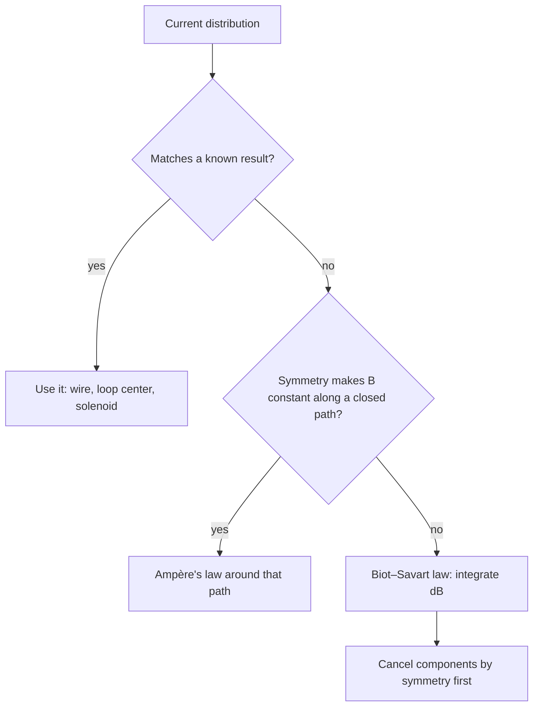

## Currents make magnetic fields

In 1820 Hans Christian Ørsted noticed a compass needle swing when he switched on a nearby current. Every magnetic field, including a bar magnet's, ultimately comes from moving charges. This lesson finds the fields of the most useful current shapes: a long straight wire, a loop, and a coil (solenoid), and shows how parallel currents push and pull on each other.

## Field of a long straight wire

A long straight wire carrying current $I$ makes a magnetic field that circles the wire. At distance $r$, its magnitude is

$$B = \frac{\mu_0I}{2\pi r},$$

where $\mu_0 = 4\pi\times10^{-7}$ T·m/A is the **permeability of free space**. (Since the 2019 redefinition of the SI units, $\mu_0$ is a measured constant, $1.25663706\times10^{-6}$ T·m/A, which still equals $4\pi\times10^{-7}$ to about one part in $10^{10}$, so the $4\pi$ form is exact enough for any calculation here.) (This and the other field formulas in this lesson are derived at the end, from the Biot–Savart law and Ampère's law.) The field weakens as $1/r$, like the electric field of a line charge.

*Direction (right-hand grip rule).* Grasp the wire with your right thumb along the current; your fingers curl in the direction of $\vec B$. Seen from above with current coming toward you, the field circles counterclockwise.

```plot
{"x": [-2.6, 2.6], "y": [-2.6, 2.6], "equal": true, "vectorField": {"u": "-y/(x^2+y^2)", "v": "x/(x^2+y^2)", "step": 0.5}, "points": [{"at": [0, 0], "label": "I out of page"}], "caption": "Field around a wire carrying current out of the page: counterclockwise circles, weaker farther out"}
```

### Example 1

A power line carries 200 A. What is the magnetic field 10 m below it? Compare with Earth's field.

$B = \dfrac{(4\pi\times10^{-7})(200)}{2\pi(10)} = 4.0\times10^{-6}$ T, about 8% of Earth's field ($5\times10^{-5}$ T).

## Field at the center of a loop and inside a solenoid

Bending the wire into a circular loop of radius $R$ concentrates the field. At the center,

$$B = \frac{\mu_0I}{2R},$$

times $N$ for a flat coil of $N$ turns. The field threads through the loop, with direction given by curling your right-hand fingers along the current: your thumb points along $\vec B$ at the center. A loop acts like a small bar magnet, with the side the field exits being its north pole.

A **solenoid** is a long coil of wire. Inside, far from the ends, the field is nearly uniform and parallel to the axis:

$$B = \mu_0nI, \qquad n = \frac NL \text{ (turns per meter)}.$$

The cut-away view below shows why: inside, the fields of the turns on the top and bottom add, while outside they nearly cancel.


Outside, the field is weak. The interior field doesn't depend on the solenoid's radius or on where you are inside it. Wrapping the coil around an iron core multiplies the field hundreds or thousands of times, because the iron's own atomic magnets line up with it; that makes an **electromagnet**, which can be switched off, unlike a permanent magnet.

### Example 2

A solenoid 0.40 m long has 2000 turns and carries 3.0 A. What is the field inside?

$n = 2000/0.40 = 5000$ turns/m. $B = (4\pi\times10^{-7})(5000)(3.0) = 1.88\times10^{-2}$ T, about 400 times Earth's field.

## Forces between parallel currents

Each of two parallel wires sits in the field of the other, so each feels a force. Wire 1's field at wire 2 (distance $d$) is $\mu_0I_1/(2\pi d)$, and the force on a length $L$ of wire 2 is $I_2LB$:

$$\frac FL = \frac{\mu_0I_1I_2}{2\pi d}.$$

Using the right-hand rules: currents in the *same* direction attract, currents in *opposite* directions repel (the reverse of electric charges). This force defined the ampere until 2019: two wires 1 m apart, each carrying 1 A, feel $2\times10^{-7}$ N per meter. (The ampere is now defined by fixing the value of the elementary charge $e$.)

### Example 3

Two long parallel wires 5.0 cm apart carry 10 A and 15 A in opposite directions. What is the force per meter, and is it attractive or repulsive?

$\dfrac FL = \dfrac{(4\pi\times10^{-7})(10)(15)}{2\pi(0.050)} = 6.0\times10^{-4}$ N/m, repulsive.

## Magnetic materials

Electrons spin and orbit, so atoms can be tiny magnets. In most materials these cancel or point randomly. In **ferromagnetic** materials (iron, nickel, cobalt), neighboring atoms' magnets align in regions called domains; an external field grows the domains that point with it, producing strong magnetization. Some ferromagnets keep their alignment when the field is removed: permanent magnets. Heating past the Curie temperature (770°C for iron) destroys ferromagnetism. The next lesson looks at magnetic materials in more detail, along with the Hall effect.

## Deriving the fields: the Biot–Savart law and Ampère's law

The **Biot–Savart law** gives the field of any current distribution. A short element $d\vec\ell$ of wire carrying current $I$ contributes, at a point displaced $\vec r$ from it,

$$d\vec B = \frac{\mu_0}{4\pi}\frac{I\,d\vec\ell\times\hat r}{r^2},$$

and the total field is the integral over the wire. It's the magnetic analog of Coulomb's law: inverse square, but with a cross product.

*Loop center.* Every element is at distance $R$ and perpendicular to $\hat r$, so $dB = \dfrac{\mu_0I\,d\ell}{4\pi R^2}$, all in the same direction. Integrating around the circumference $2\pi R$ gives $B = \dfrac{\mu_0I}{2R}$.

*Straight wire.* For an element at position $x$ along an infinite wire, a point at perpendicular distance $a$ gets $dB = \dfrac{\mu_0I}{4\pi}\dfrac{a\,dx}{(x^2 + a^2)^{3/2}}$; integrating over all $x$ gives $\dfrac{\mu_0I}{2\pi a}$.

**Ampère's law** is the magnetic counterpart of Gauss's law, a shortcut for symmetric situations. For steady currents, around any closed path,

$$\oint\vec B\cdot d\vec\ell = \mu_0I_{\text{enc}},$$

where $I_{\text{enc}}$ is the current passing through any surface bounded by the path. (With changing electric fields, as in a charging capacitor, Maxwell's extra term is needed; see the light lesson.) For a straight wire, choose a circle of radius $r$: $B(2\pi r) = \mu_0I$, the result above in one line. For a solenoid, a rectangular path with one side inside (length $L$) gives $BL = \mu_0nLI$. Inside a thick wire of radius $R$ carrying uniform current, a circle of radius $r < R$ encloses $I(r/R)^2$, so $B = \dfrac{\mu_0Ir}{2\pi R^2}$, growing linearly from zero at the center.

Which tool to reach for depends on the symmetry of the current:



## Common mistakes

- Using $1/r^2$ for a straight wire's field (it's $1/r$).
- Confusing $n$ (turns per meter) with $N$ (total turns) in $B = \mu_0nI$.
- Getting the parallel-wire rule backwards (like currents attract).
- Using the force right-hand rule where the grip rule is needed.

## Key points

- Straight wire: $B = \mu_0I/(2\pi r)$, circling the wire (right-hand grip).
- Loop center: $B = \mu_0I/(2R)$ per turn. Solenoid: $B = \mu_0nI$, uniform inside.
- Parallel wires: $F/L = \mu_0I_1I_2/(2\pi d)$; same direction attract.
- $\mu_0 = 4\pi\times10^{-7}$ T·m/A (measured since 2019, but equal to this to 10 digits).
- Biot–Savart: $d\vec B = \dfrac{\mu_0}{4\pi}\dfrac{I\,d\vec\ell\times\hat r}{r^2}$. Ampère: $\oint\vec B\cdot d\vec\ell = \mu_0I_{\text{enc}}$.
