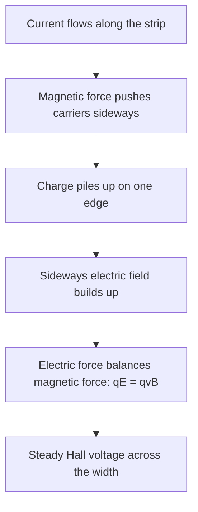
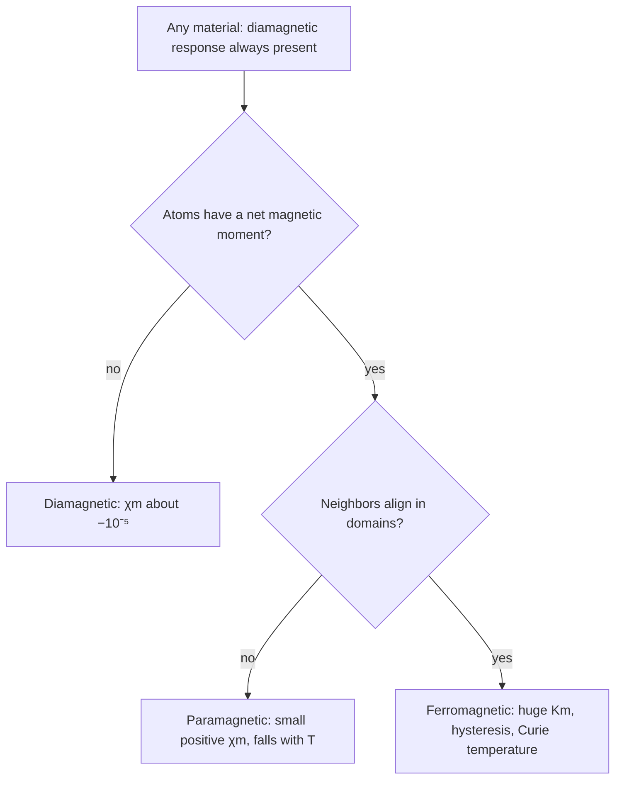

## Inside the conductor, inside the atom

The last two lessons treated magnetic forces on moving charges and the fields that currents make, mostly in empty space or in plain wires. This lesson looks inside materials, in two ways. First, the force $q\vec v\times\vec B$ acts on the individual charge carriers in a wire, and the **Hall effect** lets us see it, which tells us the sign of the carriers and gives a simple way to measure a field. Second, atoms are themselves tiny current loops, so every material responds to a magnetic field: weakly in most cases, enormously in iron. That response is why an iron core multiplies a solenoid's field.

## The Hall effect

Take a flat conducting strip of width $w$ and thickness $t$ carrying a current $I$ along its length, and put it in a field $\vec B$ perpendicular to its face. The carriers drift along the strip with speed $v_d$, and the magnetic force pushes them sideways, toward one edge. Charge piles up there, the opposite edge is left with the opposite charge, and a sideways electric field $E_H$ builds up across the strip. The pile-up stops when the electric force balances the magnetic force on each carrier:

$$qE_H = qv_dB \quad\Rightarrow\quad E_H = v_dB.$$

The voltage across the width, the **Hall voltage**, is then $V_H = E_Hw = v_dBw$. Using $I = nqv_dA$ with cross-section $A = wt$ (from the current lesson) to replace $v_d$,

$$V_H = \frac{IB}{nqt},$$

where $n$ is the number of carriers per cubic meter and $t$ is the thickness measured along $\vec B$.

```shape
{"polygons": [{"points": [[0, 0], [6, 0], [6, 2], [0, 2]]}], "segments": [{"from": [0.4, 1], "to": [2.2, 1], "arrow": true, "label": "I"}, {"from": [4.4, 0.9], "to": [4.4, 1.7], "arrow": true, "label": "F on electrons"}, {"from": [6.6, 0], "to": [6.6, 2], "dashed": true, "label": "V_H"}], "labels": [{"at": [3, 2.3], "text": "− − − − − − −"}, {"at": [3, -0.3], "text": "+ + + + + + +"}, {"at": [4.9, 0.35], "text": "B into page"}], "caption": "Hall effect in a metal: with B into the page, the electrons (drifting left) are pushed to the top edge, which becomes negative"}
```

The build-up is practically instantaneous, but it happens in this order:



Three things make the Hall effect useful.

- *The sign of the carriers.* Positive carriers moving with the current and negative carriers moving against it are pushed toward the *same* edge, so that edge charges positive or negative depending on the carriers' sign. In 1879 this showed that the carriers in most metals are negative. In p-type semiconductors the edge comes out positive: the current is carried by "holes" that act as positive charges.
- *Counting carriers.* Measuring $V_H$, $I$, $B$ and $t$ gives $n$.
- *Measuring fields.* With $n$, $t$ and $I$ known, $V_H$ is proportional to $B$. A **Hall probe** is a small semiconductor chip used exactly this way. Semiconductors have far fewer carriers than metals, so $V_H$ is millions of times larger and easy to read. Phones use Hall sensors as compasses and to detect a closed cover.

### Example 1

A copper strip 2.0 cm wide and 1.0 mm thick carries 20 A in a 1.5 T field perpendicular to its face. Copper has $8.5\times10^{28}$ free electrons per m³. Find the Hall voltage and the drift speed.

$V_H = \dfrac{IB}{nqt} = \dfrac{(20)(1.5)}{(8.5\times10^{28})(1.602\times10^{-19})(1.0\times10^{-3})} = 2.2\times10^{-6}$ V, about 2 μV.

$v_d = \dfrac{I}{nqwt} = \dfrac{20}{(8.5\times10^{28})(1.602\times10^{-19})(2.0\times10^{-5})} = 7.3\times10^{-5}$ m/s.

Check: $v_dBw = (7.3\times10^{-5})(1.5)(0.020) = 2.2\times10^{-6}$ V. A Hall voltage this small is hard to measure, which is why practical probes use semiconductors.

### Example 2

A Hall probe is a semiconductor chip 0.20 mm thick with $2.0\times10^{21}$ carriers per m³ (charge $e$ each). With 5.0 mA through it, it reads 12 mV. What is the field?

$B = \dfrac{V_Hnqt}{I} = \dfrac{(0.012)(2.0\times10^{21})(1.602\times10^{-19})(2.0\times10^{-4})}{5.0\times10^{-3}} = 0.15$ T.

## Atoms as magnets

An electron orbiting a nucleus is a tiny current loop with a magnetic dipole moment, and every electron also has an intrinsic spin moment of about one **Bohr magneton**, $\mu_B = 9.27\times10^{-24}$ J/T. In many atoms these moments cancel in pairs; in others (iron, oxygen, aluminum) an atom is left with a net moment.

Inside a material, the moments add up to a **magnetization** $\vec M$, the net magnetic dipole moment per unit volume (units A/m). Fill a long solenoid with a material, and the material's aligned moments act like extra surface current, adding $\mu_0M$ to the field:

$$B = B_0 + \mu_0M,$$

where $B_0 = \mu_0nI$ is the field the coil alone would make. For most materials $M$ is proportional to $B_0$, written $\mu_0M = \chi_mB_0$ with **magnetic susceptibility** $\chi_m$. Then

$$B = (1 + \chi_m)B_0 = K_mB_0, \qquad \mu = K_m\mu_0,$$

where $K_m = 1 + \chi_m$ is the **relative permeability** (also written $\mu_r$) and $\mu$ is the material's **permeability**. Inside a filled solenoid $B = \mu nI$: the material simply replaces $\mu_0$ by $\mu$, much as a dielectric multiplies capacitance by $\kappa$.

## Three kinds of magnetic response

**Diamagnetism**. An applied field speeds up some electron orbits and slows others, and by Lenz's law the change in their moments *opposes* the field. Every material does this, but the effect is tiny: $\chi_m$ is negative and about $-10^{-5}$ (water $-9\times10^{-6}$, bismuth $-1.7\times10^{-4}$). Diamagnetic materials are weakly pushed out of strong-field regions; a strong enough magnet can levitate a frog, which is mostly water. A superconductor expels the field completely, $\chi_m = -1$, a perfect diamagnet.

**Paramagnetism**. In atoms with net moments, the field tends to line the moments up while thermal motion scrambles them. The alignment is slight, so $\chi_m$ is small and positive, around $10^{-5}$ to $10^{-3}$ (aluminum $+2\times10^{-5}$). Since heat fights the alignment, $\chi_m$ falls as temperature rises, roughly as $1/T$ (**Curie's law**). Paramagnets are weakly drawn into strong fields: liquid oxygen clings to the poles of a magnet.

**Ferromagnetism**. In iron, nickel, cobalt and some alloys, a quantum-mechanical interaction aligns neighboring atoms' moments with each other, in regions called **magnetic domains**. With no applied field the domains point in different directions and largely cancel. A small applied field grows the domains that point along it, producing a huge magnetization: $K_m$ runs from hundreds to many thousands. It is not a constant, though. As the field rises the iron **saturates** (around 2 T for iron), and when the field is removed some alignment remains.

In this simplified scheme (it leaves out other types, such as antiferromagnets and ferrimagnets), two questions sort a material: whether its atoms carry a net moment and whether neighboring moments line up with each other:



| Type | $\chi_m$ | Pulled toward strong field? | Examples |
|---|---|---|---|
| Diamagnetic | small, negative ($\sim -10^{-5}$) | pushed away, weakly | water, copper, bismuth |
| Paramagnetic | small, positive ($10^{-5}$ to $10^{-3}$) | drawn in, weakly | aluminum, oxygen |
| Ferromagnetic | large ($10^2$ to $10^5$), not constant | drawn in, strongly | iron, nickel, cobalt |

## Hysteresis

Plot a ferromagnet's field $B$ against the applied field $B_0$ as $B_0$ is cycled up and down, and the curve does not retrace itself. This lag is **hysteresis**. When $B_0$ returns to zero, a **remanent** field is left: the iron has become a permanent magnet. Driving the field to zero takes a reverse applied field, the coercive field.

```plot
{"x": [-4, 4], "y": [-1.3, 1.3], "functions": [{"f": "tanh(x + 1)"}, {"f": "tanh(x - 1)"}, {"f": "tanh(x)", "from": 0, "to": 4, "dashed": true}], "points": [{"at": [0, 0.76], "label": "remanence"}, {"at": [-1, 0], "label": "coercive field"}], "labels": [{"at": [-1.9, 0.5], "text": "B₀ decreasing"}, {"at": [1.3, -0.55], "text": "B₀ increasing"}], "xLabel": "applied B₀", "yLabel": "B", "caption": "A hysteresis loop (schematic). The dashed curve is the first magnetization; afterward the material follows the loop"}
```

The area inside the loop measures the energy turned into heat every cycle. Transformer cores use "soft" ferromagnets with thin loops, so little energy is wasted 60 times a second. Permanent magnets and magnetic storage use "hard" ferromagnets with fat loops, which are hard to demagnetize. Above the **Curie temperature** (770°C for iron), thermal motion destroys the domains and a ferromagnet becomes merely paramagnetic.

### Example 3

A solenoid has 2000 turns per meter and carries 0.10 A. Find the field inside when it is empty, when it is filled with aluminum ($\chi_m = 2.2\times10^{-5}$), and when it is filled with iron that has $K_m = 4000$ at this field. Also find the iron's magnetization.

*Empty:* $B_0 = \mu_0nI = (4\pi\times10^{-7})(2000)(0.10) = 2.51\times10^{-4}$ T.

*Aluminum:* $B = (1 + 2.2\times10^{-5})B_0$, an increase of only $5.5\times10^{-9}$ T. For almost every purpose, dia- and paramagnets can be treated as empty space.

*Iron:* $B = K_mB_0 = 4000(2.51\times10^{-4}) = 1.0$ T, four thousand times the empty value, from a tenth of an ampere.

*Magnetization:* $M = \dfrac{B - B_0}{\mu_0} = (K_m - 1)nI = 3999(2000)(0.10) = 8.0\times10^5$ A/m.

## Common mistakes

- Using the strip's width for $t$ in $V_H = IB/(nqt)$. The thickness that matters is the one measured along $\vec B$.
- Assuming positive and negative carriers pile up on opposite edges. They pile up on the same edge; that is why the Hall sign identifies them.
- Treating $K_m$ of iron as a fixed constant. It depends on the field and on the iron's history, and it collapses at saturation.
- Calling diamagnetism "no magnetism". It is a real, weak repulsion present in all matter.

## Key points

- Hall effect: $E_H = v_dB$, $V_H = v_dBw = \dfrac{IB}{nqt}$; its sign gives the carriers' sign.
- Magnetization $M$ = dipole moment per volume; $B = B_0 + \mu_0M$.
- Linear materials: $B = K_mB_0$, $K_m = 1 + \chi_m$, $\mu = K_m\mu_0$, filled solenoid $B = \mu nI$.
- Diamagnetic: $\chi_m < 0$, tiny. Paramagnetic: $\chi_m > 0$, tiny, falls with temperature. Ferromagnetic: domains, huge and field-dependent $K_m$, saturation, hysteresis, Curie temperature.
