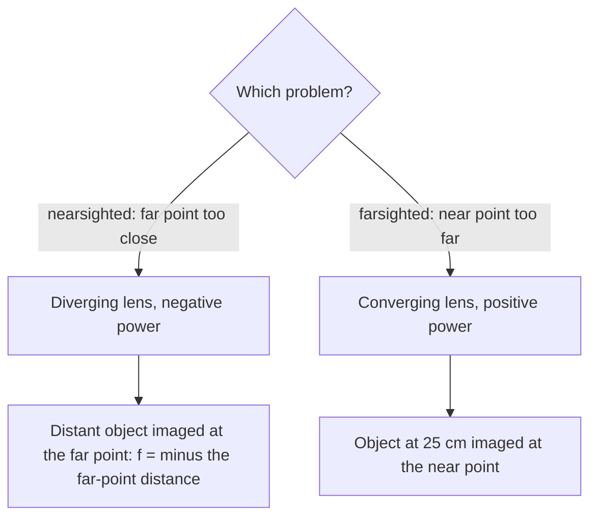

## From one surface to whole instruments

The previous lesson treated a thin lens as a single object with one focal length. A real lens is two curved surfaces, and many optical systems contain just one: the front of your eye, a glass rod with a rounded end, the wall of a fishbowl, the flat surface of a pool. This lesson first finds how a single curved boundary between two materials forms an image, then puts lenses together into the instruments that extend our eyes: eyeglasses, the magnifying glass, the microscope and the telescope.

## Refraction at a spherical surface

Let a spherical surface of radius $R$ separate a material of index $n_1$ (where the light starts) from one of index $n_2$. Light from an object at distance $d_o$ in front of the surface forms an image at distance $d_i$, where

$$\frac{n_1}{d_o} + \frac{n_2}{d_i} = \frac{n_2 - n_1}{R}.$$

The signs follow the same real-is-positive rules as the thin-lens equation:

- $d_o > 0$ for a real object on the incoming side.
- $d_i > 0$ for a real image on the outgoing side (inside material 2); $d_i < 0$ for a virtual image on the incoming side.
- $R > 0$ when the center of curvature is on the outgoing side (the surface bulges toward the incoming light), $R < 0$ when it is on the incoming side.

The lateral magnification is $m = -\dfrac{n_1d_i}{n_2d_o}$.

```shape
{"x": [-6.6, 7.6], "y": [-3, 3], "curves": [{"x": "3 - 3cos(t)", "y": "3sin(t)", "t": [-1.1, 1.1]}], "segments": [{"from": [-6.6, 0], "to": [7.6, 0], "dashed": true}, {"from": [-6, 0], "to": [0.402, 1.5], "arrow": true}, {"from": [0.402, 1.5], "to": [7, 0], "arrow": true}, {"from": [3, 0], "to": [-1.16, 2.4], "dashed": true}], "points": [{"at": [-6, 0], "label": "O"}, {"at": [7, 0], "label": "I"}, {"at": [3, 0], "label": "C"}], "labels": [{"at": [-4.5, -1.2], "text": "n₁"}, {"at": [4.5, -1.2], "text": "n₂ > n₁"}, {"at": [-1.9, 2.7], "text": "normal"}], "caption": "A convex surface (R > 0): a ray from O bends toward the normal, which runs through the center of curvature C, and crosses the axis at the image I"}
```

*Where it comes from.* A ray from the object meets the surface at height $h$. In the small-angle approximation the ray from the object makes angle $h/d_o$ with the axis, the ray to the image makes angle $h/d_i$, and the normal (which passes through the center of curvature) makes angle $h/R$. The angle of incidence is the sum of the first and third, and the angle of refraction is the third minus the second. Snell's law with small angles, $n_1\theta_1 = n_2\theta_2$, then becomes $n_1(h/d_o + h/R) = n_2(h/R - h/d_i)$. Divide by $h$ and rearrange to get the equation above. Since $h$ cancels, every paraxial ray from the object meets at the same image point. Applying the equation twice, once for each face of a thin lens with the first image serving as the object for the second face, gives the lensmaker's equation.

*Flat surfaces.* For a plane boundary $R \to \infty$, the right side is zero, and $d_i = -\dfrac{n_2}{n_1}d_o$: a virtual image on the object's side. This is **apparent depth**. Looking down into water ($n_1 = 1.33$, $n_2 = 1.00$), objects appear at $1/1.33 = 0.75$ of their true depth, which is why pools look shallower than they are.

### Example 1

A long glass rod ($n = 1.50$) in air has a convex hemispherical end of radius 2.0 cm. An object sits on the rod's axis 8.0 cm in front of the end. Locate and describe the image.

The center of curvature is inside the glass, on the outgoing side, so $R = +2.0$ cm. Then

$$\frac{1.00}{8.0} + \frac{1.50}{d_i} = \frac{1.50 - 1.00}{2.0} = 0.250, \quad \frac{1.50}{d_i} = 0.125, \quad d_i = 12\text{ cm}.$$

The image is real, 12 cm inside the rod. $m = -\dfrac{(1.00)(12)}{(1.50)(8.0)} = -1.0$: inverted and the same size.

### Example 2

A coin lies on the bottom of a pool 1.80 m deep. How deep does it appear to someone looking straight down?

$d_i = -\dfrac{n_2}{n_1}d_o = -\dfrac{1.00}{1.33}(1.80) = -1.35$ m. The image is virtual, 1.35 m below the surface.

## The eye and corrective lenses

The eye's cornea does most of the focusing (its curved surface is exactly the single-surface case), and the lens behind it fine-tunes. Muscles change the lens's shape so that objects at different distances focus on the retina; this is **accommodation**. The nearest point a person can focus on is the **near point**, about 25 cm for a young adult and farther with age; the farthest is the **far point**, at infinity for a normal eye.

The diagram names the main parts. Light enters through the curved, transparent cornea, passes through the pupil (the opening in the colored iris), is fine-focused by the lens and lands on the retina, whose signals travel to the brain along the optic nerve.


- A **nearsighted** (myopic) eye has a far point closer than infinity. A diverging lens takes light from a distant object and makes it appear to come from the far point: $f = -(\text{far point distance})$.
- A **farsighted** (hyperopic) eye has a near point beyond 25 cm. A converging lens takes an object at 25 cm and makes a virtual image at the person's near point.



### Example 3

(a) A nearsighted person's far point is 50 cm. (b) A farsighted person's near point is 100 cm. What lens powers do they need? Treat the lenses as being at the eye.

(a) Distant objects must image at $d_i = -50$ cm: $\dfrac1f = \dfrac{1}{\infty} + \dfrac{1}{-0.50\text{ m}}$, so $P = -2.0$ D.

(b) An object at $d_o = 0.25$ m must image at $d_i = -1.00$ m: $P = \dfrac{1}{0.25} - \dfrac{1}{1.00} = +3.0$ D.

## The magnifying glass

How big something looks depends on the angle it covers at your eye. The best you can do unaided is to hold it at your near point $N = 25$ cm, where an object of height $h$ covers angle $h/N$. A converging lens lets you bring it much closer. With the object at the lens's focal point, the image is at infinity (comfortable for a relaxed eye) and covers angle $h/f$. The **angular magnification** is the ratio of the angles:

$$M = \frac{N}{f} = \frac{25\text{ cm}}{f}.$$

A 5.0 cm magnifier gives $M = 5$. (If you place the image at your near point instead, you get slightly more, $M = 1 + N/f$.)

## The compound microscope

A **compound microscope** uses two converging lenses. The **objective**, with a very short focal length, sits just beyond the object and makes an enlarged real image. The **eyepiece** acts as a magnifying glass on that image. The total magnification is the product:

$$M = m_oM_e = \left(-\frac{d_i}{d_o}\right)\frac{25\text{ cm}}{f_e}.$$

### Example 4

A microscope has an objective of focal length 0.40 cm and an eyepiece of focal length 2.5 cm. The specimen is 0.42 cm from the objective. Find the overall magnification.

Objective image: $\dfrac{1}{d_i} = \dfrac{1}{0.40} - \dfrac{1}{0.42}$, so $d_i = 8.4$ cm, and $m_o = -\dfrac{8.4}{0.42} = -20$.

Eyepiece: $M_e = \dfrac{25}{2.5} = 10$.

Overall $M = (-20)(10) = -200$. The image is inverted, which doesn't matter for a specimen on a slide.

## The telescope

A distant object can't be brought closer, so a telescope works on angles only. A refracting telescope's objective, with a long focal length $f_o$, forms a small real image at its focal point; the eyepiece, with a short focal length $f_e$, is placed so that this image is at *its* focal point. The lenses are $f_o + f_e$ apart and the angular magnification is

$$M = -\frac{f_o}{f_e}.$$

A telescope with $f_o = 1.20$ m and $f_e = 3.0$ cm magnifies $-40$ times and is 1.23 m long. Large research telescopes use a curved mirror as the objective instead: mirrors have no dispersion, and they can be supported from behind and made many meters across. A wide objective also gathers more light and, as the next lesson shows, resolves finer detail.

## Common mistakes

- Using $1/d_o + 1/d_i = 1/f$ for a single surface. A single surface needs the indices: $n_1/d_o + n_2/d_i = (n_2 - n_1)/R$.
- Getting the sign of $R$ backward. Ask which side the center of curvature is on.
- Adding magnifications of lenses in a microscope instead of multiplying them.
- Writing the telescope's magnification as $f_e/f_o$. The long focal length goes on top.

## Key points

- Single surface: $\dfrac{n_1}{d_o} + \dfrac{n_2}{d_i} = \dfrac{n_2 - n_1}{R}$, $m = -\dfrac{n_1d_i}{n_2d_o}$; $R > 0$ when the center is on the outgoing side.
- Flat surface: apparent depth $|d_i| = (n_2/n_1)d_o$.
- Near point about 25 cm. Nearsighted: diverging lens, $f = -$far point. Farsighted: converging lens.
- Magnifier $M = 25\text{ cm}/f$; microscope $M = m_oM_e$; telescope $M = -f_o/f_e$, length $f_o + f_e$.
