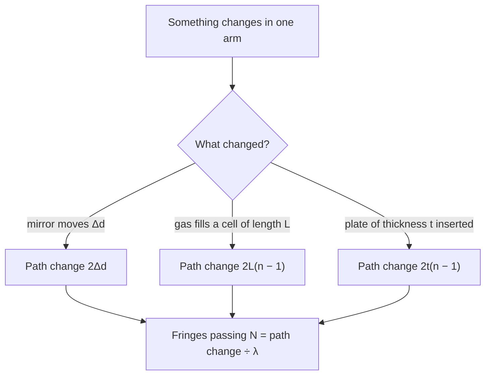

## A ruler made of wavelengths

The interference lesson used two slits and thin films to show that light is a wave: where two coherent waves meet, a path difference of a whole number of wavelengths gives a bright fringe and a half-integer number gives a dark one. That rule can be turned around. If you can see a single fringe shift, you have detected a change in path of less than one wavelength, a fraction of a micrometer. An **interferometer** is an instrument built to do exactly that: it splits light into two beams, sends them along different paths, recombines them and reads the path difference from the fringes. This lesson covers the Michelson interferometer, two simple interferometers you can build from glass plates, the limit set by the light source, and the most sensitive interferometer ever built.

## The Michelson interferometer

Albert Michelson designed his interferometer in 1881. Light from a source meets a **beam splitter**, a glass plate with a thin partly silvered coating that reflects about half the light and transmits the rest. One beam travels down arm 1 to a mirror that can be moved along the arm; the other goes down arm 2 to a fixed mirror. Each mirror sends its beam straight back, the splitter recombines them, and the combined light goes to a screen or detector.

Each beam crosses its arm twice, so if the arms have lengths $L_1$ and $L_2$, the path difference is $2(L_1 - L_2)$. (A real instrument adds a clear *compensator plate* to one arm so both beams pass through the same thickness of glass; we assume that's done.) With the mirrors aligned, the screen shows a pattern of concentric rings, and the center is bright or dark depending on the path difference.

Now slide the movable mirror by $\Delta d$. The path changes by $2\Delta d$, and each time it changes by one wavelength the center goes through one full dark-bright cycle: one **fringe** passes. Counting $N$ fringes therefore means

$$2\Delta d = N\lambda, \qquad \Delta d = N\frac{\lambda}{2}.$$

Each fringe is a mirror motion of half a wavelength, about 0.3 μm for red light. Counting fringes measures distances in units of wavelength; measuring the mirror's motion and counting fringes gives the wavelength.

### Example 1

A technician moves the mirror of a Michelson interferometer 0.250 mm and counts 790 fringes. What is the wavelength?

$\lambda = \dfrac{2\Delta d}{N} = \dfrac{2(0.250\times10^{-3}\text{ m})}{790} = 6.33\times10^{-7}$ m $= 633$ nm, the red line of a helium–neon laser (632.8 nm). Notice the leverage: an error of one fringe in 790 is only about a 0.1% error in $\lambda$.

## Changing the path without moving anything

What matters is the **optical path length**, the geometric length times the index of refraction, $nL$, because light in a material of index $n$ fits $n$ times as many wavelengths into a given length. So anything that changes the index in one arm also shifts the fringes.

Put an empty (evacuated) cell of length $L$ in arm 1 and slowly let a gas in. As the index rises from 1 to $n$, the round-trip optical path grows by $2L(n - 1)$, and the number of fringes that pass is

$$N = \frac{2L(n - 1)}{\lambda}.$$

A thin transparent plate of thickness $t$ placed in one arm likewise adds $2t(n - 1)$. In every case the recipe is the same: find the change in round-trip optical path, then divide by $\lambda$.

### Example 2

A 5.00 cm cell in one arm is pumped out, and then air is let in slowly. With 632.8 nm light, 44 fringes pass. Find the index of air.

$n - 1 = \dfrac{N\lambda}{2L} = \dfrac{44(632.8\times10^{-9}\text{ m})}{2(0.0500\text{ m})} = 2.78\times10^{-4}$, so $n = 1.000278$.

That is close to tabulated values for air near room conditions (about 1.00027 to 1.00029, depending on temperature and pressure). A difference in the fourth decimal place of $n$, impossible to see with Snell's law, becomes 44 easily counted fringes.

## Interference in a thin wedge of air

You don't need mirrors on arms to make an interferometer. Lay one flat glass plate on another, touching along one edge, and slip a hair under the other edge, a distance $L$ away. The thin wedge of air between the plates acts like the thin films of the last core lesson, with a thickness $t$ that grows steadily across the plates.

Light reflects from the bottom of the top plate (glass to air: no phase flip) and from the top of the bottom plate (air to glass: a half-wavelength flip). With one flip, the reflections cancel where

$$2t = m\lambda, \qquad m = 0, 1, 2, \ldots$$

so the line where the plates touch ($t = 0$) is dark, and each further dark fringe marks an extra $\lambda/2$ of thickness. If the hair has diameter $D$, the thickness at distance $x$ from the contact line is $t = Dx/L$, and the dark fringes are equally spaced by

$$\Delta x = \frac{\lambda L}{2D}.$$

Straight, evenly spaced fringes mean the plates are flat. Any bump or dip in a surface bends the fringes, which is how optical shops test flatness to a small fraction of a wavelength.

### Example 3

Two glass plates 8.0 cm long touch at one end and are separated by a hair at the other. In 589 nm sodium light, the dark fringes are 0.50 mm apart. How thick is the hair?

$D = \dfrac{\lambda L}{2\Delta x} = \dfrac{(589\times10^{-9})(0.080)}{2(0.50\times10^{-3})} = 4.7\times10^{-5}$ m $= 47$ μm, a typical thin human hair.

*Newton's rings.* Rest a lens with a gently curved surface of radius $R$ on a flat plate and the air gap grows outward from the contact point as $t \approx r^2/(2R)$. The same one-flip condition gives a dark center surrounded by dark rings of radius $r_m = \sqrt{m\lambda R}$. The rings crowd together farther out because the gap grows faster there. A lens maker reads the shape of a surface from the rings: a distorted ring means a distorted surface.

## Coherence length: why lasers help

Interference needs the two beams to be coherent, and real sources are only partly so. A source emits a spread of wavelengths $\Delta\lambda$ around $\lambda$. Each wavelength makes its own fringe pattern, and at large path differences the patterns drift out of step and wash each other out. The path difference over which fringes stay visible is the **coherence length**, roughly

$$\ell_c \approx \frac{\lambda^2}{\Delta\lambda}$$

(an order-of-magnitude estimate; the exact factor depends on the spectrum's shape). White light ($\lambda \approx 550$ nm, $\Delta\lambda \approx 300$ nm) has $\ell_c \approx 1$ μm, so white-light fringes appear only when the arms are equal to within about a micrometer. That makes them useful for finding the exact equal-arm position. A single spectral line from a lamp has a coherence length of millimeters to centimeters, and a stabilized laser can reach many meters, which is why lasers made interferometry routine.

## History and the biggest interferometer

In 1887 Michelson and Edward Morley used an interferometer to look for Earth's motion through the "luminiferous ether," the medium light was then thought to need. Turning the instrument should have shifted the fringes by a measurable amount if light's speed depended on the direction of Earth's motion. They saw no such shift. That null result became one of the experimental foundations of Einstein's relativity (the modern physics module), although historians debate how much it influenced Einstein directly. Michelson received the 1907 Nobel Prize in Physics for his precision optical instruments and measurements. Interferometers went on to define length itself: from 1960 to 1983 the meter was defined as a fixed number of wavelengths of an orange-red line of krypton-86.

The Laser Interferometer Gravitational-Wave Observatory (LIGO) is, at heart, a Michelson interferometer with arms 4 km long, in which the light bounces back and forth many times to lengthen its path. A passing gravitational wave stretches one arm and squeezes the other by a fraction (the *strain*) of about $10^{-21}$. On 14 September 2015 both LIGO detectors recorded the waves from two merging black holes, the first direct detection; three physicists central to the project shared the 2017 Nobel Prize. The arm length changed by about

$$\Delta L = (10^{-21})(4000\text{ m}) = 4\times10^{-18}\text{ m},$$

a few thousandths of a proton's diameter. LIGO doesn't count whole fringes; it measures a tiny fraction of one with very high laser power and careful isolation from vibration.

## Common mistakes

- Forgetting the factor 2: moving a mirror by $\Delta d$ changes the path by $2\Delta d$, so each fringe is $\lambda/2$ of mirror motion, not $\lambda$.
- Using geometric length instead of optical path length $nL$ when a material is in the beam, or forgetting the $-1$ in $2L(n - 1)$ (the cell held a vacuum, index 1, before).
- In wedges and Newton's rings, forgetting the phase flip: with one flip the contact point is dark, not bright.
- Expecting white-light fringes at any path difference. Fringes need a path difference smaller than the coherence length.

## Key points

- An interferometer splits light, sends it along two paths and reads the path difference from the fringes.
- Michelson: moving a mirror $\Delta d$ passes $N = 2\Delta d/\lambda$ fringes.
- Optical path length is $nL$; a gas cell passes $N = 2L(n - 1)/\lambda$ fringes as it fills.
- Air wedge (one flip): dark where $2t = m\lambda$; fringe spacing $\lambda L/(2D)$. Newton's rings: dark rings at $r = \sqrt{m\lambda R}$.
- Coherence length $\ell_c \approx \lambda^2/\Delta\lambda$: about 1 μm for white light, meters for good lasers.
- The 1887 Michelson–Morley null result; LIGO detects arm changes near $10^{-18}$ m.
