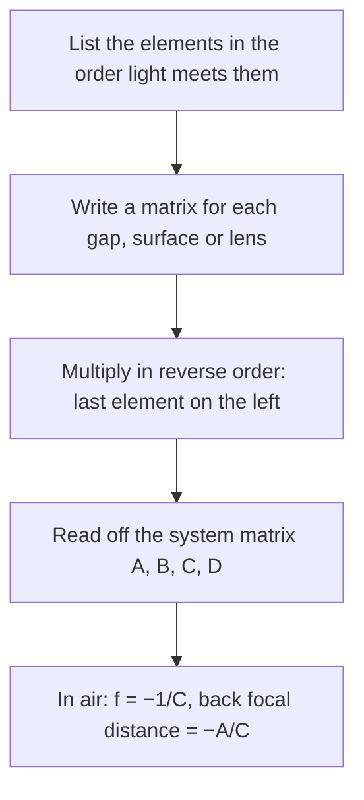

## Bookkeeping for many lenses

The thin-lens lesson handled two lenses by letting the first image serve as the object for the second, and the optical-instruments lesson did the same for each face of a lens. That works, but a camera lens may have a dozen surfaces, and chaining images through all of them gets messy fast. Optical designers use a cleaner method: describe each ray by two numbers, and each piece of the system by a 2 × 2 matrix that turns the ray's numbers before it into the numbers after it. Multiply the matrices and you have the whole system in four entries. The method rests on the same small-angle (paraxial) approximation as the thin-lens equation, so the second half of this lesson looks at what happens when that approximation fails: the **aberrations** that keep real lenses from forming perfect images.

## A ray as a column vector

Let light travel left to right along an optical axis. At any position, a paraxial ray is described by its height $y$ above the axis and its angle $\theta$ to the axis (positive when the ray is rising, in radians). Stack them as a column vector $\begin{pmatrix} y \\ \theta \end{pmatrix}$.

*Translation.* Over a distance $d$ of uniform material the angle doesn't change and the height grows by $d\tan\theta \approx d\theta$:

$$\begin{pmatrix} y' \\ \theta' \end{pmatrix} = \begin{pmatrix} 1 & d \\ 0 & 1 \end{pmatrix}\begin{pmatrix} y \\ \theta \end{pmatrix}.$$

*Thin lens.* A thin lens doesn't change a ray's height, only its angle. A ray through the center ($y = 0$) passes straight through, and a ray parallel to the axis at height $y$ leaves aimed at the far focal point, with angle $-y/f$. The angle change is proportional to the height, so in general $\theta' = \theta - y/f$:

$$\begin{pmatrix} 1 & 0 \\ -1/f & 1 \end{pmatrix}.$$

*Refraction at a spherical surface* from index $n_1$ to $n_2$, with radius $R$ (positive when the center of curvature is on the outgoing side, as in the optical-instruments lesson): small-angle Snell's law gives $n_2\theta' = n_1\theta - (n_2 - n_1)y/R$, so

$$\begin{pmatrix} 1 & 0 \\ -\dfrac{n_2 - n_1}{n_2R} & \dfrac{n_1}{n_2} \end{pmatrix}.$$

You can check this against the single-surface equation: a ray from an axial object at distance $d_o$ has $\theta = y/d_o$, and setting the height to zero a distance $d_i$ past the surface gives $\dfrac{n_1}{d_o} + \dfrac{n_2}{d_i} = \dfrac{n_2 - n_1}{R}$.

## Chaining elements

If the ray passes through element 1, then 2, then 3, the output is $M_3(M_2(M_1\vec r))$, so the **system matrix** is

$$M = M_3M_2M_1 = \begin{pmatrix} A & B \\ C & D \end{pmatrix}.$$

The order matters: the first element the light meets goes on the *right*. A useful check is the determinant, $AD - BC = n_{\text{start}}/n_{\text{end}}$, which is 1 for any system that starts and ends in air.

## Reading the system matrix

Send in a ray parallel to the axis, $\begin{pmatrix} y \\ 0 \end{pmatrix}$. It leaves the last surface at height $Ay$ with angle $Cy$, so it crosses the axis a distance

$$\text{BFD} = -\frac{A}{C}$$

past the last surface. That is the **back focal distance**, where you would put a camera's sensor for distant objects. For a single thin lens $C = -1/f$, and for any system in air we define the **effective focal length** as

$$f = -\frac1C.$$

It sets the image size, just as $f$ does for a single thin lens: an object at infinity subtending angle $\alpha$ gives an image of height $f\alpha$.

Matrices also find images. If the matrix from an object plane to some later plane has $B = 0$, every ray from a given object point reaches the same height there, whatever its angle: that plane holds the image, and $A$ is the magnification. For the thin-lens lesson's Example 1 (object 30 cm from a 10 cm lens, image 15 cm beyond it), multiplying gap, lens, gap gives

$$\begin{pmatrix} 1 & 15 \\ 0 & 1 \end{pmatrix}\begin{pmatrix} 1 & 0 \\ -0.1 & 1 \end{pmatrix}\begin{pmatrix} 1 & 30 \\ 0 & 1 \end{pmatrix} = \begin{pmatrix} -0.5 & 0 \\ -0.1 & -2 \end{pmatrix}:$$

$B = 0$ and $m = A = -0.5$, as before.

### Example 1: a telephoto pair

A converging lens ($f_1 = +10$ cm) is followed 5.0 cm later by a diverging lens ($f_2 = -10$ cm). Find the effective focal length and where the focus of distant objects lies.

Lens 1, then a 5.0 cm gap, then lens 2:

$$M = \begin{pmatrix} 1 & 0 \\ 0.1 & 1 \end{pmatrix}\begin{pmatrix} 1 & 5 \\ 0 & 1 \end{pmatrix}\begin{pmatrix} 1 & 0 \\ -0.1 & 1 \end{pmatrix} = \begin{pmatrix} 0.5 & 5 \\ -0.05 & 1.5 \end{pmatrix}.$$

(The determinant is $0.75 + 0.25 = 1$, as it must be.) Effective focal length $f = -1/(-0.05) = 20$ cm; back focal distance $-0.5/(-0.05) = 10$ cm. The focus is $5 + 10 = 15$ cm behind the first lens, yet the system makes images as large as a single 20 cm lens would. This is the idea behind a **telephoto lens**: a long focal length in a short barrel.

For any two thin lenses a distance $d$ apart, the $C$ entry gives the general rule

$$\frac1f = \frac{1}{f_1} + \frac{1}{f_2} - \frac{d}{f_1f_2},$$

which reduces to adding powers, $P = P_1 + P_2$, for lenses in contact.

### Example 2: a thick lens

A glass lens ($n = 1.50$) has $R_1 = +10$ cm, $R_2 = -10$ cm and is 2.0 cm thick at the center. Compare its focal length with the thin-lens value.

First surface (air to glass): $-\dfrac{1.50 - 1.00}{1.50(10)} = -0.0333$ and $\dfrac{1.00}{1.50} = 0.667$. Second surface (glass to air, $R = -10$ cm): $-\dfrac{1.00 - 1.50}{1.00(-10)} = -0.05$ and $\dfrac{1.50}{1.00} = 1.5$. Then

$$M = \begin{pmatrix} 1 & 0 \\ -0.05 & 1.5 \end{pmatrix}\begin{pmatrix} 1 & 2 \\ 0 & 1 \end{pmatrix}\begin{pmatrix} 1 & 0 \\ -0.0333 & 0.667 \end{pmatrix} = \begin{pmatrix} 0.933 & 1.333 \\ -0.0967 & 0.933 \end{pmatrix}.$$

$f = -1/C = 10.3$ cm and $\text{BFD} = 0.933/0.0967 = 9.66$ cm. The lensmaker's equation, which ignores thickness, gives exactly 10 cm. The 2 cm of glass changes $f$ by about 3%, and the focus sits 9.66 cm from the back surface, not 10.3 cm: for a thick lens, "where is the lens?" no longer has a single answer.

## When the small-angle approximation fails: aberrations

Everything so far assumed $\sin\theta \approx \theta$. Rays far from the axis or steeply tilted break that assumption, and a real lens no longer sends every ray from a point to one image point. These departures are aberrations.

**Spherical aberration**. With spherical surfaces, rays that hit near the edge of a converging lens or concave mirror are bent a little too much and cross the axis closer than the paraxial focus. The image of a point becomes a small blur. Cures: block the outer rays with a smaller aperture (losing light), use aspheric surfaces, or, for a mirror imaging distant objects on its axis, make it a paraboloid, which brings every incoming parallel ray to exactly one focus. The Hubble Space Telescope's 2.4 m primary mirror, launched in 1990, had been polished to the wrong shape, too flat near the edge by about 2.2 μm, and suffered badly from spherical aberration. Astronauts installed corrective optics in 1993, designed to cancel the error.

Off the axis, further aberrations named *coma*, *astigmatism*, *field curvature* and *distortion* blur or warp the image; lens designers balance all of them at once.

**Chromatic aberration**. The index of glass depends on wavelength (dispersion), so a single lens has a slightly shorter focal length for violet light than for red, and white points get colored fringes. Mirrors don't have this problem, since the law of reflection doesn't involve $n$; it is one reason large telescopes use mirrors. A glass's dispersion is summarized by its **Abbe number**

$$V = \frac{n_d - 1}{n_F - n_C},$$

using indices at three standard wavelengths: yellow 587.6 nm ($d$), blue 486.1 nm ($F$) and red 656.3 nm ($C$). A large $V$ means low dispersion. Because a thin lens's power is proportional to $n - 1$, its power changes by $P/V$ between the blue and red wavelengths.

An **achromatic doublet** cancels this by cementing a converging lens of low-dispersion crown glass to a weaker diverging lens of high-dispersion flint glass. Their powers add, $P_1 + P_2 = P$, and their color errors cancel when

$$\frac{P_1}{V_1} + \frac{P_2}{V_2} = 0.$$

Solving, $P_1 = \dfrac{PV_1}{V_1 - V_2}$ and $P_2 = -\dfrac{PV_2}{V_1 - V_2}$. The idea dates from the 1730s (Chester Moor Hall) and was made commercial by John Dollond in the 1750s.

### Example 3

Design an achromatic doublet of focal length 100 mm ($P = 10.0$ D) from crown glass ($V_1 = 64.2$) and flint glass ($V_2 = 36.4$).

$V_1 - V_2 = 27.8$. $P_1 = \dfrac{(10.0)(64.2)}{27.8} = +23.1$ D, so $f_1 = +43.3$ mm. $P_2 = -\dfrac{(10.0)(36.4)}{27.8} = -13.1$ D, so $f_2 = -76.4$ mm. Check: $23.1 - 13.1 = 10.0$ D. Each element is much stronger than the doublet; the strong crown lens supplies the power, and the flint lens undoes its color spread while taking back only part of the power. Red and blue now share a focus (other wavelengths still differ slightly, a small leftover called the secondary spectrum).

## Common mistakes

- Multiplying matrices in the order the light meets them. The first element goes on the right: $M = M_3M_2M_1$.
- Using the thin-lens matrix for a thick lens. Use two surface matrices with the glass's thickness between them.
- Reading the focus from the effective focal length. The focus is $-A/C$ past the last surface (the back focal distance); $f = -1/C$ sets the image size.
- Forgetting that spherical aberration and chromatic aberration have different causes: the shape of the surface versus the dispersion of the glass. Mirrors have the first but not the second.

## Key points

- Paraxial ray: $(y, \theta)$. Translation $\begin{pmatrix} 1 & d \\ 0 & 1 \end{pmatrix}$; thin lens $\begin{pmatrix} 1 & 0 \\ -1/f & 1 \end{pmatrix}$; surface $\begin{pmatrix} 1 & 0 \\ -(n_2 - n_1)/(n_2R) & n_1/n_2 \end{pmatrix}$.
- System matrix $M = M_k\cdots M_2M_1$; determinant $n_{\text{start}}/n_{\text{end}}$.
- In air: $f = -1/C$, back focal distance $-A/C$; imaging plane where $B = 0$, magnification $A$.
- Two thin lenses: $1/f = 1/f_1 + 1/f_2 - d/(f_1f_2)$.
- Spherical aberration: edge rays focus short; cured by apertures, aspheres, paraboloids. Chromatic aberration: dispersion; cured by an achromatic doublet with $P_1/V_1 + P_2/V_2 = 0$.
