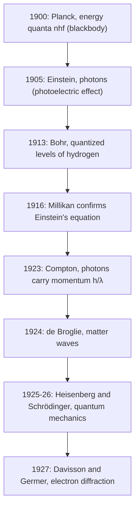

## Two more cracks in classical physics

The previous lesson began with photons and mentioned that Planck introduced energy quanta to explain the light from glowing objects. This lesson tells that story properly, because it is where quantum physics started, and then adds the experiment that convinced most physicists that photons are real particles: the **Compton effect**, in which X-rays bounce off electrons like billiard balls. Along the way you get two practical tools, Wien's law and the Stefan–Boltzmann law, that astronomers and engineers use every day to read temperatures from light.

The two experiments in this lesson bracket the early history of quantum physics, which unfolded over less than three decades.



## Thermal radiation

Every object above absolute zero emits electromagnetic radiation because its charged particles jiggle with thermal motion. At room temperature the radiation is infrared and invisible; a stove element at 1000 K glows dull red; a lamp filament near 3000 K glows yellow-white. An ideal absorber, which absorbs every wavelength that falls on it, is called a **blackbody**, and it is also the ideal emitter. A small hole in a hollow box is an excellent blackbody: light that enters bounces around inside and almost never gets out. The radiation leaking out of such a hole has a spectrum that depends *only* on the temperature, not on what the box is made of. That universality is what made it a fundamental puzzle.

Two measured facts describe the spectrum.

**Wien's displacement law**. The wavelength at which the emission peaks is inversely proportional to the absolute temperature:

$$\lambda_{\max}T = 2.898\times10^{-3}\text{ m·K}.$$

Hotter objects peak at shorter wavelengths. The Sun's surface, about 5800 K, peaks near 500 nm in the visible; your skin at about 307 K peaks near 9.4 μm in the infrared, which is what thermal cameras see; the cosmic microwave background at 2.725 K peaks near 1.1 mm.

The **Stefan–Boltzmann law**. The total power radiated grows as the fourth power of temperature:

$$P = e\sigma AT^4, \qquad \sigma = 5.67\times10^{-8}\text{ W/(m}^2\text{·K}^4),$$

where $A$ is the surface area and $e$ the **emissivity**, between 0 and 1 (1 for a blackbody). An object in surroundings at temperature $T_s$ also absorbs radiation, so its net loss is $e\sigma A(T^4 - T_s^4)$. Doubling the absolute temperature multiplies the radiated power by 16.

### Example 1

(a) A star's spectrum peaks at 290 nm. Estimate its surface temperature and the power it radiates per square meter. (b) A person with 1.8 m² of skin at 307 K (emissivity 0.97) stands in a room at 295 K. What is the net power lost by radiation?

(a) $T = \dfrac{2.898\times10^{-3}}{290\times10^{-9}} = 9.99\times10^3$ K, a hot blue-white star. Per square meter, $\sigma T^4 = (5.67\times10^{-8})(9.99\times10^3)^4 = 5.65\times10^8$ W/m².

(b) $P_{\text{net}} = (0.97)(5.67\times10^{-8})(1.8)\left[(307)^4 - (295)^4\right] = 130$ W. The person emits about 880 W but absorbs about 750 W from the walls, so the net loss is comparable to their resting metabolic rate.

## The ultraviolet catastrophe and Planck's quanta

Classical physics predicted the spectrum by counting the standing-wave modes of the field in a box and giving each one an average energy $k_BT$ (equipartition). The number of modes grows rapidly at short wavelengths, so the predicted intensity grows as $1/\lambda^4$ without limit: every warm object should blaze with ultraviolet and X-rays, and the total power should be infinite. This failure became known as the **ultraviolet catastrophe**.

```plot
{"x": [0, 3], "y": [0, 0.3], "functions": [{"f": "1/(x^5*(exp(2.398/x) - 1))", "from": 0.1}, {"f": "1/(x^5*(exp(2.878/x) - 1))", "from": 0.1}, {"f": "1/(x^5*(exp(3.597/x) - 1))", "from": 0.1}, {"f": "1/(2.878*x^4)", "from": 0.9, "dashed": true}], "labels": [{"at": [0.62, 0.275], "text": "6000 K"}, {"at": [0.85, 0.115], "text": "5000 K"}, {"at": [1.1, 0.045], "text": "4000 K"}, {"at": [1.75, 0.2], "text": "classical, 5000 K"}], "xLabel": "λ (μm)", "yLabel": "intensity", "caption": "Blackbody spectra (relative units). Hotter bodies emit far more and peak at shorter wavelengths; the classical prediction (dashed) runs off to infinity at short wavelengths"}
```

In 1900 Max Planck found a formula that fit the data perfectly, and then found what it required: the oscillating charges in the walls can only have energies in whole-number multiples of $hf$. A mode of high frequency needs a large minimum energy $hf$, far more than the typical thermal energy $k_BT$, so it is rarely excited at all. The short-wavelength modes are frozen out, and the spectrum turns over instead of blowing up. **Planck's radiation law** for the intensity per unit wavelength is

$$I(\lambda, T) = \frac{2\pi hc^2}{\lambda^5\left(e^{hc/\lambda k_BT} - 1\right)}.$$

For long wavelengths, $e^{x} - 1 \approx x$ and it reduces to the classical $2\pi ck_BT/\lambda^4$. Setting $dI/d\lambda = 0$ gives $\dfrac{hc}{\lambda_{\max}k_BT} = 4.965$, which is Wien's law with $hc/(4.965k_B) = 2.898\times10^{-3}$ m·K. Integrating over all wavelengths gives $\sigma T^4$ with $\sigma = \dfrac{2\pi^5k_B^4}{15c^2h^3}$. Both empirical laws fall out of one formula, with Planck's constant $h$ the only new ingredient.

## The Compton effect

In 1923 Arthur Compton aimed X-rays at a carbon target and measured the wavelength of the X-rays scattered at different angles. The scattered rays had a *longer* wavelength than the incoming ones, and the shift depended only on the scattering angle $\theta$:

$$\lambda' - \lambda = \frac{h}{m_ec}(1 - \cos\theta).$$

A classical wave cannot do this: an electron shaken by a wave re-radiates at the same frequency it is shaken at. A particle can. Treat the X-ray as a photon with energy $hc/\lambda$ and momentum $h/\lambda$ colliding with a free electron at rest. In the collision the photon gives some energy to the recoiling electron, so it comes away with less energy and a longer wavelength. Writing conservation of energy (with the electron's relativistic energy) and conservation of momentum in two directions, then eliminating the electron's speed and recoil angle, gives exactly the formula above.

```shape
{"segments": [{"from": [-4, 0], "to": [-0.15, 0], "arrow": true, "label": "photon, λ"}, {"from": [0, 0], "to": [3, 0], "dashed": true}, {"from": [0.1, 0.08], "to": [2.3, 1.93], "arrow": true, "label": "photon, λ′"}, {"from": [0.1, -0.07], "to": [1.97, -1.38], "arrow": true, "label": "electron"}], "points": [{"at": [0, 0]}], "labels": [{"at": [-0.35, 0.35], "text": "e⁻"}, {"at": [0.75, 0.22], "text": "θ"}, {"at": [0.75, -0.32], "text": "φ"}], "caption": "Compton scattering: the photon scatters at angle θ with a longer wavelength, and the electron recoils at angle φ"}
```

The constant $\dfrac{h}{m_ec} = 2.43\times10^{-12}$ m $= 2.43$ pm is the **Compton wavelength** of the electron. The shift runs from zero (photon barely deflected) to $2h/(m_ec) = 4.86$ pm (photon sent straight back). Because the shift is only a few picometers, it matters for X-rays and gamma rays, whose wavelengths are comparable, but is utterly negligible for visible light at 500 nm. The energy lost by the photon is the electron's kinetic energy: $K = \dfrac{hc}{\lambda} - \dfrac{hc}{\lambda'}$.

### Example 2

X-rays of wavelength 70.0 pm scatter from electrons at $90^\circ$. Find the scattered wavelength and the kinetic energy of the recoiling electron.

At $90^\circ$, $\cos\theta = 0$, so $\Delta\lambda = 2.43$ pm and $\lambda' = 72.43$ pm.

Using $hc = 1240$ eV·nm with wavelengths in nm: $K = 1240\left(\dfrac{1}{0.07000} - \dfrac{1}{0.07243}\right) = 1240(14.286 - 13.806) = 594$ eV. The photon started with $1240/0.0700 = 17.7$ keV, so it lost about 3% of its energy.

### Example 3

A 0.200 nm X-ray photon is scattered straight back ($\theta = 180^\circ$). What is the new wavelength, and what fraction of its energy did the photon lose?

$\Delta\lambda = 2(2.43\text{ pm}) = 4.86$ pm, so $\lambda' = 204.86$ pm $= 0.2049$ nm. The energy is proportional to $1/\lambda$, so the fraction lost is $1 - \lambda/\lambda' = 1 - 200/204.86 = 0.024$, about 2.4%. Longer wavelengths lose a smaller fraction, which is why the effect needs X-rays to show up.

## Common mistakes

- Using Celsius in $T^4$ or in Wien's law. Both need kelvins.
- Forgetting that a body also absorbs from its surroundings: net power uses $T^4 - T_s^4$, not $(T - T_s)^4$.
- Thinking Wien's law gives the *only* wavelength emitted. It gives the peak of a broad spectrum.
- Getting the Compton shift's angle dependence backward: the shift is zero at $0^\circ$ and largest, $2h/(m_ec)$, at $180^\circ$.
- Expecting the Compton shift to depend on the incoming wavelength. The *shift* doesn't; the *fractional* change does.

## Key points

- Blackbody spectrum depends only on $T$. Wien: $\lambda_{\max}T = 2.898\times10^{-3}$ m·K. Stefan–Boltzmann: $P = e\sigma AT^4$, net $e\sigma A(T^4 - T_s^4)$.
- The classical prediction diverges at short wavelengths (ultraviolet catastrophe); Planck's quantized energies $nhf$ fix it.
- Compton: $\lambda' - \lambda = \dfrac{h}{m_ec}(1 - \cos\theta)$, $h/(m_ec) = 2.43$ pm; photons carry momentum $h/\lambda$ and collide like particles.
- Electron recoil energy $K = hc/\lambda - hc/\lambda'$.
