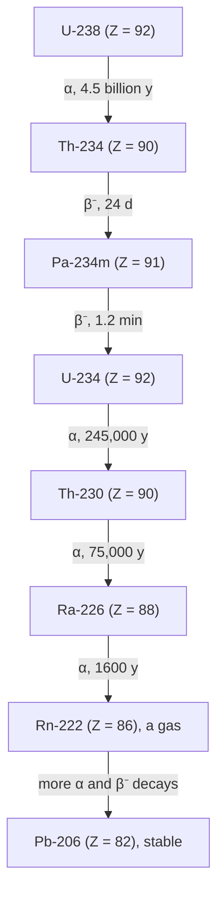

## Inside the nucleus

Almost all of an atom's mass is packed into its nucleus, a region a few femtometers across (1 fm $= 10^{-15}$ m; from about 2 fm for light nuclei to about 15 fm for uranium), tens of thousands of times smaller than the atom. Nuclear physics explains why some nuclei are stable and others fall apart, where the Sun's energy comes from, how reactors and medical isotopes work, and how we date ancient objects. This final lesson draws on two ideas from earlier: $E = mc^2$ and exponential decay.

## Nuclear structure

A nucleus contains protons and neutrons, together called **nucleons**. The **atomic number** $Z$ is the number of protons (it fixes the element); the **mass number** $A$ is the total number of nucleons; the neutron number is $N = A - Z$. A nucleus is written $^A_Z\text{X}$, for example $^{12}_{6}\text{C}$ (6 protons, 6 neutrons). **Isotopes** of an element have the same $Z$ but different $N$: carbon-12, carbon-13, carbon-14.

Protons repel each other electrically, so something stronger must hold the nucleus together: the **strong nuclear force**, an attraction between nucleons that is about 100 times stronger than the electric force but acts only over about $10^{-15}$ m. In heavy nuclei the long-range electric repulsion adds up while the short-range strong force doesn't, so heavy nuclei need extra neutrons for stability, and beyond lead ($Z = 82$) no nucleus is fully stable.

Nuclear masses are measured in **atomic mass units**: $1\text{ u} = 1.6605\times10^{-27}$ kg, equivalent to 931.5 MeV of rest energy. A proton is 1.007276 u, a neutron 1.008665 u.

## Binding energy

The mass of a nucleus is *less* than the total mass of its separate protons and neutrons. The difference, the **mass defect** $\Delta m$, corresponds to the **binding energy** $E_B = \Delta m\,c^2$: the energy released when the nucleus forms, or needed to pull it completely apart.

### Example 1

Find the binding energy of helium-4. Its atomic mass is 4.002603 u; use hydrogen-atom mass 1.007825 u (one proton plus one electron, so electron masses cancel) and neutron mass 1.008665 u.

Separate parts: $2(1.007825) + 2(1.008665) = 4.032980$ u.

Mass defect: $4.032980 - 4.002603 = 0.030377$ u.

$E_B = 0.030377(931.5) = 28.3$ MeV, or 7.07 MeV per nucleon. That's millions of times the few eV holding electrons in atoms, which is why nuclear reactions release so much energy.

*Binding energy per nucleon* rises steeply for light nuclei, peaks near iron-56 at about 8.8 MeV, and falls slowly for heavy ones. Energy is released by moving toward the peak:

- **Fission**: a heavy nucleus such as uranium-235 splits into two medium nuclei (about 200 MeV per fission). Neutrons released can trigger more fissions, a chain reaction, used in reactors and bombs.
- **Fusion**: light nuclei combine, as when hydrogen fuses into helium in the Sun (about 26.7 MeV per helium nucleus formed). It requires extreme temperatures to overcome electric repulsion.

```plot
{"x": [0, 250], "y": [0, 10], "xLabel": "mass number A", "yLabel": "MeV per nucleon", "segments": [{"from": [2, 1.11], "to": [4, 7.07]}, {"from": [4, 7.07], "to": [6, 5.33]}, {"from": [6, 5.33], "to": [12, 7.68]}, {"from": [12, 7.68], "to": [16, 7.98]}, {"from": [16, 7.98], "to": [56, 8.79]}, {"from": [56, 8.79], "to": [84, 8.72]}, {"from": [84, 8.72], "to": [120, 8.51]}, {"from": [120, 8.51], "to": [138, 8.39]}, {"from": [138, 8.39], "to": [208, 7.87]}, {"from": [208, 7.87], "to": [238, 7.57]}], "points": [{"at": [2, 1.11], "label": "²H"}, {"at": [4, 7.07], "label": "⁴He"}, {"at": [6, 5.33]}, {"at": [12, 7.68]}, {"at": [16, 7.98]}, {"at": [56, 8.79], "label": "⁵⁶Fe"}, {"at": [84, 8.72]}, {"at": [120, 8.51]}, {"at": [138, 8.39]}, {"at": [208, 7.87]}, {"at": [238, 7.57], "label": "²³⁸U"}], "labels": [{"at": [100, 3], "text": "fusion releases energy (move right)"}, {"at": [170, 6], "text": "fission releases energy (move left)"}], "caption": "Measured binding energy per nucleon for hydrogen-2, helium-4, lithium-6, carbon-12, oxygen-16, iron-56, krypton-84, tin-120, barium-138, lead-208 and uranium-238 (lines just join the points). Helium-4 is unusually tightly bound"}
```

## Radioactive decay

Unstable nuclei decay spontaneously, emitting radiation:

| Decay | Emitted | Change in nucleus | Example |
|---|---|---|---|
| Alpha (α) | helium nucleus $^4_2\text{He}$ | $Z - 2$, $A - 4$ | $^{238}_{92}\text{U} \to {}^{234}_{90}\text{Th} + \alpha$ |
| Beta minus (β⁻) | electron (and antineutrino) | neutron → proton: $Z + 1$, $A$ same | $^{14}_{6}\text{C} \to {}^{14}_{7}\text{N} + e^- + \bar\nu$ |
| Beta plus (β⁺) | positron (and neutrino) | proton → neutron: $Z - 1$ | $^{18}_{9}\text{F} \to {}^{18}_{8}\text{O} + e^+ + \nu$ |
| Gamma (γ) | high-energy photon | no change in $Z$ or $A$; nucleus drops to a lower energy state | follows many α and β decays |

In every nuclear reaction, *charge* (sum of $Z$) and *nucleon number* (sum of $A$) are conserved: the numbers on both sides balance. Alpha particles are stopped by paper, beta particles by a few millimeters of aluminum, gamma rays need thick lead or concrete.


Many heavy nuclei reach stability only after a whole series of decays. Uranium-238 starts the longest natural chain; its first steps are below (with half-lives). Each step obeys the rules in the table.



Over the whole chain there are 8 alpha and 6 beta-minus decays: $A$ drops by $8 \times 4 = 32$ (238 to 206) and $Z$ by $16 - 6 = 10$ (92 to 82). Radon-222, a gas, seeps out of soil and rock, which is why it builds up in some basements.

## Half-life and the decay law

Decay is random: you can't predict when one nucleus will decay, but a large sample decays at a predictable rate. The number of decays per second, the **activity** $R$, is proportional to the number of nuclei present: $R = \lambda N$, where $\lambda$ is the decay constant. The result is exponential decay:

$$N(t) = N_0e^{-\lambda t} = N_0\left(\tfrac12\right)^{t/T_{1/2}}.$$

The **half-life** $T_{1/2}$ is the time for half the nuclei (and half the activity) to decay:

$$T_{1/2} = \frac{\ln 2}{\lambda} = \frac{0.693}{\lambda}.$$

After one half-life, half remain; after two, a quarter; after ten, about 0.1%. Half-lives range from fractions of a second to billions of years (uranium-238: 4.5 billion years). Activity is measured in becquerels (1 Bq = 1 decay/s).

```plot
{"x": [0, 5.2], "y": [0, 1.1], "xLabel": "time (half-lives)", "yLabel": "fraction remaining", "functions": [{"f": "0.5^x"}], "points": [{"at": [1, 0.5], "label": "1/2"}, {"at": [2, 0.25], "label": "1/4"}, {"at": [3, 0.125], "label": "1/8"}], "caption": "Exponential decay: the amount halves every half-life"}
```

### Example 2

Iodine-131, used to treat thyroid disease, has a half-life of 8.0 days. A sample has activity 400 MBq. What is its activity after 24 days? After 30 days?

24 days is exactly 3 half-lives: $400(\tfrac12)^3 = 50$ MBq.

30 days: $400(\tfrac12)^{30/8.0} = 400(0.5)^{3.75} = 400(0.0743) = 29.7$ MBq.

### Example 3: carbon dating

Living things maintain a constant ratio of carbon-14 to carbon-12 while alive; after death the C-14 decays with half-life 5730 years. A wooden artifact has 35% of the C-14 activity of living wood. How old is it?

$0.35 = (\tfrac12)^{t/5730}$, so $t = 5730\dfrac{\ln 0.35}{\ln 0.5} = 5730(1.515) = 8680$ years.

## The decay law as a differential equation

The decay law is the differential equation

$$\frac{dN}{dt} = -\lambda N,$$

the same first-order equation as RC discharge and Newton's cooling. Separating variables, $\int_{N_0}^N\dfrac{dN'}{N'} = -\lambda\int_0^tdt'$, gives $N = N_0e^{-\lambda t}$. Setting $N = N_0/2$ gives $T_{1/2} = \ln 2/\lambda$.

The **mean lifetime** of a nucleus is the average of $t$ over the decay distribution: $\tau = \displaystyle\int_0^\infty t\,\lambda e^{-\lambda t}\,dt = \dfrac1\lambda$ (here $\lambda e^{-\lambda t}\,dt$ is the fraction of nuclei that decay between $t$ and $t + dt$), so $T_{1/2} = \tau\ln 2$. For a chain where A decays to B which also decays, $\dfrac{dN_B}{dt} = \lambda_AN_A - \lambda_BN_B$; when B's half-life is much shorter, it settles into secular equilibrium with $\lambda_AN_A = \lambda_BN_B$, equal activities.

## Common mistakes

- Thinking all the sample is gone after two half-lives (a quarter remains).
- Using $N_0/2t$ or linear decay instead of exponential.
- Forgetting to balance both $Z$ and $A$ in decay equations.
- Confusing mass number $A$ with atomic mass in kilograms, or binding energy with total rest energy.

## Key points

- $^A_Z\text{X}$: $Z$ protons, $A$ nucleons; isotopes share $Z$.
- Binding energy $E_B = \Delta m\,c^2$; 1 u $\leftrightarrow$ 931.5 MeV; per-nucleon peak near iron.
- α: $Z - 2$, $A - 4$; β⁻: $Z + 1$; β⁺: $Z - 1$; γ: no change.
- $N = N_0(\tfrac12)^{t/T_{1/2}} = N_0e^{-\lambda t}$; $T_{1/2} = 0.693/\lambda$; activity $R = \lambda N$.
