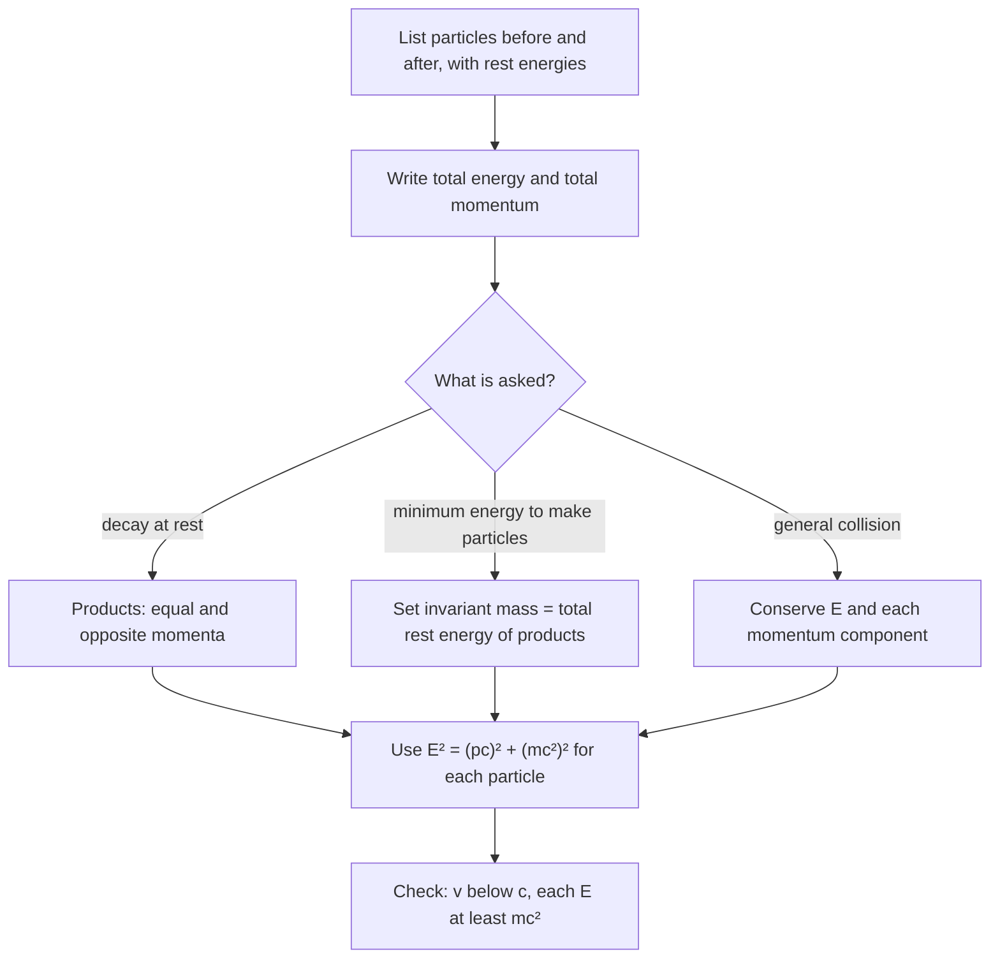

## From one particle to many

The relativity lesson ended with the energy–momentum relation $E^2 = (pc)^2 + (mc^2)^2$ for a single particle. Particle physics is almost entirely about *several* particles: a pion decaying into a muon and a neutrino, an electron and a positron annihilating into two photons, protons smashed together to make new particles. Newtonian collision rules fail badly at these speeds, but the fix is short. This lesson shows how to combine conservation of relativistic energy and momentum with one powerful new idea, the invariant mass, to answer the questions particle physicists ask every day: how fast do the decay products fly apart, and how much beam energy does it take to create a new particle?

## Units that make the algebra easy

At these energies joules and kilograms are clumsy. Physicists measure energy in MeV or GeV, momentum in MeV/$c$, and mass in MeV/$c^2$. Then $pc$ and $mc^2$ are both in MeV, and the energy–momentum relation is simply

$$E^2 = (pc)^2 + (mc^2)^2.$$

A proton has $m_pc^2 = 938.3$ MeV, so its mass is 938.3 MeV/$c^2$. A proton with momentum 1000 MeV/$c$ has $E = \sqrt{1000^2 + 938.3^2} = 1371$ MeV. In this lesson masses are written as rest energies ($mc^2$ in MeV) and momenta as $pc$ in MeV, so every quantity is in MeV.

## What is conserved, and what is not

In every collision or decay, in every inertial frame:

- **Total energy** is conserved, where each particle's energy is $E = \gamma mc^2$, *including* its rest energy.
- **Total momentum** (a vector) is conserved, with each particle's momentum $\vec p = \gamma m\vec v$.

What is *not* conserved is the sum of the rest masses, and neither is kinetic energy on its own. In a decay, rest energy turns into kinetic energy; in a particle-producing collision, kinetic energy turns into rest energy. That is $E_0 = mc^2$ in action. "Elastic" and "inelastic" keep their meanings: an elastic collision leaves the same particles with the same masses, so kinetic energy is conserved too.

## The invariant mass of a system

For one particle, $E^2 - (pc)^2 = (mc^2)^2$ is the same in every frame, even though $E$ and $p$ separately change from frame to frame. The same is true for a whole system of particles if you use the *totals*:

$$(Mc^2)^2 = \Big(\sum E\Big)^2 - \Big|\sum \vec pc\Big|^2.$$

$M$ is the system's **invariant mass**. Because it is the same in every frame, you can compute it in whichever frame is easiest. The most useful one is the **center-of-momentum frame**, the frame in which the total momentum is zero. There $Mc^2$ is just the total energy. So the invariant mass is the energy available to make particles: no matter how the energy is shared, the products can never have total rest energy greater than $Mc^2$.

Two consequences come quickly.

- A single photon cannot turn into an electron–positron pair in empty space. A lone photon has $E = pc$, so its invariant mass is zero, but the pair has an invariant mass of at least $2m_ec^2 = 1.022$ MeV. **Pair production** needs a nearby nucleus to take up momentum; the photon then needs just over 1.022 MeV (the nucleus's recoil takes a tiny extra share).
- In **annihilation**, an electron and a positron nearly at rest have total momentum zero and total energy $2(0.511)$ MeV. One photon cannot carry away zero momentum with nonzero energy, so at least two photons are made: in the commonest case two of 0.511 MeV each, flying off back to back. PET scanners locate a tracer in the body by detecting these photon pairs. Their wavelength is $1240\text{ eV·nm}/511{,}000\text{ eV} = 2.43$ pm, exactly the Compton wavelength $h/(m_ec)$ from the previous lesson.

## Two-body decays

When a particle of mass $M$ decays at rest into two particles of masses $m_1$ and $m_2$, momentum conservation forces the two products to fly apart back to back with equal momenta $p$. Energy conservation says $E_1 + E_2 = Mc^2$. Writing $E_2^2 = E_1^2 - (m_1c^2)^2 + (m_2c^2)^2$ (both have the same $pc$) and solving gives

$$E_1 = \frac{(Mc^2)^2 + (m_1c^2)^2 - (m_2c^2)^2}{2Mc^2}, \qquad pc = \sqrt{E_1^2 - (m_1c^2)^2}.$$

The energies are fixed: a two-body decay at rest always gives each product the *same* energy. (This is why the continuous spread of electron energies in beta decay was such a puzzle in the 1920s: it pointed to a third, unseen particle, the neutrino, which Pauli proposed in 1930.)

### Example 1

A positive pion at rest ($m_\pi c^2 = 139.6$ MeV) decays into a muon ($m_\mu c^2 = 105.7$ MeV) and a neutrino, whose mass is negligible here. Find the muon's momentum and kinetic energy.

**Energy of the muon.** With $m_2 = 0$:

$$E_\mu = \frac{139.6^2 + 105.7^2}{2(139.6)} = \frac{19{,}488 + 11{,}172}{279.2} = 109.8\text{ MeV}.$$

**Momentum.** $pc = \sqrt{109.82^2 - 105.7^2} = 29.8$ MeV, so $p = 29.8$ MeV/$c$. (Shortcut: the neutrino has $E_\nu = pc$, and $E_\mu + E_\nu = 139.6$ MeV, which gives $pc = (139.6^2 - 105.7^2)/(2 \cdot 139.6) = 29.8$ MeV directly.)

**Kinetic energy.** $K_\mu = E_\mu - m_\mu c^2 = 109.8 - 105.7 = 4.1$ MeV. The neutrino carries the other 29.8 MeV. The light particle takes most of the released energy, as in a gun's recoil: equal momenta, unequal energies.

A Newtonian calculation would fail here: with $\tfrac12mv^2$ and a massless neutrino there is no consistent answer at all.

## Threshold energy for making new particles

Accelerators make new particles by turning kinetic energy into rest energy. In a **fixed-target** experiment, a beam particle of mass $m_a$ and total energy $E_a$ hits a particle of mass $m_b$ at rest. The invariant mass of the pair is

$$(Mc^2)^2 = (E_a + m_bc^2)^2 - (p_ac)^2 = (m_ac^2)^2 + (m_bc^2)^2 + 2E_am_bc^2.$$

The reaction can happen only if $Mc^2$ is at least the total rest energy $\Sigma$ of the products. Setting them equal gives the **threshold energy**, the smallest beam kinetic energy that works:

$$K_{\text{th}} = \frac{\Sigma^2 - (m_ac^2 + m_bc^2)^2}{2m_bc^2}.$$

At threshold the products are all at rest in the center-of-momentum frame, so they move together in the lab: part of the beam's energy is always "wasted" on the motion of the center of momentum.

### Example 2

The antiproton was discovered in 1955 at Berkeley's Bevatron, an accelerator built to give protons about 6 GeV. The reaction is $p + p \to p + p + p + \bar p$ (charge and the count of protons minus antiprotons must balance, so an antiproton comes with an extra proton). Find the threshold kinetic energy for a proton beam on a fixed proton target.

All four products and both initial particles have rest energy $m_pc^2 = 938.3$ MeV, so $\Sigma = 4m_pc^2$ and $m_ac^2 + m_bc^2 = 2m_pc^2$:

$$K_{\text{th}} = \frac{(4m_pc^2)^2 - (2m_pc^2)^2}{2m_pc^2} = \frac{12(m_pc^2)^2}{2m_pc^2} = 6m_pc^2 = 5.63\text{ GeV}.$$

Only $2m_pc^2 = 1.88$ GeV of new rest energy is created, yet the beam needs three times that. Newtonian intuition would have suggested 1.88 GeV.

## Colliders versus fixed targets

If two equal beams of energy $E$ collide head-on, the total momentum is zero: the lab *is* the center-of-momentum frame, and all of $2E$ is available. Physicists write the invariant mass of the colliding pair as $\sqrt{s}$, so for a symmetric collider $\sqrt{s} = 2E$. For a fixed target at very high energy ($E_a \gg mc^2$), the formula above gives $\sqrt{s} \approx \sqrt{2E_am_bc^2}$, which grows only as the *square root* of the beam energy. That is why the highest-energy machines today are all colliders.

### Example 3

The Large Hadron Collider has run with 6.8 TeV proton beams (since 2022). (a) What is $\sqrt{s}$ for head-on collisions? (b) What $\sqrt{s}$ would a 6.8 TeV beam give on a fixed proton target? (c) What beam energy would a fixed-target machine need to match (a)?

(a) $\sqrt{s} = 2(6.8) = 13.6$ TeV.

(b) $(Mc^2)^2 = 2(938.3)^2 + 2(6.8\times10^6)(938.3)$ MeV², so $Mc^2 = \sqrt{1.276\times10^{10}}$ MeV $= 113$ GeV, less than 1% of the collider value.

(c) Solve $(13.6\times10^6)^2 = 2(938.3)^2 + 2E_a(938.3)$ for $E_a$: $E_a = 9.9\times10^{10}$ MeV $\approx 1\times10^{17}$ eV. No accelerator comes close, but cosmic rays at and above that energy do strike the atmosphere: nature runs fixed-target experiments far beyond any machine.

## Common mistakes

- Conserving rest mass or kinetic energy. Only total energy (with rest energy included) and momentum are conserved.
- Adding the invariant masses of the parts to get the invariant mass of a system. Two photons each have zero mass, but a pair flying apart has an invariant mass; use the totals $\sum E$ and $\sum\vec p$.
- Setting the beam's kinetic energy equal to the products' extra rest energy. In a fixed-target collision the center of momentum keeps moving, so the threshold is higher (6 $m_pc^2$, not 2 $m_pc^2$, for antiprotons).
- Forgetting that momentum is a vector: in a decay at rest the products' momenta are equal *and opposite*.
- Mixing units: keep everything in MeV ($pc$, $mc^2$, $E$) and convert at the end.

## Key points

- Conserved: total energy $\sum\gamma mc^2$ and total momentum $\sum\gamma m\vec v$. Not conserved: total rest mass, total kinetic energy (except in elastic collisions).
- Invariant mass: $(Mc^2)^2 = (\sum E)^2 - |\sum\vec pc|^2$, the same in every frame; it equals the total energy in the center-of-momentum frame.
- Two-body decay at rest: $E_1 = \dfrac{(Mc^2)^2 + (m_1c^2)^2 - (m_2c^2)^2}{2Mc^2}$; the products share equal and opposite momenta.
- Fixed-target threshold: $K_{\text{th}} = \dfrac{\Sigma^2 - (m_ac^2 + m_bc^2)^2}{2m_bc^2}$; antiprotons need $6m_pc^2$.
- Colliders: $\sqrt{s} = 2E$; fixed target: $\sqrt{s} \approx \sqrt{2E_am_bc^2}$ at high energy.
- A lone photon cannot make a pair; electron–positron annihilation at rest gives two 0.511 MeV photons back to back.
