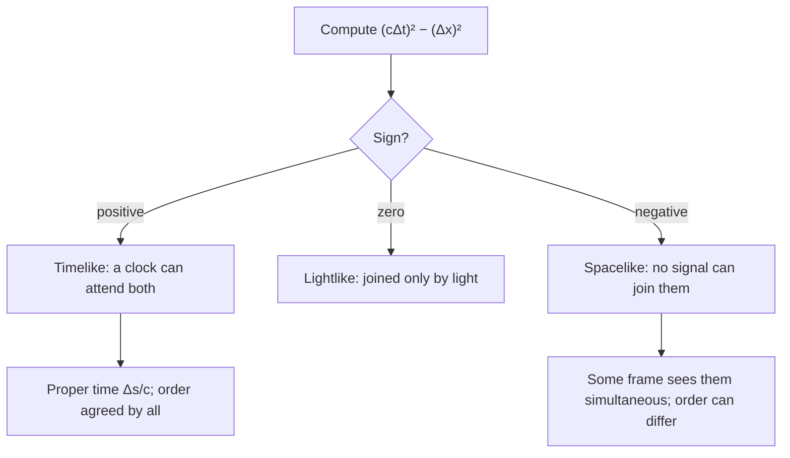

## Seeing relativity as geometry

The relativity lesson derived time dilation from a light clock and length contraction from the muon's point of view, and it closed with the Lorentz transformation. Those results can feel like a list of separate surprises. In 1908 Hermann Minkowski showed that they are all consequences of one geometric fact: space and time together form a four-dimensional **spacetime**, with its own rule for measuring "distance". This lesson uses that geometry to settle the most famous puzzle in relativity, the twin paradox, and then works out how relativity changes the Doppler effect for light, which is how astronomers measure the speeds of distant galaxies.

## Spacetime diagrams

A **spacetime diagram** plots position $x$ across and time up, measured as $ct$ so both axes are in meters (or in light-years and years). A point is an **event**: something that happens at one place at one moment. The history of an object is a line called its **worldline**. An object at rest is a vertical line; one moving at constant speed $v$ is a straight line tilted from the vertical, with $\Delta x/\Delta(ct) = v/c$. A light pulse moves one light-year per year, so its worldline is at exactly $45^\circ$. Because nothing outruns light, every massive object's worldline is steeper than $45^\circ$.

The two $45^\circ$ lines through an event form its **light cone** (a cone when two space dimensions are drawn). Events inside the upper half can be reached from it by something moving slower than light: the event can cause them. Events outside the cone cannot be affected by it at all.

## The spacetime interval

Different observers disagree about $\Delta t$ and about $\Delta x$ between two events. But one combination of them is the same for everyone. The **spacetime interval** is

$$(\Delta s)^2 = (c\Delta t)^2 - (\Delta x)^2.$$

Using the Lorentz transformation, $c\Delta t' = \gamma(c\Delta t - \beta\Delta x)$ and $\Delta x' = \gamma(\Delta x - \beta c\Delta t)$ with $\beta = v/c$. Squaring and subtracting, the cross terms cancel and

$$(c\Delta t')^2 - (\Delta x')^2 = \gamma^2(1 - \beta^2)\left[(c\Delta t)^2 - (\Delta x)^2\right] = (c\Delta t)^2 - (\Delta x)^2,$$

since $\gamma^2(1 - \beta^2) = 1$. The interval plays the role that distance plays in ordinary geometry, except for the minus sign, which is what makes spacetime geometry different from Euclid's.

The sign of $(\Delta s)^2$ sorts every pair of events into one of three kinds:

For a **timelike** separation, a clock can travel from one event to the other, and in the frame where it is at rest, $\Delta x' = 0$. Then $\Delta s = c\Delta t'$: the interval divided by $c$ is the proper time. Time dilation is simply the statement that $\Delta t_0 = \sqrt{(\Delta t)^2 - (\Delta x/c)^2}$ is shorter than $\Delta t$. For a **spacelike** separation, there is a frame in which the events are simultaneous, and frames moving one way or the other see them in opposite orders. That is harmless: since no signal can connect them, neither can cause the other.

### Example 1

In Earth's frame, event A happens at $x = 0$, $t = 0$, and event B at $x = 900$ m, $t = 5.00$ μs. (a) Classify the separation and find the proper time between them. (b) Repeat for event C at $x = 2000$ m, $t = 5.00$ μs, and find the speed of a frame in which A and C are simultaneous.

(a) $c\Delta t = (3.00\times10^8)(5.00\times10^{-6}) = 1500$ m. $(\Delta s)^2 = 1500^2 - 900^2 = 1.44\times10^6$ m², positive, so timelike, with $\Delta s = 1200$ m. Proper time: $1200/(3.00\times10^8) = 4.00$ μs. Check: a clock moving from A to B has $v = 900/(5.00\times10^{-6}) = 1.8\times10^8$ m/s $= 0.60c$, so $\gamma = 1.25$ and $5.00/1.25 = 4.00$ μs ✓.

(b) $(\Delta s)^2 = 1500^2 - 2000^2 < 0$: spacelike. Setting $\Delta t' = \gamma(\Delta t - v\Delta x/c^2) = 0$ gives $v = c^2\Delta t/\Delta x = c\,(1500/2000) = 0.75c$. An observer moving at $0.75c$ toward $+x$ sees A and C at the same time; one moving faster than that sees C first.

## The twin paradox

One twin stays on Earth. The other flies at $0.60c$ to a star 6.0 light-years away (Earth frame), turns around and flies back. Earth's clocks show $2(6.0/0.60) = 20$ years for the trip. The traveler, with $\gamma = 1.25$, ages $20/1.25 = 16$ years and comes home four years younger.

The "paradox": from the traveler's point of view, Earth was moving, so shouldn't the *Earth* twin be younger? No, because the situation is not symmetric. The Earth twin stays in one inertial frame the whole time. The traveler uses two different inertial frames, one going out and one coming back, and feels the acceleration at the turnaround. On a spacetime diagram the Earth twin's worldline is straight and the traveler's is bent.

Compute each twin's proper time from the interval. For Earth: $\Delta x = 0$, so $c\tau = 20$ light-years: 20 years. For each leg of the trip: $c\Delta t = 10$ ly, $\Delta x = 6.0$ ly, so $c\tau = \sqrt{10^2 - 6.0^2} = 8.0$ ly: 8.0 years per leg, 16 in total. The minus sign in the interval reverses the triangle inequality: **in spacetime, the straight (inertial) worldline between two events has the *longest* proper time**, and any detour makes a clock read less. The effect is real and measured: atomic clocks flown around the world on airliners in 1971 (Hafele and Keating) disagreed with ground clocks by tens to hundreds of nanoseconds as predicted (gravity also contributes there), and muons circulating in a storage ring at CERN in the 1970s lived longer by the predicted factor $\gamma \approx 29$.

## The relativistic Doppler effect

Sound's Doppler formula depends on motion relative to the air. Light has no medium, so only the *relative* velocity of source and observer can matter. Let a source emit waves with period $T_0$ in its own frame and move directly away from the observer at speed $v$. In the observer's frame the source's clock runs slow, so the emissions are $\gamma T_0$ apart; during that time the source moves $v\gamma T_0$ farther away, so each wavefront has an extra distance $v\gamma T_0$ to travel. The received period is

$$T = \gamma T_0\left(1 + \beta\right) = T_0\frac{1 + \beta}{\sqrt{1 - \beta^2}} = T_0\sqrt{\frac{1 + \beta}{1 - \beta}}.$$

So for a source and observer moving apart,

$$f_{\text{obs}} = f_{\text{src}}\sqrt{\frac{1 - \beta}{1 + \beta}}, \qquad \lambda_{\text{obs}} = \lambda_{\text{src}}\sqrt{\frac{1 + \beta}{1 - \beta}},$$

and for approach, change the sign of $\beta$. Receding sources are **redshifted** (longer wavelength); approaching ones are blueshifted. Astronomers report the **redshift** $z = \lambda_{\text{obs}}/\lambda_{\text{src}} - 1$. For $\beta \ll 1$ the formula reduces to the familiar $z \approx \beta$. (For very distant galaxies the redshift comes from the expansion of space, which needs general relativity; the special-relativistic formula is the right one for objects moving through space, such as stars in our galaxy or jets from black holes.)

Relativity also predicts a **transverse Doppler effect**: a source moving at right angles to the line of sight (in the observer's frame) is still redshifted, by the factor $\gamma$, purely from time dilation. Sound has no such effect.

### Example 2

The red hydrogen line has $\lambda = 656.3$ nm in the lab. (a) What wavelength is seen from a source receding at $0.20c$? (b) A star's line is observed at 700.0 nm. How fast is it receding, and how good is the estimate $\beta \approx z$?

(a) $\lambda = 656.3\sqrt{1.20/0.80} = 656.3(1.2247) = 803.8$ nm, in the infrared.

(b) Let $r = 700.0/656.3 = 1.06659$. Then $r^2 = (1 + \beta)/(1 - \beta)$, so $\beta = \dfrac{r^2 - 1}{r^2 + 1} = \dfrac{0.13762}{2.13762} = 0.0644$. The approximation gives $z = 0.0666$, about 3% too high.

### Example 3

Back to the twins. The traveler sends a radio pulse to Earth on each of her birthdays. How often do they arrive at Earth on each leg, and does the total add up?

Outbound, she recedes at $\beta = 0.60$: the period is multiplied by $\sqrt{1.6/0.4} = 2$, so pulses arrive every 2 Earth years. Her 8 outbound pulses arrive over 16 years: the pulse from the turnaround (sent at Earth time 10 years from 6 light-years away) arrives at year 16. Coming back she approaches, the factor is $\sqrt{0.4/1.6} = \tfrac12$, and her 8 return pulses arrive every half year from year 16 to year 20. Total: 16 pulses (16 birthdays) in 20 Earth years. The Doppler effect, the interval and time dilation all tell the same story, with no contradiction anywhere.

## Common mistakes

- Using $(c\Delta t)^2 + (\Delta x)^2$. The interval has a minus sign; that sign is the whole of relativity's geometry.
- Thinking the twins are symmetric. Only the traveler changes inertial frames; her worldline is the bent one.
- Using the sound Doppler formula for light, or forgetting the time-dilation factor in the derivation.
- Mixing up which way the square root goes: receding sources have *longer* wavelengths, so $\lambda_{\text{obs}}/\lambda_{\text{src}} = \sqrt{(1 + \beta)/(1 - \beta)} > 1$.
- Believing spacelike-separated events could swap order *and* be cause and effect. They cannot be cause and effect at all.

## Key points

- Spacetime diagram: $ct$ up, $x$ across; light moves at $45^\circ$; massive objects' worldlines are steeper.
- Interval $(\Delta s)^2 = (c\Delta t)^2 - (\Delta x)^2$ is the same in all inertial frames; positive = timelike, zero = lightlike, negative = spacelike.
- For timelike separations, $\Delta s/c$ is the proper time; the inertial worldline between two events has the longest proper time (twin paradox).
- Relativistic Doppler: $\lambda_{\text{obs}} = \lambda_{\text{src}}\sqrt{(1 + \beta)/(1 - \beta)}$ for recession; $z = \lambda_{\text{obs}}/\lambda_{\text{src}} - 1 \approx \beta$ when $\beta \ll 1$.
- A transversely moving source is redshifted by $\gamma$ (transverse Doppler effect).
