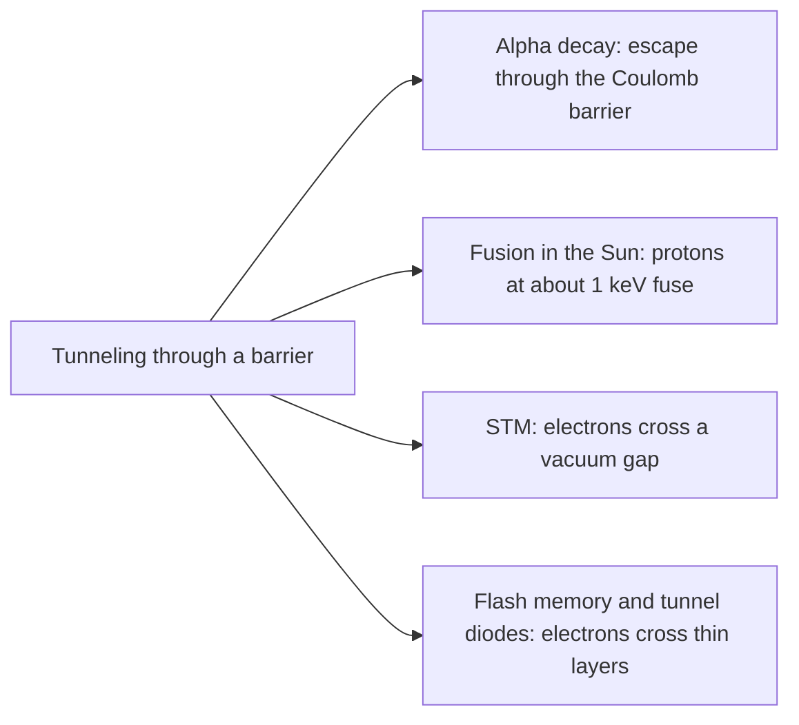

## Through the wall

The quantum lesson ended with a particle in a box: a wave confined between walls, with quantized energies. Those walls were infinitely high, so the wave function was exactly zero outside. Real walls have a finite height. Then something classically impossible happens: a particle that does not have enough energy to climb over a barrier can still turn up on the other side. This **quantum tunneling** is not a curiosity. It makes alpha decay possible, lets the Sun fuse hydrogen, runs the scanning tunneling microscope that images single atoms, and is how flash memory stores your files. This lesson works out how likely tunneling is and why it depends so violently on the barrier's width and the particle's mass.

## Classically forbidden regions

A particle with total energy $E$ moving where the potential energy is $U$ has kinetic energy $K = E - U$. Classically $K$ can never be negative, so a region where $U > E$ is off limits: a ball rolling toward a hill it cannot climb turns around at the point where $U = E$, the **turning point**. The region beyond it is a **classically forbidden region**.

Quantum mechanics replaces the trajectory with a wave function obeying the Schrödinger equation from the quantum lesson,

$$-\frac{\hbar^2}{2m}\frac{d^2\psi}{dx^2} + U\psi = E\psi, \qquad\text{or}\qquad \frac{d^2\psi}{dx^2} = \frac{2m(U - E)}{\hbar^2}\,\psi.$$

Where $E > U$, the right side has the opposite sign from $\psi$, so $\psi$ curves back toward the axis and oscillates: a traveling or standing wave with wavelength $h/p$. Where $U > E$, the right side has the *same* sign as $\psi$, and the solutions are real exponentials:

$$\psi = Ae^{-\kappa x} + Be^{\kappa x}, \qquad \kappa = \frac{\sqrt{2m(U - E)}}{\hbar}.$$

Inside a thick barrier the physically sensible solution is mostly the decaying one, $e^{-\kappa x}$. The wave function does not stop at the wall; it leaks in, and the probability density $|\psi|^2$ falls off as $e^{-2\kappa x}$. The amplitude drops by a factor of $e$ every $1/\kappa$, which is called the **penetration depth**.

A convenient way to compute $\kappa$ uses rest energies and $\hbar c = hc/(2\pi) = 197.3$ eV·nm:

$$\kappa = \frac{\sqrt{2(mc^2)(U - E)}}{\hbar c}.$$

For an electron ($mc^2 = 511{,}000$ eV) 1 eV below the top, $\kappa = \sqrt{2(511{,}000)(1)}/197.3 = 5.12$ nm⁻¹, so the penetration depth is about 0.2 nm, roughly an atom's width.

## Tunneling through a barrier

Now let the forbidden region end: a rectangular barrier of height $U$ and width $L$, with $U = 0$ on both sides. A wave arrives from the left. Part reflects; inside, the wave function decays; at the far side it is small but not zero, and it continues as a transmitted wave with the *same* wavelength (same energy) but a much smaller amplitude. The particle does not lose energy in the barrier. What shrinks is the probability of finding it on the far side.


The **transmission coefficient** $T$ is the probability that a particle gets through. Matching $\psi$ and $d\psi/dx$ at both edges gives the exact result for a rectangular barrier with $E < U$:

$$T = \left[1 + \frac{U^2\sinh^2(\kappa L)}{4E(U - E)}\right]^{-1}.$$

For a thick barrier ($\kappa L$ well above 1), $\sinh(\kappa L) \approx \tfrac12e^{\kappa L}$ and this becomes

$$T \approx 16\frac{E}{U}\left(1 - \frac{E}{U}\right)e^{-2\kappa L} \approx e^{-2\kappa L}.$$

The last form drops a prefactor that is usually between about 0.5 and 4, so it gives the order of magnitude. The exponential is what matters: *tunneling probability falls exponentially with barrier width, and with the square root of the mass and of the energy deficit $U - E$.*

### Example 1

An electron with $E = 2.0$ eV meets a barrier $U = 5.0$ eV high and $L = 0.50$ nm wide. Estimate $T$. What happens if the barrier is twice as wide?

**Decay constant.** $U - E = 3.0$ eV, so $\kappa = \dfrac{\sqrt{2(511{,}000)(3.0)}}{197.3} = \dfrac{1751}{197.3} = 8.87$ nm⁻¹.

**Exponent.** $2\kappa L = 2(8.87)(0.50) = 8.87$, so $e^{-2\kappa L} = e^{-8.87} = 1.4\times10^{-4}$.

**Prefactor.** $16(0.40)(0.60) = 3.84$, so $T \approx 3.84(1.4\times10^{-4}) = 5.4\times10^{-4}$. The exact formula gives $5.37\times10^{-4}$: about one electron in 1900 gets through.

**Double the width.** Now $2\kappa L = 17.7$, and $T \approx 3.84e^{-17.7} = 7.5\times10^{-8}$. Doubling the width did not halve $T$; it *squared* the exponential factor, cutting $T$ by a factor of about 7000.

```plot
{"x": [0, 1], "y": [-8, 1], "xLabel": "barrier width L (nm)", "yLabel": "log₁₀ T", "functions": [{"f": "-log10(1 + 1.0417*sinh(8.875*x)^2)"}], "points": [{"at": [0.5, -3.27], "label": "Example 1: T = 5.4 × 10⁻⁴"}], "caption": "Transmission of a 2.0 eV electron through a 5.0 eV barrier, on a logarithmic scale: past about 0.2 nm, log T falls along a straight line, losing a factor of 10 for about every 0.13 nm of extra width"}
```

### Example 2

Replace the electron with a proton ($mc^2 = 938.3$ MeV), same energy, same 0.50 nm barrier.

$\kappa$ grows by $\sqrt{938.3/0.511} = 42.9$, to 380 nm⁻¹, so $2\kappa L = 380$ and $T \approx e^{-380} \approx 10^{-165}$. For all practical purposes, never. Mass enters inside the exponent, which is why electrons tunnel through nanometer-thin insulating layers while protons tunnel appreciably only through far thinner barriers.

## The scanning tunneling microscope

In a **scanning tunneling microscope** (STM), invented by Gerd Binnig and Heinrich Rohrer at IBM Zurich in 1981 (Nobel Prize 1986), a sharp metal tip is held a few tenths of a nanometer above a conducting surface. The vacuum gap is a barrier whose height above the electrons' energy is about the work function, a few eV. A small voltage drives a **tunneling current** across it, proportional to roughly $e^{-2\kappa d}$ for a gap $d$. Because the dependence is exponential, the current is exquisitely sensitive to $d$: a feedback loop moves the tip up and down to keep the current constant as it scans, and the tip's height traces the surface atom by atom.

### Example 3

For a work function of 4.5 eV, by what factor does the tunneling current change when the gap widens by 0.10 nm?

$\kappa = \dfrac{\sqrt{2(511{,}000)(4.5)}}{197.3} = 10.9$ nm⁻¹. The current is multiplied by $e^{-2\kappa\,\Delta d} = e^{-2(10.9)(0.10)} = e^{-2.17} = 0.11$: it drops about ninefold. A height change of 0.01 nm, a tiny fraction of an atom's diameter, still changes the current by about 20%, easily measured.

## Alpha decay: tunneling out of the nucleus

Inside a heavy nucleus an alpha particle is held by the strong force; outside, the Coulomb repulsion from the remaining protons pushes it away. Together they make a barrier. For uranium-238, the Coulomb barrier at the nuclear surface (about 9 fm from the center) is roughly $(1.44\text{ MeV·fm})(2)(90)/(9.3\text{ fm}) \approx 28$ MeV, yet the alpha particles come out with only about 4.2 MeV. Classically they could never escape; the turning point on the outside, where the Coulomb energy falls to 4.2 MeV, is about 60 fm out. In 1928 George Gamow, and independently Ronald Gurney and Edward Condon, explained alpha decay as tunneling through this thick barrier.

The theory explains a striking pattern. Polonium-212 emits 8.8 MeV alphas and has a half-life of 0.3 μs; uranium-238 emits 4.2 MeV alphas and has a half-life of 4.5 billion years. A factor of about 2 in energy makes a factor of more than $10^{23}$ in half-life, because a higher energy makes the barrier both lower (smaller $U - E$) and thinner (closer outer turning point), and both sit in the exponent. The empirical rule that log(half-life) falls roughly linearly with $1/\sqrt{E_\alpha}$ (the **Geiger–Nuttall law**, found in 1911 and refined later) follows from the tunneling calculation.



The same physics runs in reverse in stars. In the Sun's core, near 15 million K, typical proton energies are only about 1 keV, hundreds of times below the Coulomb barrier between two protons, so fusion happens only through the rare protons that tunnel. Electronics depends on tunneling too: flash memory erases its cells (and in many designs writes them) by tunneling electrons through an oxide layer only about 10 nanometers thick or less, and the tunnel diode (Leo Esaki, 1957) relies on electrons tunneling through a very thin junction.

## Common mistakes

- Thinking a tunneling particle loses energy in the barrier. Its energy is the same on both sides; only the amplitude, and so the probability, is reduced.
- Using $E$ instead of $U - E$ in $\kappa$. What matters is how far below the top of the barrier the particle is.
- Writing $T \approx e^{-\kappa L}$. The probability goes as $|\psi|^2$, so the exponent is $2\kappa L$.
- Expecting $T$ to halve when the width doubles. Doubling $L$ doubles the exponent, which squares the exponential factor.
- Forgetting units: with $\hbar c = 197.3$ eV·nm and energies in eV, $\kappa$ comes out in nm⁻¹, so $L$ must be in nm.

## Key points

- In a region where $U > E$, $\psi$ is a real exponential with $\kappa = \sqrt{2m(U - E)}/\hbar$; $|\psi|^2$ decays as $e^{-2\kappa x}$.
- Rectangular barrier: $T = \left[1 + \dfrac{U^2\sinh^2\kappa L}{4E(U - E)}\right]^{-1} \approx 16\dfrac EU\left(1 - \dfrac EU\right)e^{-2\kappa L}$ for thick barriers.
- $T$ falls exponentially with width $L$ and with $\sqrt{m(U - E)}$: electrons tunnel through nanometer gaps, protons essentially never do.
- STM current $\propto e^{-2\kappa d}$: about a factor of 10 per 0.1 nm for a 4.5 eV work function.
- Alpha decay (Gamow; Gurney and Condon, 1928) is tunneling through the Coulomb barrier; small changes in alpha energy change half-lives by many powers of 10.
