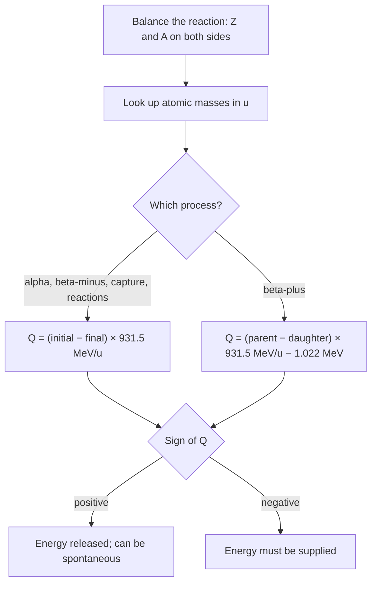

## Where the curve comes from

The nuclear lesson used the binding energy per nucleon curve to explain why fission and fusion release energy: it rises steeply for light nuclei, peaks near iron, and falls slowly for heavy ones. Two questions were left open. First, how do you compute exactly how much energy a given reaction or decay releases, and how is it shared among the products? Second, why does the curve have that shape at all? This lesson answers the first with the Q-value and the second with one of the most successful simple models in physics: the nucleus as a drop of charged liquid.

## The Q-value of a reaction

For any nuclear reaction or decay, the **Q-value** is the rest energy that disappears:

$$Q = \left(\sum m_{\text{initial}} - \sum m_{\text{final}}\right)c^2.$$

If $Q > 0$ the reaction is **exothermic** and releases $Q$ as kinetic energy of the products (and any photons). If $Q < 0$ it is **endothermic**: it can only happen if the incoming particles bring at least $|Q|$ of kinetic energy (in fact somewhat more, because momentum must also be conserved; the honors lesson on invariant mass and thresholds shows how to find the exact threshold). A spontaneous decay must have $Q > 0$.

Tables list *atomic* masses (nucleus plus electrons), not nuclear masses. Using them is easy as long as you keep track of electrons:

- **Alpha decay, beta-minus decay, electron capture and most reactions:** the electron counts balance, so use atomic masses directly. (In β⁻ decay the daughter atom has one more electron than the parent atom, but the emitted electron supplies it.)
- **Beta-plus decay:** the daughter atom has one *fewer* electron, and a positron is created. With atomic masses, subtract $2m_ec^2 = 1.022$ MeV:

$$Q_{\beta^+} = \left(M_{\text{parent}} - M_{\text{daughter}}\right)c^2 - 2m_ec^2.$$

So β⁺ decay is possible only if the parent atom outweighs the daughter atom by more than 1.022 MeV/$c^2$. For fluorine-18, the tracer in PET scans, the atomic masses (18.000938 u and 17.999159 u for oxygen-18) differ by 1.657 MeV, so $Q = 1.657 - 1.022 = 0.635$ MeV.



## Sharing the energy

In a decay at rest into two bodies, momentum conservation decides the split. The products fly apart with equal and opposite momenta $p$, and with $K = p^2/(2m)$ (good here, because alpha energies are far below the alpha's rest energy of 3727 MeV), the lighter one gets more: $K_1/K_2 = m_2/m_1$. For alpha decay of a parent with mass number $A$, using mass numbers for masses,

$$K_\alpha \approx Q\,\frac{A - 4}{A}, \qquad K_{\text{recoil}} \approx Q\,\frac{4}{A}.$$

### Example 1

Radium-226 (226.025410 u) alpha decays to radon-222 (222.017578 u). With helium-4 at 4.002603 u, find $Q$ and the alpha particle's kinetic energy.

**Mass lost.** $226.025410 - 222.017578 - 4.002603 = 0.005229$ u.

**Q-value.** $Q = 0.005229(931.5) = 4.871$ MeV.

**Sharing.** $K_\alpha = 4.871 \cdot \dfrac{222}{226} = 4.785$ MeV; the radon nucleus recoils with the other 0.086 MeV. Measured alpha spectra of radium-226 show their main line at 4.78 MeV, a direct check of $E = mc^2$ to better than 1 part in 1000 of the decay energy.

### Example 2

The fusion reaction planned for most fusion reactors is deuterium–tritium: $^2\text{H} + {}^3\text{H} \to {}^4\text{He} + n$. Atomic masses: 2.014102 u, 3.016049 u, 4.002603 u; neutron 1.008665 u. Find $Q$ and how it is shared (the reactants' kinetic energy is small enough to neglect).

$\Delta m = (2.014102 + 3.016049) - (4.002603 + 1.008665) = 0.018883$ u, so $Q = 0.018883(931.5) = 17.59$ MeV.

The helium nucleus (mass number 4) and neutron (1) share it in the ratio 1 : 4, so the neutron carries $\tfrac45(17.59) = 14.07$ MeV and the alpha particle 3.52 MeV. That 14.1 MeV neutron, which escapes the magnetic field, is how a reactor's energy would be collected (and why its walls become radioactive).

## The liquid-drop model

Nuclear matter behaves in some ways like a liquid. The density inside every nucleus is about the same, so volume is proportional to $A$ and the radius is about $R = (1.2\text{ fm})A^{1/3}$. The strong force acts only between neighbors, just as molecules in a drop attract only nearby molecules. In 1935 Carl Friedrich von Weizsäcker turned this picture into the **semi-empirical mass formula**, the binding energy as a sum of five terms:

$$E_B = a_VA - a_SA^{2/3} - a_C\frac{Z(Z - 1)}{A^{1/3}} - a_A\frac{(A - 2Z)^2}{A} \pm \delta.$$

Each term has a physical reason:

- **Volume term** $a_VA$: each nucleon is bound to its neighbors, so binding grows in proportion to the number of nucleons.
- **Surface term** $-a_SA^{2/3}$: nucleons at the surface have fewer neighbors, like surface tension. The surface area grows as $R^2 \propto A^{2/3}$. This term hurts small nuclei most.
- **Coulomb term** $-a_CZ(Z - 1)/A^{1/3}$: every pair of protons repels. There are $Z(Z - 1)/2$ pairs, and the energy of a charged sphere goes as $1/R \propto A^{-1/3}$. This term hurts heavy nuclei most.
- **Asymmetry term** $-a_A(A - 2Z)^2/A$: a quantum effect. Protons and neutrons each obey the exclusion principle, so a big imbalance forces the extra neutrons (or protons) into higher energy levels.
- **Pairing term** $\pm\delta$: nucleons are more tightly bound in pairs. Add $\delta$ for even $Z$ and even $N$, subtract it for odd $Z$ and odd $N$, and use 0 when $A$ is odd.

The coefficients are fitted to measured masses. One common fit (values differ slightly between textbooks) is $a_V = 15.75$ MeV, $a_S = 17.8$ MeV, $a_C = 0.711$ MeV, $a_A = 23.7$ MeV and $\delta = 11.18\text{ MeV}/\sqrt{A}$.

### Example 3

Use the formula to estimate the binding energy of iron-56 ($Z = 26$, $N = 30$) and compare with the measured 492.3 MeV.

| Term | Calculation | MeV |
|---|---|---|
| Volume | $15.75(56)$ | $+882.0$ |
| Surface | $17.8(56)^{2/3} = 17.8(14.64)$ | $-260.5$ |
| Coulomb | $0.711(26)(25)/56^{1/3} = 462.2/3.826$ | $-120.8$ |
| Asymmetry | $23.7(56 - 52)^2/56 = 23.7(16)/56$ | $-6.8$ |
| Pairing | even–even: $+11.18/\sqrt{56}$ | $+1.5$ |
| Total | | $495.4$ |

The estimate, 495.4 MeV or 8.85 MeV per nucleon, is within 0.7% of the measured value. A five-parameter formula reproduces the binding energies of most of the more than 3000 known nuclides heavier than about $A = 30$, typically to within about 1%. It does much worse for very light nuclei (it gives only 22.8 MeV for helium-4, against 28.3 MeV), where a "drop" of a few nucleons is mostly surface and quantum shell effects dominate.

```plot
{"x": [0, 250], "y": [0, 17], "xLabel": "mass number A", "yLabel": "MeV per nucleon", "functions": [{"f": "15.75", "dashed": true, "from": 4}, {"f": "15.75 - 17.8*x^(-1/3)", "dashed": true, "from": 4}, {"f": "15.75 - 17.8*x^(-1/3) - 0.711*(x/(2 + 0.015*x^(2/3)))*(x/(2 + 0.015*x^(2/3)) - 1)/x^(4/3)", "dashed": true, "from": 4}, {"f": "15.75 - 17.8*x^(-1/3) - 0.711*(x/(2 + 0.015*x^(2/3)))*(x/(2 + 0.015*x^(2/3)) - 1)/x^(4/3) - 23.7*(x - 2*x/(2 + 0.015*x^(2/3)))^2/x^2", "from": 4}], "points": [{"at": [4, 7.07]}, {"at": [12, 7.68]}, {"at": [16, 7.98]}, {"at": [56, 8.79]}, {"at": [84, 8.72]}, {"at": [120, 8.51]}, {"at": [208, 7.87]}, {"at": [238, 7.57]}], "labels": [{"at": [200, 16.2], "text": "volume"}, {"at": [200, 13.8], "text": "− surface"}, {"at": [200, 10.4], "text": "− Coulomb"}, {"at": [160, 6.6], "text": "− asymmetry = model"}], "caption": "Building the binding-energy curve term by term (pairing omitted), along the line of stable nuclei. Dots are measured values for helium-4, carbon-12, oxygen-16, iron-56, krypton-84, tin-120, lead-208 and uranium-238"}
```

## What the model explains

**The peak.** The surface term makes light nuclei weakly bound per nucleon; the Coulomb term makes heavy ones weakly bound. In between, binding per nucleon is greatest. (Measured precisely, the very top belongs to nickel-62 at 8.795 MeV per nucleon, just above iron-58 at 8.792 and iron-56 at 8.790; "near iron" is the usual summary.)

**The line of stability.** For a fixed $A$, the most stable $Z$ maximizes $E_B$. Setting $\partial E_B/\partial Z = 0$ (with $Z(Z - 1) \approx Z^2$ and ignoring the small neutron–proton mass difference) gives

$$Z \approx \frac{A}{2 + \dfrac{a_C}{2a_A}A^{2/3}} = \frac{A}{2 + 0.0150A^{2/3}}.$$

For light nuclei this is $Z \approx A/2$, equal numbers of protons and neutrons; for $A = 56$ it gives 25.2 (iron has 26); for $A = 238$, 92.4 (uranium has 92). The Coulomb term is why heavy nuclei need extra neutrons. A nucleus with too many neutrons for its $A$ moves toward this line by β⁻ decay; one with too many protons, by β⁺ decay or electron capture.

**Fission.** Uranium-235 has about 7.6 MeV per nucleon; its fission fragments, near $A = 95$ to 140, have about 8.5. Rearranging 236 nucleons (after it absorbs a neutron) into more tightly bound fragments releases roughly $(8.5 - 7.6)(236) \approx 200$ MeV, matching the measured value of about 200 MeV per fission. In the drop picture, deforming a heavy nucleus increases its surface energy but decreases its Coulomb energy. Bohr and Wheeler's 1939 analysis found that a drop with no barrier against splitting would need $Z^2/A$ above about $2a_S/a_C \approx 50$; uranium's 36 means a barrier of about 6 MeV remains. When uranium-235 absorbs a slow neutron, the binding energy released (about 6.5 MeV) is enough to get over it; uranium-238 gains less and needs a fast neutron. (This is a simplified estimate; the full theory includes shell effects.)

## Common mistakes

- Using nuclear masses for some particles and atomic masses for others. Use atomic masses throughout, and for β⁺ decay subtract 1.022 MeV.
- Giving all of $Q$ to the alpha particle. The daughter recoils; the alpha gets the fraction $(A - 4)/A$.
- Reading $Q < 0$ as "impossible". It means energy must be supplied.
- Forgetting that the surface term matters most for light nuclei and the Coulomb term for heavy ones.
- Expecting the liquid-drop formula to work for helium or lithium. It is a model for medium and heavy nuclei; light nuclei need the shell model.

## Key points

- $Q = (\sum m_i - \sum m_f)c^2$, 931.5 MeV per u; $Q > 0$ releases energy. With atomic masses, β⁺ decay needs an extra $-2m_ec^2 = -1.022$ MeV.
- Two-body decay at rest: the lighter product gets most of $Q$; $K_\alpha \approx Q(A - 4)/A$.
- D–T fusion: $Q = 17.6$ MeV, 14.1 MeV to the neutron.
- Semi-empirical mass formula: $E_B = a_VA - a_SA^{2/3} - a_CZ(Z - 1)/A^{1/3} - a_A(A - 2Z)^2/A \pm \delta$ (volume, surface, Coulomb, asymmetry, pairing).
- The surface and Coulomb terms make the curve peak at middle masses; the Coulomb term bends the stability line toward extra neutrons; fission of uranium releases about 200 MeV.
