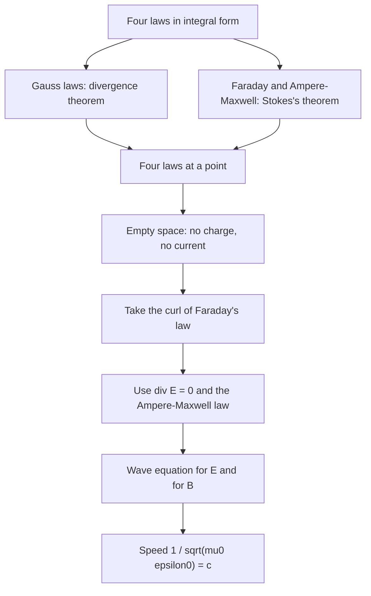

## Four laws, one theory

The light lesson listed Maxwell's equations in integral form: Gauss's law, Gauss's law for magnetism, Faraday's law and the Ampère–Maxwell law. Each one talks about a whole surface or a whole loop, which is perfect for symmetric problems and awkward for everything else. This lesson rewrites them as statements about a single point in space. In that form the theory becomes a set of rules for how fields change from place to place and moment to moment, and three big results drop out in a few lines: charge cannot appear or vanish, Ampère's original law could not have been complete, and light must be an electromagnetic wave moving at one fixed speed.

That fixed speed raises the question that opens the next lesson: fixed relative to *what*? The answer, special relativity, rebuilt physics around Maxwell's equations. This module follows that thread and then follows the quantum thread that began with light itself.

## Divergence: sources and sinks

Shrink a closed surface around a point until it encloses a tiny volume $\Delta V$. The outward flux of a field $\vec E$ through it, divided by the volume, tends to a limit called the **divergence**:

$$\nabla\cdot\vec E = \lim_{\Delta V\to0}\frac{1}{\Delta V}\oint\vec E\cdot d\vec A = \frac{\partial E_x}{\partial x} + \frac{\partial E_y}{\partial y} + \frac{\partial E_z}{\partial z}.$$

It measures how much field "comes out" of each point: positive at a source, negative at a sink, zero where every field line that enters also leaves. The **divergence theorem** adds these tiny outflows up: for any closed surface, $\oint\vec E\cdot d\vec A = \int(\nabla\cdot\vec E)\,dV$ over the volume inside, because the flux through every interior wall is counted once outward and once inward and cancels.

Apply this to Gauss's law. The enclosed charge is $\int\rho\,dV$, where $\rho$ is the charge density, so $\int(\nabla\cdot\vec E)\,dV = \int(\rho/\varepsilon_0)\,dV$ for *every* volume. Two integrals that agree on every region must have equal integrands:

$$\nabla\cdot\vec E = \frac{\rho}{\varepsilon_0}.$$

The same step turns "the magnetic flux through any closed surface is zero" into $\nabla\cdot\vec B = 0$: magnetic field lines have no starting or ending points anywhere.

### Example 1

In a region of space the electric field is $\vec E = (6.0\times10^4\text{ V/m}^2)(x\,\hat\imath + y\,\hat\jmath + z\,\hat k)$. What charge density produces it?

Each term contributes $\partial(6.0\times10^4\,x)/\partial x = 6.0\times10^4$ V/m², so $\nabla\cdot\vec E = 3(6.0\times10^4) = 1.8\times10^5$ V/m². Then

$$\rho = \varepsilon_0\nabla\cdot\vec E = (8.85\times10^{-12})(1.8\times10^5) = 1.59\times10^{-6}\text{ C/m}^3.$$

The density is the same everywhere: this is the field inside a uniformly charged ball, $E = \rho r/(3\varepsilon_0)$, which you can check against the Gauss's law lesson.

## Curl: circulation

The circulation of a field around a small loop, divided by the loop's area, measures how much the field swirls around that point. Taking the loop perpendicular to each axis in turn gives the components of a vector called the **curl**:

$$\nabla\times\vec E = \left(\frac{\partial E_z}{\partial y} - \frac{\partial E_y}{\partial z}\right)\hat\imath + \left(\frac{\partial E_x}{\partial z} - \frac{\partial E_z}{\partial x}\right)\hat\jmath + \left(\frac{\partial E_y}{\partial x} - \frac{\partial E_x}{\partial y}\right)\hat k.$$

**Stokes's theorem** adds up the tiny circulations over any surface bounded by a loop: $\oint\vec E\cdot d\vec\ell = \int(\nabla\times\vec E)\cdot d\vec A$, because neighboring tiny loops traverse their shared edge in opposite directions. Applied to Faraday's law, with $\Phi_B = \int\vec B\cdot d\vec A$ through the same surface, it gives $\int(\nabla\times\vec E)\cdot d\vec A = -\int(\partial\vec B/\partial t)\cdot d\vec A$ for every surface, so $\nabla\times\vec E = -\partial\vec B/\partial t$. Applied to the Ampère–Maxwell law, with the current written as the flux of the current density $\vec J$, it gives the fourth equation. The complete set is

$$\nabla\cdot\vec E = \frac{\rho}{\varepsilon_0}, \qquad \nabla\cdot\vec B = 0,$$

$$\nabla\times\vec E = -\frac{\partial\vec B}{\partial t}, \qquad \nabla\times\vec B = \mu_0\vec J + \mu_0\varepsilon_0\frac{\partial\vec E}{\partial t}.$$

## Charge conservation and the missing term

Charge is conserved locally: if the charge in a small volume drops, it is because current flowed out through the surface. In point form this is the **continuity equation**,

$$\nabla\cdot\vec J + \frac{\partial\rho}{\partial t} = 0.$$

Now look at Ampère's original law, $\nabla\times\vec B = \mu_0\vec J$. A vector identity (check it by writing out the components; the mixed partial derivatives cancel in pairs) says that the divergence of any curl is zero: $\nabla\cdot(\nabla\times\vec B) = 0$. So Ampère's law would force $\nabla\cdot\vec J = 0$ everywhere, which by the continuity equation means $\partial\rho/\partial t = 0$: charge could never pile up anywhere. A charging capacitor flatly contradicts that.

Maxwell's term repairs it. Take the divergence of the full law and use Gauss's law:

$$0 = \mu_0\nabla\cdot\vec J + \mu_0\varepsilon_0\frac{\partial}{\partial t}(\nabla\cdot\vec E) = \mu_0\left(\nabla\cdot\vec J + \frac{\partial\rho}{\partial t}\right),$$

which is exactly the continuity equation. With the displacement current included, the equations *require* charge conservation instead of contradicting it. Historically Maxwell first reached the extra term in 1861–62 through a mechanical model of the ether, not this clean argument, and kept it in his 1865 field theory; the consistency argument is the one physicists usually give today.

### Example 2

A capacitor with circular plates of radius 5.0 cm is charged by a steady current of 2.0 A. Ignoring edge effects, find the rate of change of the field between the plates and the magnetic field 3.0 cm from the axis in the gap.

The field between the plates is $E = Q/(\varepsilon_0\pi R^2)$, so

$$\frac{dE}{dt} = \frac{I}{\varepsilon_0\pi R^2} = \frac{2.0}{(8.85\times10^{-12})\pi(0.050)^2} = 2.88\times10^{13}\text{ V/(m·s)}.$$

No conduction current crosses the gap, so on a circle of radius $r$ the Ampère–Maxwell law reads $B(2\pi r) = \mu_0\varepsilon_0(\pi r^2)\,dE/dt$. Substituting $dE/dt$:

$$B = \frac{\mu_0Ir}{2\pi R^2} = \frac{(4\pi\times10^{-7})(2.0)(0.030)}{2\pi(0.050)^2} = 4.8\times10^{-6}\text{ T}.$$

At the rim ($r = R$) this becomes $\mu_0I/(2\pi R) = 8.0$ μT, the same field as around the wire at that distance. The changing electric field acts as a current spread uniformly over the plate area.

## Light from the equations

In empty space $\rho = 0$ and $\vec J = \vec 0$. Take the curl of Faraday's law and use the identity $\nabla\times(\nabla\times\vec E) = \nabla(\nabla\cdot\vec E) - \nabla^2\vec E$, where $\nabla^2$ acts on each component:

$$\nabla(\nabla\cdot\vec E) - \nabla^2\vec E = -\frac{\partial}{\partial t}(\nabla\times\vec B) = -\mu_0\varepsilon_0\frac{\partial^2\vec E}{\partial t^2}.$$

Gauss's law with no charge removes the first term, leaving the three-dimensional **wave equation**

$$\nabla^2\vec E = \mu_0\varepsilon_0\frac{\partial^2\vec E}{\partial t^2},$$

and the same steps give the same equation for $\vec B$. Every wave equation of the form $\nabla^2f = \dfrac{1}{v^2}\dfrac{\partial^2f}{\partial t^2}$ describes waves of speed $v$, so electromagnetic waves travel at

$$v = \frac{1}{\sqrt{\mu_0\varepsilon_0}} = \frac{1}{\sqrt{(4\pi\times10^{-7})(8.854\times10^{-12})}} = 3.00\times10^8\text{ m/s}.$$

Two constants measured with currents and charges at rest give the speed of light, with no optics anywhere in the calculation.

The equations say more than the speed. For a **plane wave** traveling along $x$, the fields depend only on $x$ and $t$. Gauss's law with no charge then gives $\partial E_x/\partial x = 0$, so $E_x$ cannot vary along the direction of travel the way a wave must (the $x$ component of the Ampère–Maxwell law also gives $\partial E_x/\partial t = 0$, so any $E_x$ is just a constant field, not part of the wave): the wave is transverse. Faraday's law links $\vec B$ to $\vec E$, as the next example shows, making $\vec B$ perpendicular to $\vec E$ with $E = cB$ and $\vec E\times\vec B$ along the direction of travel.

### Example 3

An FM radio wave in vacuum has $\vec E = (60\text{ V/m})\sin(kx - \omega t)\,\hat\jmath$ and wavelength 3.0 m. Find its frequency and the magnetic field.

$f = c/\lambda = (3.00\times10^8)/3.0 = 1.0\times10^8$ Hz, or 100 MHz; $k = 2\pi/\lambda = 2.09$ rad/m and $\omega = 2\pi f = 6.28\times10^8$ rad/s.

Only $E_y$ is nonzero and it depends only on $x$, so the curl has just a $z$ component: $(\nabla\times\vec E)_z = \partial E_y/\partial x = kE_0\cos(kx - \omega t)$. Faraday's law gives $\partial B_z/\partial t = -kE_0\cos(kx - \omega t)$. Integrating in time (and dropping any constant field, which is not part of the wave):

$$B_z = \frac{k}{\omega}E_0\sin(kx - \omega t) = \frac{E_0}{c}\sin(kx - \omega t).$$

So $B_0 = 60/(3.00\times10^8) = 2.0\times10^{-7}$ T along $\pm z$, in phase with $\vec E$. Check the direction: $\hat\jmath\times\hat k = \hat\imath$, the direction of travel.

## A speed with no reference

Every earlier wave you have met, sound or waves on a string, has a speed relative to its medium. Maxwell's equations contain only $\mu_0$ and $\varepsilon_0$, and they give $c$ without mentioning any medium or any observer. Physicists of the 1800s assumed the equations held only in the rest frame of an invisible medium, the ether. Experiments failed to detect motion through it. The next lesson takes the other road, Einstein's: the equations hold in every inertial frame, so $c$ is the same for everyone, and electric and magnetic fields must change from one frame to another in a precise way.

## Common mistakes

- Treating $\nabla\cdot\vec E$ as a vector or $\nabla\times\vec E$ as a number. Divergence is a scalar (a source strength); curl is a vector (an axis and amount of swirl).
- Thinking a nonzero divergence needs charge *at* the place the field is large. Divergence depends on how the field changes at a point; a strong uniform field has zero divergence.
- Dropping the displacement current. Without it the equations contradict charge conservation and predict no light.
- Forgetting the vacuum assumption. The wave equation above holds where $\rho = 0$ and $\vec J = \vec 0$.
- Concluding that $\vec B$ is negligible in a wave because $B_0 = E_0/c$ is a small number in teslas. The two fields carry equal energy.

## Key points

- Divergence = outflow per volume; curl = circulation per area. The divergence theorem and Stokes's theorem convert between point and integral forms.
- $\nabla\cdot\vec E = \rho/\varepsilon_0$; $\nabla\cdot\vec B = 0$; $\nabla\times\vec E = -\partial\vec B/\partial t$; $\nabla\times\vec B = \mu_0\vec J + \mu_0\varepsilon_0\,\partial\vec E/\partial t$.
- Continuity: $\nabla\cdot\vec J + \partial\rho/\partial t = 0$. Because $\nabla\cdot(\nabla\times\vec B) = 0$, the displacement-current term is needed for consistency with it.
- In vacuum, $\nabla^2\vec E = \mu_0\varepsilon_0\,\partial^2\vec E/\partial t^2$: waves at $c = 1/\sqrt{\mu_0\varepsilon_0}$, transverse, with $E = cB$ and $\vec E\times\vec B$ along the travel direction.
- Between charging circular plates, $B = \mu_0Ir/(2\pi R^2)$ inside the gap.
