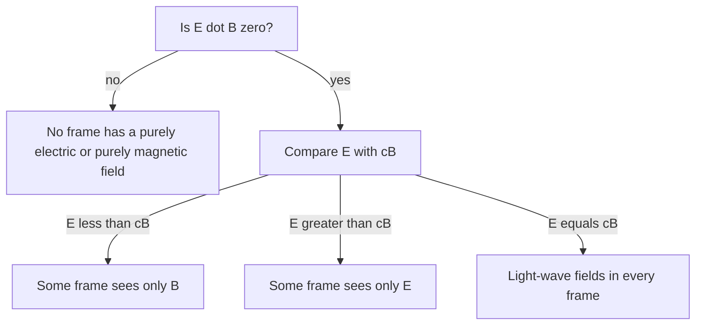

## One field seen from two frames

The magnetic force lesson gave the force on a moving charge as $q\vec v\times\vec B$. That force depends on the charge's velocity, and velocity depends on who is measuring it. Ride along with the charge and its velocity is zero, so the magnetic force should vanish. But the charge's path can't depend on who watches it: if it curves toward a wire in one frame, it curves toward the wire in every frame. Something else must push it in the moving frame.

The previous lesson ended with Maxwell's equations giving the same light speed $c$ to every observer, and the special relativity lesson built length contraction and time dilation on that fact. This lesson puts the two together. Using only length contraction and the invariance of charge, it explains the magnetic force between a wire and a moving charge as an electric force in another frame, then states the general rule for how $\vec E$ and $\vec B$ change from one frame to another, and the two combinations of them that every observer agrees on.

## Charge is invariant, charge density is not

Experiments show that electric charge does not depend on speed. The strongest evidence is ordinary matter: the electrons in different atoms and molecules move at very different speeds relative to their nuclei, yet atoms and molecules are electrically neutral to extraordinary precision. This is **invariance of charge**: every observer measures the same total charge on a particle or object.

Charge *density* is another matter. Take a row of charges at rest with spacing $d_0$, so the line charge density is $\lambda_0 = q/d_0$ (its proper value). Seen from a frame where the row moves along its length at speed $v$, the spacing is contracted to $d_0/\gamma$, but each charge is still $q$, so

$$\lambda = \gamma\lambda_0.$$

A moving line of charge looks denser than the same line at rest.

## A wire seen by a moving charge

Model a straight wire as a line of positive ions at rest, with density $+\lambda$, and a line of conduction electrons drifting at speed $u$, with density $-\lambda$ in the lab, so the wire is neutral and carries a current of size $I = \lambda u$. A positive test charge $q$ moves parallel to the wire at distance $r$, at the electrons' speed $u$ and in their direction (opposite to the conventional current).

*In the lab.* The wire is neutral, so there is no electric force. The current makes $B = \mu_0I/(2\pi r)$, and since the charge moves opposite to the conventional current, it is repelled (antiparallel currents repel) with force

$$F = quB = \frac{q\mu_0\lambda u^2}{2\pi r} = \frac{q\lambda u^2}{2\pi\varepsilon_0c^2r},$$

using $\mu_0 = 1/(\varepsilon_0c^2)$.

*In the charge's frame.* Now the electrons are at rest. Their lab density $-\lambda$ was already contracted, so their proper density is $-\lambda/\gamma$. The ions move backward at speed $u$, so their density grows to $+\gamma\lambda$. The wire is no longer neutral:

$$\lambda' = \gamma\lambda - \frac{\lambda}{\gamma} = \gamma\lambda\left(1 - \frac{1}{\gamma^2}\right) = \frac{\gamma\lambda u^2}{c^2}.$$

A positively charged line repels the test charge, which is now at rest, with a purely electric force

$$F' = qE' = \frac{q\lambda'}{2\pi\varepsilon_0r} = \gamma\frac{q\lambda u^2}{2\pi\varepsilon_0c^2r} = \gamma F.$$

Both frames predict a repulsion. The factor $\gamma$ is not a disagreement: a sideways push gives the same sideways momentum in both frames, but the charge's own clock runs slow in the lab, so the same momentum is delivered in a longer lab time and the lab force is smaller by $\gamma$. What the lab calls a magnetic force, the charge's frame calls an electric force from a wire made slightly charged by length contraction.


Repeating the argument for a test charge moving at any speed $v$ along the wire gives a net density of size $\gamma vI/c^2$ in its frame. The wire looks negative when the charge moves along the conventional current (so a positive charge is attracted, as parallel currents attract) and positive when it moves against it.

### Example 1

A proton moves at $2.0\times10^6$ m/s parallel to a long wire carrying 15 A, in the direction of the current, 2.0 cm from the wire. Find the force in the lab frame and in the proton's frame.

*Lab:* $B = \dfrac{\mu_0I}{2\pi r} = \dfrac{(4\pi\times10^{-7})(15)}{2\pi(0.020)} = 1.5\times10^{-4}$ T, so $F = evB = (1.602\times10^{-19})(2.0\times10^6)(1.5\times10^{-4}) = 4.8\times10^{-17}$ N, toward the wire.

*Proton's frame:* $\gamma = 1.00002$, so the wire carries a net charge density of size

$$\lambda' = \frac{\gamma vI}{c^2} = \frac{(2.0\times10^6)(15)}{(3.00\times10^8)^2} = 3.3\times10^{-10}\text{ C/m},$$

negative because the proton moves along the current. Its field is $E' = \dfrac{\lambda'}{2\pi\varepsilon_0r} = \dfrac{3.3\times10^{-10}}{2\pi(8.85\times10^{-12})(0.020)} = 3.0\times10^2$ V/m, and $F' = eE' = 4.8\times10^{-17}$ N toward the wire. The two agree (to within the factor $\gamma$, here invisible).

How can a speed of 0.7% of $c$, and electron drift speeds of millimeters per second, give a force anyone can measure? Because the cancelling charges are enormous. A copper wire 1 mm² in cross section holds about $1.4\times10^4$ C of conduction electrons per meter, so an imbalance of only about 2 parts in $10^{14}$ is enough. Magnetism is a tiny relativistic effect of huge charges.

## How the fields transform

The wire is one case of a general rule. Let frame $S'$ move at velocity $v$ along the $x$ axis of frame $S$. The **field transformations** are

$$E'_x = E_x, \qquad E'_y = \gamma(E_y - vB_z), \qquad E'_z = \gamma(E_z + vB_y),$$

$$B'_x = B_x, \qquad B'_y = \gamma\left(B_y + \frac{v}{c^2}E_z\right), \qquad B'_z = \gamma\left(B_z - \frac{v}{c^2}E_y\right).$$

Components along the motion don't change; perpendicular components mix. Compactly, $\vec E'_\perp = \gamma(\vec E + \vec v\times\vec B)_\perp$ and $\vec B'_\perp = \gamma(\vec B - \vec v\times\vec E/c^2)_\perp$. The electric rule is the Lorentz force in disguise: a charge at rest in $S'$ moves with velocity $\vec v$ in $S$ and feels $q(\vec E + \vec v\times\vec B)$ there; in its own frame that push must come from $\vec E'$ alone. At everyday speeds $\gamma \approx 1$, and the electric rule is how the motional emf lesson's rod sees things: a charge riding on the rod feels an electric field $\vec v\times\vec B$.

### Example 2

In a lab there is a uniform magnetic field of 0.40 T along $+z$ and no electric field. What fields does an observer moving at $3.0\times10^6$ m/s along $+x$ measure?

$\gamma = 1/\sqrt{1 - (0.010)^2} = 1.00005$. With $E = 0$ and only $B_z$:

$E'_y = \gamma(0 - vB_z) = -(1.00005)(3.0\times10^6)(0.40) = -1.2\times10^6$ V/m, and $E'_x = E'_z = 0$.

$B'_z = \gamma B_z = 0.40002$ T.

The moving observer sees an electric field of 1.2 MV/m along $-y$, plus essentially the same magnetic field. A charge at rest in the lab would feel no force, and it doesn't in $S'$ either: there it moves at $-v$ along $x$, and its magnetic force $q(-v\hat\imath)\times B'_z\hat k = +qvB'_z\,\hat\jmath$ cancels the electric force $qE'_y\hat\jmath$ (both have size $\gamma qvB$).

## What every observer agrees on

Observers disagree about $\vec E$ and $\vec B$ separately, but two combinations are **field invariants**, the same in every inertial frame:

$$\vec E\cdot\vec B \qquad\text{and}\qquad E^2 - c^2B^2.$$

You can check them by substituting the transformation equations. They settle at a glance what a change of frame can and cannot do.



For instance, a pure magnetic field has $E^2 - c^2B^2 < 0$, and no change of frame can make it positive, so no observer sees a pure electric field there. A light wave has $\vec E\perp\vec B$ and $E = cB$, so both invariants are zero in every frame: every observer sees a light wave.

### Example 3

A velocity selector has $\vec E = (3.0\times10^4\text{ V/m})\,\hat\jmath$ and $\vec B = (2.0\times10^{-3}\text{ T})\,\hat k$. Find a frame in which there is no electric field, and the magnetic field there.

$\vec E\cdot\vec B = 0$ and $E = 3.0\times10^4 < cB = 6.0\times10^5$ (both in V/m), so such a frame exists. Set $E'_y = \gamma(E_y - vB_z) = 0$: $v = E/B = 1.5\times10^7$ m/s along $+x$. Then $\gamma = 1/\sqrt{1 - 0.050^2} = 1.00125$ and

$$B'_z = \gamma\left(B - \frac{vE}{c^2}\right) = \gamma B\left(1 - \frac{v^2}{c^2}\right) = \frac{B}{\gamma} = 1.998\times10^{-3}\text{ T}.$$

Check the invariant: $E^2 - c^2B^2 = 9.0\times10^8 - 3.6\times10^{11} = -3.59\times10^{11}$ V²/m², and $-c^2B'^2 = -3.59\times10^{11}$ V²/m² too. This is why the selector works: a particle moving at exactly $E/B$ is at rest in this frame, where there is only a magnetic field, which exerts no force on a charge at rest. So it goes straight.

## The field of a fast charge

The same rules give the field of a charge moving at constant velocity $v$. In its rest frame the field is the familiar radial Coulomb field. Transforming to a frame where it moves, the field at a given distance from its present position is still radial, but it is weakened ahead and behind by $1/\gamma^2$ and strengthened at the sides by $\gamma$, and a magnetic field $\vec B = \vec v\times\vec E/c^2$ circles the line of motion. At $v = 0.8c$ ($\gamma = 5/3$) the side field is 1.67 times the Coulomb value and the field straight ahead is 0.36 times it:

```plot
{"x": [-2, 2], "y": [-2, 2], "equal": true, "curves": [{"x": "cos(t)", "y": "sin(t)", "t": [0, "2pi"], "dashed": true}, {"x": "0.36/(1 - 0.64*sin(t)^2)^1.5*cos(t)", "y": "0.36/(1 - 0.64*sin(t)^2)^1.5*sin(t)", "t": [0, "2pi"]}], "segments": [{"from": [-1.9, -1.8], "to": [-0.9, -1.8], "arrow": true, "label": "v"}], "points": [{"at": [0, 0]}], "labels": [{"at": [1.25, 0.85], "text": "v = 0.8c"}, {"at": [0.95, -0.95], "text": "at rest"}], "xLabel": "x (direction of motion)", "yLabel": "y", "caption": "Strength of the electric field of a point charge in each direction, relative to the Coulomb value: at rest (dashed circle) and moving at 0.8c along x (solid)"}
```

For a proton in the Large Hadron Collider, with $\gamma$ in the thousands, the field is squeezed into a thin pancake perpendicular to the motion. This picture is exact for uniform motion; an *accelerating* charge does something new, the subject of the next lesson.

The picture in this lesson has limits worth stating. It explains magnetic forces between currents completely, but the magnetism of iron comes mostly from electron spin, an intrinsic magnetic moment that has no classical "moving charge" explanation. And in full relativity $\vec E$ and $\vec B$ are not two vectors at all but six components of a single object, the electromagnetic field tensor, which is why they mix.

## Common mistakes

- Contracting the wrong density. A line of charges at rest has its proper (smallest) density; any frame in which it moves sees it denser by $\gamma$.
- Expecting the forces in the two frames to be exactly equal. Transverse forces differ by $\gamma$; the motion they predict agrees.
- Transforming the components along the motion. $E_x$ and $B_x$ stay the same; only perpendicular components mix.
- Trying to remove a magnetic field by a change of frame when $E^2 - c^2B^2 < 0$ guarantees one will remain, or expecting to cancel both fields when $\vec E\cdot\vec B \ne 0$.
- Concluding that because the electric picture exists, magnetic fields are "not real." Each frame's description is complete and correct; neither is privileged.

## Key points

- Charge is invariant; a moving line of charge has density $\lambda = \gamma\lambda_0$.
- A neutral current-carrying wire is charged, with density of size $\gamma vI/c^2$, in the frame of a charge moving along it at $v$: the lab's magnetic force is that frame's electric force.
- $E'_\parallel = E_\parallel$, $B'_\parallel = B_\parallel$; $\vec E'_\perp = \gamma(\vec E + \vec v\times\vec B)_\perp$; $\vec B'_\perp = \gamma(\vec B - \vec v\times\vec E/c^2)_\perp$.
- Invariants: $\vec E\cdot\vec B$ and $E^2 - c^2B^2$.
- Crossed fields with $E < cB$: in the frame moving at $E/B$, only $B' = B/\gamma$ remains.
- A uniformly moving charge's field is weaker by $1/\gamma^2$ along the motion, stronger by $\gamma$ at the sides, with $\vec B = \vec v\times\vec E/c^2$.
