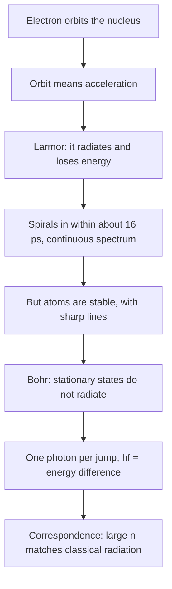

## Where light comes from

Maxwell's equations allow electromagnetic waves, but something has to make them. The previous lesson showed that a charge moving at constant velocity carries its field along with it, squeezed but unchanged in time from the charge's point of view; nothing breaks free and travels outward. A charge at rest radiates nothing, and by relativity neither does one moving uniformly. What remains is acceleration. Every radio antenna, X-ray tube, glowing filament and blue sky is a collection of accelerating charges.

This lesson finds how strongly an accelerating charge radiates and in which directions, and then applies the result to the atom as classical physics pictured it, an electron orbiting a nucleus. The answer is a disaster: the atom should collapse in about $10^{-11}$ seconds. That failure, alongside the spectra of the photons-and-atoms lesson, is why Bohr broke with classical physics, and the way he reconnected the two theories, the correspondence principle, is the bridge from Maxwell to quanta.

## The kink in the field lines

A picture due to J. J. Thomson shows why acceleration matters. A charge sits at rest; at $t = 0$ it is jolted to a small speed during a short time $\Delta t$, then coasts. News of the jolt spreads outward at $c$. At a later time $t$, field lines outside the sphere of radius $ct$ still point to where the charge would have been with no jolt, while lines inside point to where it actually is. The two sets of lines must connect across the thin shell where the news is arriving, so each line has a **kink** there: a short stretch running almost sideways.

That sideways stretch is the radiation. Working out the geometry of the kink (a short argument with similar triangles, done carefully in more advanced texts) gives a transverse **radiation field**

$$E_{\text{rad}} = \frac{qa\sin\theta}{4\pi\varepsilon_0c^2r},$$

where $a$ is the acceleration, $r$ the distance and $\theta$ the angle between the acceleration and the direction to the observer. Two features matter. First, it falls off as $1/r$, not $1/r^2$, so far away it beats the Coulomb field. Second, it is proportional to $\sin\theta$: nothing radiates along the line of the acceleration. The result holds for charges moving slowly compared with $c$, which this lesson assumes throughout.

## The radiation pattern and the Larmor formula

The radiated fields form a little electromagnetic wave, with $B_{\text{rad}} = E_{\text{rad}}/c$, so the energy flowing outward per unit area is the Poynting magnitude from the wave-energy lesson:

$$S = \frac{E_{\text{rad}}^2}{\mu_0c} = \frac{q^2a^2}{16\pi^2\varepsilon_0c^3}\,\frac{\sin^2\theta}{r^2}.$$

The intensity is strongest perpendicular to the acceleration and zero along it. A vertical radio antenna, in which electrons accelerate up and down, broadcasts horizontally and sends nothing straight up.


To find the total power, add up $S$ over a sphere of radius $r$. The area element is $r^2\sin\theta\,d\theta\,d\phi$, so the $r^2$ cancels (as it must if energy is to travel outward forever), and

$$\int_0^{2\pi}\!\!\int_0^\pi\sin^2\theta\,\sin\theta\,d\theta\,d\phi = 2\pi\cdot\frac43 = \frac{8\pi}{3}.$$

Multiplying gives the **Larmor formula** for the total power radiated by a slow charge:

$$P = \frac{q^2a^2}{6\pi\varepsilon_0c^3}.$$

The power depends on the square of the charge and the square of the acceleration, and the $c^3$ in the denominator makes it tiny for everyday accelerations. It doesn't matter which way the charge is accelerating, or whether it is speeding up, slowing down or turning.

### Example 1

An electron moves at $1.0\times10^7$ m/s perpendicular to a 1.0 T magnetic field. How much power does it radiate, and how long would it take to radiate away its kinetic energy at that rate?

The magnetic force gives a centripetal acceleration $a = evB/m_e = (1.602\times10^{-19})(1.0\times10^7)(1.0)/(9.11\times10^{-31}) = 1.76\times10^{18}$ m/s².

$$P = \frac{(1.602\times10^{-19})^2(1.76\times10^{18})^2}{6\pi(8.85\times10^{-12})(3.00\times10^8)^3} = 1.76\times10^{-17}\text{ W}.$$

Its kinetic energy is $\tfrac12m_ev^2 = 4.56\times10^{-17}$ J, so the time scale is $K/P = 2.6$ s. Because $P$ is proportional to $v^2$, and so to $K$, the energy actually decays exponentially with this time constant, whatever the starting speed. Radiation from circling charges is called **synchrotron radiation**; at the much higher energies of electron storage rings (where the fully relativistic version of the formula applies) it is strong enough to be the main design limit, and it is also deliberately produced as an intense X-ray source.

## Radiation in the world

The same formula runs through very different technologies and phenomena.

- *Antennas.* Electrons driven up and down at frequency $f$ have acceleration amplitude $(2\pi f)^2$ times their displacement amplitude, so they radiate at $f$ with the $\sin^2\theta$ pattern.
- *Bremsstrahlung* ("braking radiation"). Electrons slammed into a metal target in an X-ray tube decelerate violently and radiate X-rays with a continuous spread of energies.
- *The blue sky.* Sunlight drives the electrons in air molecules up and down. Well below the molecules' resonant frequencies, their displacement amplitude barely depends on frequency, so the acceleration grows as $f^2$ and the radiated power as $f^4$, or $1/\lambda^4$. This is **Rayleigh scattering**. Blue light at 450 nm is scattered about $(700/450)^4 \approx 6$ times more strongly than red light at 700 nm. (This is a simplified model; the sky's actual color also depends on the Sun's spectrum and on how the eye responds, which is why it looks blue rather than violet.)

## The classical atom collapses

In Rutherford's picture of hydrogen, an electron orbits a proton under the Coulomb force. A circular orbit is accelerated motion, so by the Larmor formula the electron must radiate, lose energy and spiral inward.

### Example 2

The Bohr radius is $r_0 = 5.29\times10^{-11}$ m. How much power would an electron in a circular orbit of that radius radiate?

The Coulomb force provides the centripetal force: $\dfrac{ke^2}{r_0^2} = \dfrac{m_ev^2}{r_0}$, so $v = \sqrt{\dfrac{ke^2}{m_er_0}} = 2.19\times10^6$ m/s and $a = \dfrac{v^2}{r_0} = 9.05\times10^{22}$ m/s². Then

$$P = \frac{e^2a^2}{6\pi\varepsilon_0c^3} = 4.7\times10^{-8}\text{ W} = 2.9\times10^{11}\text{ eV/s}.$$

The atom's binding energy is 13.6 eV, so even at this starting rate it would be lost in about $13.6/(2.9\times10^{11}) = 5\times10^{-11}$ s. The real collapse is faster, because the power grows as the orbit shrinks.

### Example 3

Find how long the classical orbit takes to shrink from $r_0$ to zero.

The total energy of a circular orbit is $E = -\dfrac{ke^2}{2r}$, so $\dfrac{dE}{dt} = \dfrac{ke^2}{2r^2}\dfrac{dr}{dt}$. Set this equal to $-P$, with $a = ke^2/(m_er^2)$ and $\dfrac{1}{6\pi\varepsilon_0} = \dfrac{2k}{3}$:

$$\frac{ke^2}{2r^2}\frac{dr}{dt} = -\frac{2ke^2}{3c^3}\left(\frac{ke^2}{m_er^2}\right)^2 \quad\Longrightarrow\quad r^2\frac{dr}{dt} = -\frac43r_e^2c,$$

where $r_e = \dfrac{ke^2}{m_ec^2} = 2.81\times10^{-15}$ m is the **classical electron radius**, a length that simply collects the constants. Separate and integrate from $r_0$ down to 0: $\dfrac{r_0^3}{3} = \dfrac43r_e^2c\,t$, so

$$t = \frac{r_0^3}{4r_e^2c} = \frac{(5.29\times10^{-11})^3}{4(2.81\times10^{-15})^2(3.00\times10^8)} = 1.6\times10^{-11}\text{ s}.$$

Classical physics predicts that every atom in the universe should collapse in about 16 picoseconds, emitting a smear of radiation of steadily rising frequency on the way. Atoms are stable, and they emit sharp spectral lines. The calculation is only an estimate (the electron's speed grows as it falls, and nonrelativistic formulas eventually fail), but no refinement within classical physics saves the atom.



## Bohr's way out and the correspondence principle

Bohr's 1913 model simply declared that certain orbits are **stationary states** that do not radiate, and that light is emitted only as single photons when the electron jumps between them, with $hf$ equal to the energy difference. That was a break with Maxwell's theory, not a derivation from it. But Bohr insisted on a link, the **correspondence principle**: in the limit of large quantum numbers, where orbits are big and levels close together, quantum predictions must agree with classical physics.

For hydrogen the check is direct. Classically, an electron in orbit $n$ should radiate at its orbital frequency, which in the Bohr model works out to

$$f_{\text{orbit}} = \frac{2(13.6\text{ eV})}{hn^3} = \frac{6.57\times10^{15}\text{ Hz}}{n^3}.$$

Quantum mechanically, a jump from $n$ to $n - 1$ emits a photon of frequency

$$f_{\text{photon}} = \frac{13.6\text{ eV}}{h}\left(\frac{1}{(n - 1)^2} - \frac{1}{n^2}\right) = \frac{13.6\text{ eV}}{h}\cdot\frac{2n - 1}{n^2(n - 1)^2}.$$

For large $n$, $2n - 1 \approx 2n$ and $(n - 1)^2 \approx n^2$, so $f_{\text{photon}} \to 2(13.6\text{ eV})/(hn^3) = f_{\text{orbit}}$. The ratio is $\dfrac{n(2n - 1)}{2(n - 1)^2}$, which is 3.0 at $n = 2$ and approaches 1:

```plot
{"x": [0, 30], "y": [0, 3.2], "functions": [{"f": "x*(2*x - 1)/(2*(x - 1)^2)", "from": 2, "to": 30, "label": "f photon / f orbit"}, {"f": "1", "dashed": true}], "points": [{"at": [2, 3]}], "xLabel": "n", "yLabel": "frequency ratio", "caption": "Ratio of the n to n − 1 photon frequency to the classical orbital frequency in hydrogen; it approaches 1 (dashed) for large n"}
```

### Example 4

Compare the two frequencies for $n = 100$. Use $13.6\text{ eV}/h = 3.29\times10^{15}$ Hz.

$f_{\text{orbit}} = 6.57\times10^{15}/100^3 = 6.57\times10^9$ Hz.

$f_{\text{photon}} = (3.29\times10^{15})\dfrac{199}{100^2(99)^2} = (3.29\times10^{15})(2.030\times10^{-6}) = 6.68\times10^9$ Hz.

They differ by 1.5%, and the difference shrinks like $3/(2n)$. Both are microwaves: atoms in such highly excited "Rydberg" states are huge (radius $n^2r_0 \approx 0.5$ μm) and behave almost classically.

## Common mistakes

- Thinking any moving charge radiates. Uniform velocity produces no radiation; acceleration does, including a change of direction at constant speed.
- Expecting radiation along the line of the acceleration. The pattern goes as $\sin^2\theta$ and is zero there.
- Using $1/r^2$ for the radiation field. The radiation field falls as $1/r$, and its intensity as $1/r^2$.
- Forgetting that $P$ depends on $a^2$: doubling the acceleration quadruples the power.
- Reading the correspondence principle as "quantum and classical always agree." They agree only in the limit of large quantum numbers; for $n = 2$ the frequencies differ by a factor of 3.

## Key points

- Only accelerated charges radiate. Radiation field $E_{\text{rad}} = \dfrac{qa\sin\theta}{4\pi\varepsilon_0c^2r}$, falling as $1/r$, transverse, with pattern $\sin^2\theta$.
- Larmor formula (slow charges): $P = \dfrac{q^2a^2}{6\pi\varepsilon_0c^3}$.
- Rayleigh scattering by small molecules goes as $1/\lambda^4$: blue scatters about 6 times more than red.
- A classical hydrogen atom would collapse in $t = r_0^3/(4r_e^2c) \approx 1.6\times10^{-11}$ s.
- Bohr's stationary states do not radiate; correspondence principle: for large $n$ the photon frequency approaches the classical orbital frequency.
