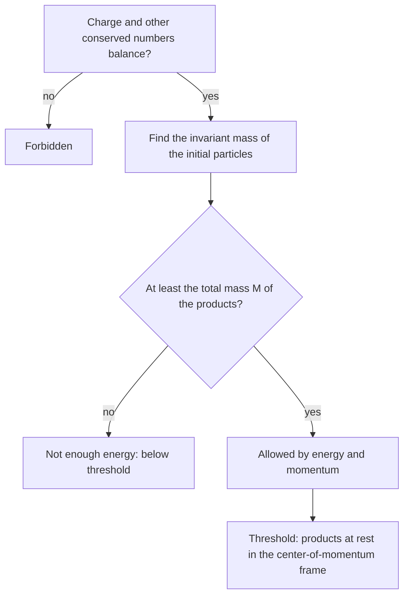

## The particle that is always relativistic

Three threads of this course meet in the photon. Maxwell's equations made light a wave moving at $c$. The photons-and-atoms lesson gave it energy $E = hf$ and momentum $p = h/\lambda$, and the Compton lesson showed that momentum at work. The relativity lesson gave the rule $E^2 = (pc)^2 + (mc^2)^2$, which for a massless particle becomes $E = pc$. A photon never moves slower than $c$ and has no rest frame, so no part of its physics is "nonrelativistic."

This lesson builds the tool particle physicists use for every collision involving photons or fast particles: energy and momentum combined into one four-component object, whose "length" every observer agrees on. With it, Compton's formula takes four lines, you can prove that a free electron can never absorb a photon, and you can find the minimum beam energy needed to create new particles.

## Four-momentum

The Lorentz transformation from the relativity lesson mixes $ct$ and $x$: $x' = \gamma(x - \beta ct)$ and $ct' = \gamma(ct - \beta x)$, with $\beta = v/c$. Energy and momentum mix in exactly the same way:

$$p'_x = \gamma\left(p_x - \beta\frac{E}{c}\right), \qquad \frac{E'}{c} = \gamma\left(\frac{E}{c} - \beta p_x\right),$$

with $p_y$ and $p_z$ unchanged. So the four numbers $P = (E/c,\ p_x,\ p_y,\ p_z)$ form a **four-momentum**. For any two four-momenta define the product

$$P_1\cdot P_2 = \frac{E_1E_2}{c^2} - \vec p_1\cdot\vec p_2.$$

Like the spacetime interval $(c\Delta t)^2 - (\Delta x)^2$, this product has the same value in every inertial frame. For a single particle, $P\cdot P = E^2/c^2 - p^2 = m^2c^2$: the relativity lesson's $E^2 = (pc)^2 + (mc^2)^2$ is the statement that a particle's four-momentum has "length" $mc$ in every frame. For a photon $P\cdot P = 0$.

## Invariant mass of a system

Energy and momentum are conserved, so the total four-momentum of a group of particles is conserved too, and its square is the same in every frame. That defines the system's **invariant mass** $M$:

$$M^2c^4 = \left(\sum E\right)^2 - \left|\sum\vec pc\right|^2.$$

In the **center-of-momentum frame**, where the total momentum is zero, $Mc^2$ is simply the total energy. It is the energy that is really available to make new particles: momentum must be conserved, so energy that goes into moving the whole system along cannot be converted.

The invariant mass of a system is *not* the sum of its particles' masses. Two photons, each massless, have

$$M^2c^4 = (E_1 + E_2)^2 - |\vec p_1c + \vec p_2c|^2 = 2E_1E_2(1 - \cos\theta),$$

where $\theta$ is the angle between them (using $|\vec p_ic| = E_i$). This is positive unless the photons travel in the same direction.

### Example 1

A detector records two gamma rays from one point, with energies 300 MeV and 50 MeV and an angle of $67^\circ$ between them. Could they come from the decay of a neutral pion ($m_\pi c^2 = 135.0$ MeV)?

$$Mc^2 = \sqrt{2(300)(50)(1 - \cos67^\circ)} = \sqrt{30000(0.6093)} = 135\text{ MeV}.$$

Yes. If a single particle decayed into the two photons, the invariant mass of the pair equals that particle's mass, whatever the parent's speed. Experiments find short-lived particles exactly this way: they plot the invariant mass of many pairs and look for a peak.

## What a photon cannot do

Invariant mass turns some intuitive-sounding processes into impossibilities.

*A free electron cannot absorb a photon.* Before: an electron at rest plus a photon of energy $E$, with $M^2c^4 = (m_ec^2 + E)^2 - E^2 = (m_ec^2)^2 + 2Em_ec^2$. After: one electron, with invariant mass $m_e$. These are equal only if $E = 0$. Electrons in atoms *can* absorb photons (the photoelectric effect) because the rest of the atom takes up momentum. A free electron can only scatter the photon, which is the Compton effect.

*A photon cannot turn into matter in empty space.* A single photon has $M = 0$, but an electron and a **positron** (the electron's antiparticle, same mass, charge $+e$) together have invariant mass at least $2m_e$. In **pair production** a gamma ray creates an electron–positron pair in the strong field near a nucleus, which recoils and balances the momentum.

## Threshold energies

To create particles of total mass $M$ by firing a beam particle (mass $m_b$) at a target at rest (mass $m_t$), the invariant mass of beam plus target must be at least $M$. At exactly the **threshold energy**, the products are all at rest in the center-of-momentum frame. Writing $E_b$ for the beam's total energy,

$$(E_b + m_tc^2)^2 - (p_bc)^2 = m_b^2c^4 + m_t^2c^4 + 2E_bm_tc^2 = M^2c^4.$$

Solving for $E_b$ and subtracting the beam's rest energy gives the threshold kinetic energy

$$K_{\text{th}} = \frac{M^2 - (m_b + m_t)^2}{2m_t}c^2.$$

For a photon beam ($m_b = 0$), $K_{\text{th}}$ is the photon's whole energy.

### Example 2

Find the threshold photon energy for creating an electron–positron pair (a) near a lead nucleus ($m_{\text{Pb}}c^2 \approx 1.93\times10^5$ MeV) and (b) by striking a free electron at rest.

(a) Target mass $m_t = m_{\text{Pb}}$, products $M = m_{\text{Pb}} + 2m_e$, beam mass 0:

$$K_{\text{th}} = \frac{(m_t + 2m_e)^2 - m_t^2}{2m_t}c^2 = 2m_ec^2\left(1 + \frac{m_e}{m_t}\right) \approx 2(0.511) = 1.022\text{ MeV}.$$

The heavy nucleus takes the needed momentum at almost no energy cost; the correction $m_e/m_t$ is about $3\times10^{-6}$.

(b) Target $m_e$, products $3m_e$ (the original electron plus the pair): $K_{\text{th}} = \dfrac{9m_e^2 - m_e^2}{2m_e}c^2 = 4m_ec^2 = 2.044$ MeV. A light target must recoil fast to carry the photon's momentum, and that kinetic energy is not available for making mass, so the threshold is twice the pair's rest energy.

### Example 3

In 1955 Owen Chamberlain, Emilio Segrè and their team at Berkeley discovered the antiproton by firing protons at protons at rest: $p + p \to p + p + p + \bar p$. What beam kinetic energy is needed? ($m_pc^2 = 938.3$ MeV.)

Here $m_b = m_t = m_p$ and $M = 4m_p$:

$$K_{\text{th}} = \frac{(4m_p)^2 - (2m_p)^2}{2m_p}c^2 = 6m_pc^2 = 5.63\text{ GeV}.$$

Creating only $2m_pc^2 = 1.88$ GeV of new mass takes 5.63 GeV of beam energy. The Bevatron accelerator that made the discovery was built to reach about 6 GeV with this threshold in mind. Fixed targets waste most of the beam's energy on moving the products along, which is why modern colliders aim two beams at each other: head-on, equal and opposite momenta cancel, and the whole energy is available.

## Compton's formula in four lines

The Compton lesson stated $\lambda' - \lambda = \dfrac{h}{m_ec}(1 - \cos\theta)$. Call the photon's four-momenta $P$ (before) and $P'$ (after), and the electron's $Q = (m_ec, \vec 0)$ (at rest) and $Q'$. Conservation says $P + Q = P' + Q'$.

1. Isolate the unknown electron recoil, $Q' = P + Q - P'$, and square both sides. Using $P\cdot P = P'\cdot P' = 0$ and $Q\cdot Q = Q'\cdot Q' = m_e^2c^2$, everything else cancels to $P\cdot Q - P'\cdot Q - P\cdot P' = 0$.
2. With the electron at rest, $P\cdot Q = Em_e$ and $P'\cdot Q = E'm_e$. For the photons, $P\cdot P' = \dfrac{EE'}{c^2} - pp'\cos\theta = \dfrac{EE'}{c^2}(1 - \cos\theta)$.
3. So $m_e(E - E') = \dfrac{EE'}{c^2}(1 - \cos\theta)$; dividing by $m_eEE'$, $\dfrac{1}{E'} - \dfrac1E = \dfrac{1 - \cos\theta}{m_ec^2}$.
4. Put in $E = hc/\lambda$: $\dfrac{\lambda' - \lambda}{hc} = \dfrac{1 - \cos\theta}{m_ec^2}$, so $\lambda' - \lambda = \dfrac{h}{m_ec}(1 - \cos\theta)$.

The electron's unknown speed and recoil angle never appear: squaring $Q'$ removed them.

## Photons that cannot cross the universe

Two photons can make a pair if $2E_1E_2(1 - \cos\theta) \ge (2m_ec^2)^2$; head-on ($\theta = 180^\circ$) this needs $E_1E_2 \ge (m_ec^2)^2$. Space is filled with photons of the cosmic microwave background, typically about $6\times10^{-4}$ eV each. A gamma ray colliding head-on with one needs $E_1 \ge (0.511\times10^6\text{ eV})^2/(6\times10^{-4}\text{ eV}) \approx 4\times10^{14}$ eV. As a rough estimate, then, gamma rays above a few hundred TeV are absorbed over intergalactic distances, and the highest-energy gamma rays we see come from within or near our own galaxy. A formula derived from Maxwell's light, Einstein's kinematics and Planck's quanta sets a limit on what telescopes can see.

## Common mistakes

- Adding masses to get a system's invariant mass. Use total energy and total momentum; two massless photons can have a large invariant mass.
- Setting the threshold beam energy equal to the mass created. Momentum conservation makes the fixed-target threshold larger: $6m_pc^2$, not $2m_pc^2$, for antiprotons.
- Confusing total and kinetic energy in the threshold formula. $K_{\text{th}}$ above is kinetic; for a photon the two are the same.
- Forgetting the minus sign in the four-momentum product: $P_1\cdot P_2 = E_1E_2/c^2 - \vec p_1\cdot\vec p_2$.
- Using $p = mv$ or $K = \tfrac12mv^2$ for photons or fast particles. Photons have $E = pc$; massive particles need $E^2 = (pc)^2 + (mc^2)^2$.

## Key points

- Four-momentum $P = (E/c, \vec p)$ transforms like $(ct, \vec x)$; $P\cdot P = m^2c^2$ in every frame, and 0 for a photon.
- Invariant mass of a system: $M^2c^4 = (\sum E)^2 - |\sum\vec pc|^2$; for two photons, $2E_1E_2(1 - \cos\theta)$.
- A free electron cannot absorb a photon; a photon cannot make a pair in empty space. Pair production near a nucleus needs about 1.022 MeV; on a free electron, 2.044 MeV.
- Fixed-target threshold: $K_{\text{th}} = \dfrac{M^2 - (m_b + m_t)^2}{2m_t}c^2$.
- Compton's formula follows from squaring $Q' = P + Q - P'$.
